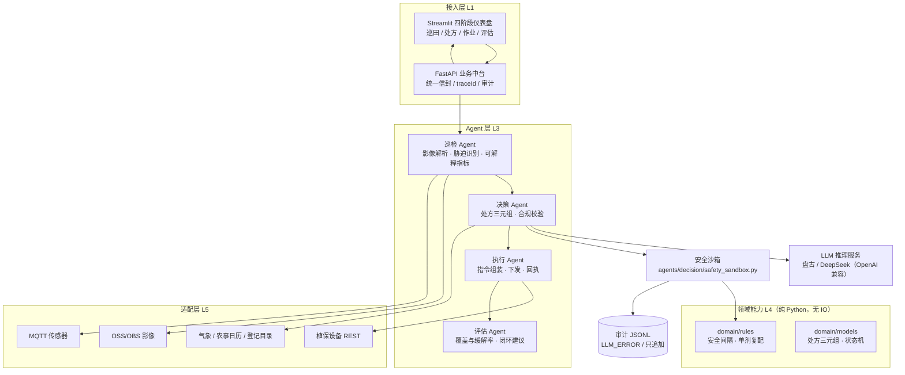
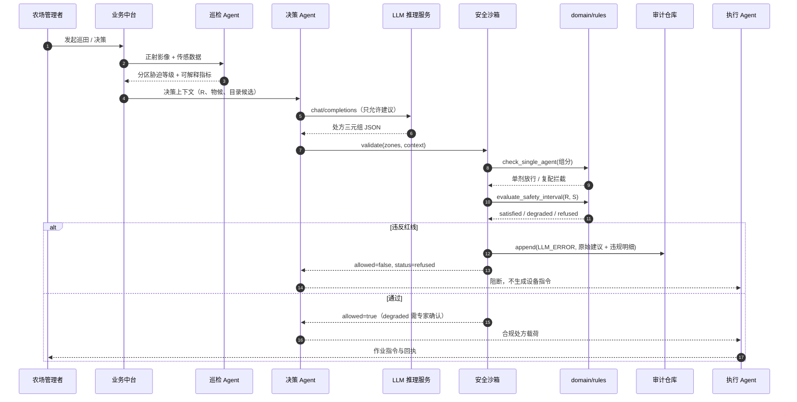

# 新疆棉田植保决策多智能体系统（CIPM-MAS）

[](https://github.com/GXmom0/cipm-mas/actions/workflows/ci.yml)

面向新疆棉田的低空植保决策闭环系统：接收无人机多光谱正射影像与田间传感数据，识别病虫害胁迫，生成变量施药处方，联动植保设备作业，并用回传数据完成效果评估。

系统由四个角色 Agent 协作：**巡检 Agent → 决策 Agent → 执行 Agent → 评估 Agent**，以作业单号贯穿「巡田—处方—作业—评估」全链路。

本仓库当前完成 **P0 骨架 + P2 运行时接入**：Mock 数据闭环、四阶段仪表盘、确定性规则引擎、真实 LLM 调用层、安全沙箱与 `LLM_ERROR` 审计、Docker/华为云部署说明。

---

## V1.0 交付边界声明

本项目为比赛交付版本，能力状态按三档**如实标注**，避免"演示可用"与"生产可用"混淆：

- ✅ **已实现**：有完整代码和测试，可真实运行；
- 🧪 **演示骨架**：架构已就位、有 Mock 数据演示，但核心逻辑为桩或 Mock；
- 📋 **规划中**：仅在 `spec`/`design` 中定义，尚无代码。

> 完整设计见 `.codeartsdoer/specs/cotton_ipm_mas/spec.md` 与 `design.md`；下列标注以当前仓库代码与测试为准。

### 能力实现状态（三档标注）

**巡田阶段**
- 正射影像解析（M02）：🧪 演示骨架（Mock 数据，真实 rasterio + NDVI 待接入）
- 胁迫分区与等级判定：🧪 演示骨架
- 可解释指标（NDVI 偏离值 / 虫口密度）：🧪 演示骨架
- 置信度门禁（<0.7 任务级阻断）：🧪 演示骨架（PatrolAgent + runtime_state 已置阻断态，完整 BlockController 待接入）

**处方阶段**
- 登记目录绑定校验：✅ 已实现
- 安全间隔判定（`evaluate_safety_interval`）：✅ 已实现
- 单剂复配拦截（`check_single_agent`）：✅ 已实现
- 制剂亩用量区间校验：✅ 已实现
- 喷液量/稀释浓度换算校验：✅ 已实现
- 作业窗口约束（温度 + 风速 + 南疆 RH + 滴灌 + 降水概率）：✅ 已实现（降水概率纯函数已就位，weather 适配层待接入）
- LLM 处方候选 + 安全沙箱校验：✅ 已实现
- 降级待确认流程：✅ 已实现
- 复配拦截转专家：✅ 已实现
- **处方前置门禁**（新增）：✅ 已实现（`prescription_guard.py`，`_generate_runtime` 开头调用）

**作业阶段**
- 处方状态机硬拦截（`prescription_sm`）：✅ 已实现（`assert_transition` 函数就绪，待审核 API 落地后直接挂载）
- 作业单状态机硬拦截（`work_order_sm`）：✅ 已实现（`assert_transition` 函数就绪，`plot_table` 下发分支已接入）
- 幂等下发：✅ 已实现
- 设备 REST 下发（Mock）：🧪 演示骨架
- 批量作业批次调度：🧪 演示骨架
- 执行前二次窗口校验：🧪 演示骨架
- 进度跟踪 + 偏差告警：📋 规划中
- 批次状态机：📋 规划中

**评估阶段**
- 覆盖率 + 缓解率 + 达标判定：🧪 演示骨架
- 闭环建议回写：📋 规划中

**基础设施**
- 四 Agent 骨架：✅ 已实现
- FastAPI 业务中台 + 统一信封：✅ 已实现
- Streamlit 四阶段仪表盘：✅ 已实现
- 审计账本（JSONL + LLM_ERROR）：✅ 已实现
- traceId / agentRunId 贯穿：✅ 已实现
- GitHub Actions CI：✅ 已实现（`.github/workflows/ci.yml`，pytest 0 failed 即通过）
- PostgreSQL DDL：📋 规划中
- 华为云 AgentArts 部署：🧪 演示骨架（`README_CLOUD.md` 有说明）

**外部数据**
- 登记用药目录：✅ 已实现（11 条真实数据 + icama.cn 来源）
- 气象预报：✅ 已实现（Open-Meteo 真实 API + 断网降级）
- 影像 / MQTT 传感器 / 设备 REST：🧪 演示骨架

---

## 1. 项目要解决的问题

新疆棉田病虫害防治面临三个现实矛盾：

1. **不能只看等级，必须能落地**：处方必须给出「药剂品类 + 制剂亩用量（毫升/亩）+ 喷液量或稀释浓度」三元组，并绑定新疆现行登记用药目录。
2. **不能突破合规红线**：安全间隔期、采收剩余天数、作业窗口温度/风速、滴灌模式、单剂边界，任何一项都不能由模型自由发挥。
3. **不能是黑盒**：每次阻断、降级、拒绝、LLM 违规都必须可解释、可审计、可回放。

因此系统采用**确定性规则优先**架构：大模型只负责生成候选建议，所有红线判定由 `domain/rules` 纯函数完成；模型建议违反红线时直接拦截并写入 `LLM_ERROR` 审计。

---

## 2. 系统架构



### 2.1 LLM 与安全沙箱的交互



**关键设计：**

- 沙箱**不信任 LLM 自报的安全间隔期**，以登记用药目录条目为准重新计算。
- `R < S` 一律拒绝，不因存在更短间隔期的替代药剂而自动放行；替代清单只用于重新发起处方。
- `0 ≤ R − S < 3` 进入「降级待确认」，必须专家确认，不自动下发。
- 复配（同处方出现 ≥2 个「有效成分 + 剂型」品类）硬拦截，V1.0 无自动放行路径。
- 契约层与沙箱双重校验：`extra="forbid"` + 三元组完整性 + 1% 换算偏差。

---

## 3. 四角色分工

| Agent | 阶段 | 核心职责 | 当前实现 |
|---|---|---|---|
| 巡检 Agent | 巡田 | 正射影像解析、胁迫分区、四级等级、可解释指标、置信度门禁 | Mock 数据 + 运行时日志 |
| 决策 Agent | 处方 | LLM 生成三元组建议、沙箱校验、降级/拒绝 | 本地 Mock + 真实 LLM 双链路 |
| 执行 Agent | 作业 | 指令组装、设备 REST 下发、回执跟踪、批量调度 | 契约与演示骨架 |
| 评估 Agent | 评估 | 覆盖率、缓解率、达标判定、下一轮建议 | 契约与演示骨架 |

---

## 数据来源说明（mock / real 双轨）

本系统采用独立环境变量切换数据源，与 `CIPM_MOCK` 语义解耦：

| 数据源 | 开关 | mock 模式 | real 模式 |
|---|---|---|---|
| 登记用药目录 | `CIPM_REGISTRY_SOURCE` | 演示数据 | **11 条真实登记数据**（`knowledge/real_registry.json`），来源：中国农药数字监督管理平台（icama.cn）等，含登记证号、安全间隔期、亩用量、毒性，可用 `python -m knowledge.print_registry_sources` 逐条打印来源 |
| 气象预报 | `CIPM_WEATHER_PROVIDER` | 固定演示数据 | **Open-Meteo 真实预报**（`adapters/weather/openmeteo.py`），按地块南疆棉区坐标（阿克苏/阿拉尔/库尔勒）逐地块拉取；风速以响应元数据 `hourly_units` 自查单位（km/h 则 ÷3.6）后换算蒲福风级 |

**降级策略**：真实气象 API 失败/超时（>10s）自动回退 mock 数据并记录 `DEGRADED` 日志（AgentRunLogger 进 trace + logging 兜底双路），演示永不中断。

**关于喷液量的诚实说明**：登记目录中的兑水量（40-60 升/亩）针对传统地面喷雾；无人机低容量喷雾的喷液量换算规范为待接入项（`uav_spray_conversion="待接入规范"`），系统当前将登记总水量作为参考展示，设备能力校验（`device_max_spray_l_per_mu`，低容量语义）独立进行，不混用两种语义。

**其他环节状态**：影像解析、田间传感器、设备下发当前为 Mock 实现（架构与契约已就绪，待接入真实数据源）。

## 4. 快速开始

### 4.1 环境

- Python 3.12（实测 3.12.3；3.14 下部分科学计算库无 wheel）
- Node 仅用于工具链，本项目不依赖

### 4.2 安装

Windows PowerShell：

```powershell
python -m venv venv
venv\Scripts\Activate.ps1
pip install -e .[ui]
pip install -e .[dev]
```

Linux / macOS：

```bash
python3 -m venv venv
source venv/bin/activate
pip install -e '.[ui]'
pip install -e '.[dev]'
```

### 4.3 生成演示数据

```bash
python -m mock.cli --write
```

### 4.4 一键启动

Windows PowerShell：

```powershell
$env:CIPM_MOCK="1"
python ops/start_dev.py
```

Linux / macOS / Git Bash：

```bash
CIPM_MOCK=1 python ops/start_dev.py
# 或：bash ops/start_demo.sh
```

| 地址 | 用途 |
|---|---|
| http://127.0.0.1:8501 | 四阶段仪表盘 |
| http://127.0.0.1:8000/api/v1/health | 健康检查 |
| http://127.0.0.1:8000/docs | 交互式接口文档 |

### 4.5 验证

```bash
python -m pytest -q
python -m mock.cli --check
python -m sdk.contracts.schema_export --check
```

---

## 5. 五种业务场景演示路径

演示数据包含 5 个地块，覆盖四类业务标识：`BLOCKED`、`DEGRADED`、`REFUSED`、`RESCHEDULED`。

| # | 场景 | 地块 | 关键数值 | 预期结论 | 仪表盘标识 |
|---|---|---|---|---|---|
| 1 | 正常地块 | PLOT-0912 | R=20、S=7、buffer=13 | 安全间隔满足，处方待审核 | 无 |
| 2 | 缓冲不足降级 | PLOT-0915 | R=9、S=7、buffer=2 | `degraded` + `BUFFER_LT_3`，待专家确认 | 降级待确认 |
| 3 | 置信度不足阻断 | PLOT-0913 | Z03 confidence=0.62 | 任务级阻断，不生成处方 | 阻断待复核 |
| 4 | 安全间隔冲突拒绝 | PLOT-0914 | R=5、S=7、buffer=−2 | `refused`，禁止施药 | 已拒绝 |
| 5 | 作业窗口不通过重排 | PLOT-0916 | 执行前 minT=11.8℃ | 处方已通过但下发失败，待重新排期 | 待重新排期 |

### 场景 1：正常地块

1. 打开仪表盘，四阶段表第一行 `PLOT-0912`。
2. 巡田、处方均为已完成/待审核，业务标识显示「无」。
3. 点击「查看处方」可用；因处方未审核，不出现「下发作业」。
4. 接口验证：

```bash
curl http://127.0.0.1:8000/api/v1/dashboard
```

预期：`data.plots` 含 5 个地块，`PLOT-0912` 的 `safetyCheck.bufferDays=13`。

### 场景 2：缓冲不足降级

1. 表格中 `PLOT-0915` 显示「降级待确认」。
2. 待办区出现「降级处方待农技专家确认」。
3. 讲解要点：降级不是放行，必须专家确认后才能进入审核。

### 场景 3：置信度不足阻断

1. 表格中 `PLOT-0913` 显示「阻断待复核」。
2. 「查看处方」按钮为禁用态，提示“识别结果待人工复核，处方生成已暂停”。
3. 待办区出现 Z03 复核事项。
4. 讲解要点：任务级整体阻断，不存在部分分区处方；复核完成前下游决策链完全暂停。

### 场景 4：安全间隔冲突拒绝

1. 表格中 `PLOT-0914` 显示「已拒绝」。
2. 异常提示出现“距采收 5 天短于安全间隔期 7 天，禁止施药”。
3. 讲解要点：`R < S` 一律拒绝，替代清单仅供重新发起处方，不自动改药放行。

### 场景 5：作业窗口不通过重排

1. 表格中 `PLOT-0916` 显示「待重新排期」。
2. 异常提示出现“执行前窗口最低温 11.8℃ 低于 12.5℃ 红线”。
3. 讲解要点：决策阶段与执行阶段双重校验，执行阶段以执行时快照为准；红线不可人工豁免。

### 扩展：LLM 幻觉拦截

```bash
python -m workflows.local.runtime_demo --runtime agentarts --demo-llm --scenario safety_conflict_plot
```

预期输出：

```text
[AgentRun: run_local_xxx] 决策Agent 正在调用 LLM 生成处方建议... model=mock-replay
[AgentRun: run_local_xxx] 决策Agent 正在执行本地规则校验（单剂复配 + 安全间隔期）...
[AgentRun: run_local_xxx] 决策Agent LLM 建议被安全沙箱拦截，已写入 LLM_ERROR 审计。 audit=AUD-xxxx
决策结论：refused；沙箱放行：False
```

同时 `data/audit/YYYY-MM-DD.jsonl` 新增一条 `eventType=LLM_ERROR`、`result=rejected` 的只追加记录。

---

## 6. 多智能体流转与运行时

### 6.1 三条演示命令

```bash
# 1. 本地 Mock 链路
python -m workflows.local.runtime_demo --scenario normal_plot

# 2. 运行时链路（内置回放 LLM，不联网）
python -m workflows.local.runtime_demo --runtime agentarts --demo-llm --scenario normal_plot

# 3. 幻觉拦截
python -m workflows.local.runtime_demo --runtime agentarts --demo-llm --scenario safety_conflict_plot
```

### 6.2 运行时开关

| 变量 | 取值 | 行为 |
|---|---|---|
| `CIPM_RUNTIME` | `local` | 决策 Agent 读取 Mock 处方，不调用大模型 |
| `CIPM_RUNTIME` | `agentarts` / `agent_runtime` / `runtime` / `cloud` | 决策 Agent 强制调用真实 LLM，经沙箱校验 |
| `CIPM_MOCK` | `0` | 关闭 Mock 数据源；非 Mock 模式缺 LLM 配置时启动失败 |
| `CIPM_LLM_ENDPOINT` | `https://api.deepseek.com/v1` 或盘古推理地址 | OpenAI 兼容端点 |
| `CIPM_LLM_MODEL` | `deepseek-chat` / 盘古模型名 | 模型名 |
| `CIPM_LLM_API_KEY` | 密钥 | 建议用 CSMS 或容器 Secret 注入 |
| `CIPM_LLM_TIMEOUT_SECONDS` | `30` | 超时 |
| `CIPM_LLM_MAX_RETRIES` | `2` | 5xx/网络错误重试 |

### 6.3 决策接口

`POST /api/v1/agents/decision/invoke`（仅运行时模式可用）

```json
{
  "taskNo": "PT-20261113-0001",
  "plotNo": "PLOT-0912",
  "plotName": "呼图壁示范田-东区",
  "areaMu": 120.0,
  "remainingDays": 20,
  "phenology": "flower_boll",
  "irrigation": "drip",
  "zones": [{"zoneNo": "Z01", "stressLevel": "heavy", "areaMu": 10.0}]
}
```

返回 `data.allowed=false` 时，必须进入人工专家节点，禁止继续下发。

---

## 7. 规则与审计口径

### 7.1 安全间隔判定

| 优先级 | 条件 | 结论 |
|---|---|---|
| 1 | 目录中无可用替代（`S' ≤ R`） | 拒绝 |
| 2 | `R < S` | 拒绝 |
| 3 | 间隔期内同成分重复 / 季次数超限 | 拒绝 |
| 4 | `0 ≤ R − S < 3` | 降级 |
| 5 | 轮换间隔不足 | 降级 |
| 6 | 采收前敏感窗口 | 降级 |
| 7 | 苗期 / 吐絮期 | 降级 |
| 8 | `R − S ≥ 3` 且无 5—7 | 满足 |

拒绝优先级命中即短路；降级原因按 4→5→6→7 全部累加。

### 7.2 单剂边界（V1.0）

- 品类唯一键：`(有效成分, 剂型)`，同成分不同剂型计为 2 个品类。
- 复配硬拦截：`allowed=false`、`applies_to=expert_manual_only`、`auto_dispatch_allowed=false`。
- 复配的安全间隔期仅作专家手工组合参考，禁止据此自动写入处方。

### 7.3 LLM_ERROR 审计

字段：`auditId / eventType / operator / occurredAt / bizId / beforeValue / afterValue / result / traceId / agentRunId`。

- `beforeValue.llmSuggestion` 保留模型原始建议，便于复盘。
- `afterValue` 记录违规码、规则结论、R/S/buffer。
- 文件按天切分，只追加；敏感字段经 `redact()` 脱敏。

---

## 8. 目录结构

```text
apps/console/          Streamlit 四阶段仪表盘
apps/platform_api/     FastAPI 中台（信封、追踪、审计、只读与 Agent 接口）
agents/patrol/         巡检 Agent（占位，P1 实现）
agents/decision/       决策 Agent + 安全沙箱
agents/execution/      执行 Agent（占位）
agents/assessment/     评估 Agent（占位）
domain/models/         领域枚举、三元组、地块、日历、目录
domain/rules/          安全间隔与单剂复配纯函数
domain/state_machines/ 处方状态机
adapters/              OSS / MQTT / REST / 气象 / 日历 / 目录
sdk/                   配置、契约、LLM 客户端、运行时、追踪与脱敏
mock/                  数据集、生成器、Mock 服务桩
workflows/local/       四 Agent 流转演示
ops/                   一键启动、环境变量、兼容性记录
tests/                 单元、集成、运行时与门禁
Dockerfile             华为云 API 镜像
README_CLOUD.md        SWR / CCE / AgentArts 部署说明
DEMO_SCRIPT.md         3 分钟答辩演示脚本
```

---

## 9. 测试与门禁

当前真实测试规模：**419 项**（339 项原有 + 80 项新增：仪表盘交互、三个 Agent 与四阶段编排、本次 UI 优化用例）。

```bash
python -m pytest -q
python -m mock.cli --check
python -m sdk.contracts.schema_export --check
```

最近一次全量结果（普通本地 venv）：**419 passed / 0 failed**，含 1 个无害 warning（starlette 提示 `fastapi.testclient` 使用 `httpx` 已弃用，不影响任何用例结果）。受限沙箱因禁止本地回环套接字会导致 ASGI/AppTest 用例跳过，完整成绩以普通本地环境为准。

覆盖：契约校验、规则纯函数（ST/SA 用例）、Mock 场景一致性、中台信封与追踪、审计脱敏、仪表盘 AppTest、三个 Agent 与四阶段编排、LLM 客户端、安全沙箱与 `LLM_ERROR`。

> 说明：若在受限容器/沙箱中执行，依赖本地 loopback 套接字的 ASGI/AppTest 用例会自动跳过；普通本地 venv 会完整执行。

---

## 10. 华为云部署

`Dockerfile` 为 **API 镜像**，仅暴露 8000；前端使用 `Dockerfile.ui`，不会在一个容器中打开 8501。

完整步骤见 `README_CLOUD.md`：

1. `docker build -t cipm-mas-api:0.1.0 .`（API 镜像）
2. `docker build -f Dockerfile.ui -t cipm-mas-ui:0.1.0 .`（前端镜像）
3. 推送至 SWR：`swr.cn-north-4.myhuaweicloud.com/<组织>/cipm-mas-api:0.1.0`
4. CCE Deployment + Secret + 就绪探针
5. AgentArts 工作流将决策节点指向 `POST /api/v1/agents/decision/invoke`

生产要求：密钥不入镜像、审计目录挂载持久卷、副本数 ≥2、`CIPM_RUNTIME=agentarts` 且 `CIPM_MOCK=0`。

---

## 11. 设计边界与免责声明

- 本系统不负责飞控航线、影像拼接与辐射定标，输入假定为已拼接、已定标的正射影像产品。
- 不负责农药采购、库存、设备硬件控制与气象预报生产。
- V1.0 仅支持单剂处方；复配转人工专家复核。
- 演示数据为模拟数据，不代表真实农艺建议；真实作业须以新疆现行登记用药目录与当地农技部门意见为准。

---

## 12. 常见问题

| 问题 | 处理 |
|---|---|
| `streamlit` 未安装 | `pip install -e .[ui]`（建议 Python 3.12） |
| 决策接口返回 409 | 当前 `CIPM_RUNTIME=local`；云端改为 `agentarts` |
| LLM 调用失败 | 检查 `CIPM_LLM_ENDPOINT/MODEL/API_KEY` 与网络出口 |
| 数据集漂移 | `python -m mock.cli --write` 重新生成，不要手改 JSON |
| 审计目录无文件 | 仅在发生拒绝/违规或业务审计时写入；路径由 `CIPM_AUDIT_DIR` 决定 |