# 棉田植保决策多智能体系统 技术设计说明书

- 功能标识：`cotton_ipm_mas`
- 依据文档：`.codeartsdoer/specs/cotton_ipm_mas/spec.md`（V1.0 定稿）
- 设计范围：巡田（巡检Agent）→ 处方（决策Agent）→ 作业（执行Agent）→ 评估（评估Agent）四阶段闭环，含业务中台、Streamlit 仪表盘、规则引擎、外部接入适配与华为云 AgentArts/Agent Runtime 部署约束。
- 设计边界（与 spec 第 1.4 节一致）：不做飞控与航线、不做原始帧拼接/定标/校正、不做农药进销存、不做设备固件、不做气象生产、不做目录行政审批、不做农事日历编制、不做残检与监管报送、不自动生成复配处方。

# 一、需求与存量功能关系分析

## 1.1 需求功能与存量功能对比

### 1.1.1 已实现功能

工作区为**空项目**：根目录无业务源码目录（无 `src/`、无包管理清单、无 CI 配置、无数据库脚本），唯一与本特性相关的文件是 `.codeartsdoer/specs/cotton_ipm_mas/spec.md`。因此业务功能层面**不存在已实现功能**。

| 需求功能 | 存量功能 | 代码位置 | 匹配度 |
|---------|---------|---------|--------|
| 巡田—处方—作业—评估全链路业务能力 | 无（工作区仅含需求规格文件，无任何可执行源码） | 无源码；规格位于 `.codeartsdoer/specs/cotton_ipm_mas/spec.md` | 0% |
| 四阶段仪表盘 | 无 | 无源码 | 0% |
| 外部数据接入适配（OSS/MQTT/REST） | 无 | 无源码 | 0% |

判定依据：执行仓库结构探查，工作区仅存在与工程无关的目录（`.codeartsdoer/`、`.arts/`、`output/` 等）与若干独立媒体文件，不存在 Python 包、依赖声明或可被引用的模块，故匹配度均为 0%。

### 1.1.2 需要扩展的功能

无存量代码可扩展。规格中 5.7「外部数据接入配置」、5.8「知识库辅助决策」虽为通用工程能力，但工作区不存在任何可复用的接入层或检索层实现，故全部按下节「新增」处理。

| 需求功能 | 存量功能 | 差异说明 | 扩展方向 |
|---------|---------|---------|---------|
| —— | 无 | 无存量实现可供改造 | 不作扩展设计，统一纳入新增清单（见 1.1.3） |

### 1.1.3 需要新增的功能或接口

新增模块按业务域分组，模块编号与第 2 章模块清单一一对应。所有功能点均需从零建设。

**A. 巡田任务与数据接入（M01 / M02）**

| 功能点 | 输入 | 输出 | 核心逻辑（对应规格条款） | 依赖 |
|-------|------|------|------------------------|------|
| 巡田任务创建与权限/时间窗校验 | 地块编号、时间窗、发起人 | 任务编号、`待接入数据`状态 | 时间窗 ≤24h 且结束 ≤+7 天；越权拒绝；同地块重叠未完成任务拒绝（5.1.1-1/2、5.1.3-4） | 中台鉴权、地块档案 |
| 正射影像产品匹配与就绪校验 | 架次元数据、产品地址、完成标识、波段、GSD、云量、覆盖比例 | 就绪时间、校验结论、产品快照 | 三项完成标识全为真、波段含近红外+红光、GSD≤5cm、云量≤10%、覆盖 100% 才可用；就绪时间写入并作为 10 分钟计时起点（5.1.1-3/4、6.2） | OSS 适配器、签名地址服务 |
| 传感器数据接入与完整性判定 | MQTT 时序读数（9 类指标） | 覆盖率、缺失项清单、异常值标记 | topic 四级层级、单农场范围；覆盖率≥90% 且含土壤湿度/空气温度/风速；迟到>10min 标记；越限剔除（5.1.1-5、6.3） | MQTT 适配器、去重器 |
| 数据就绪自动触发识别 | 就绪时间、完整性结论 | `识别中`状态、识别开始时间 | 双校验通过即自动流转，无需人工二次触达（5.1.1-6） | 事件总线、异步任务队列 |
| 接入重试与失败处置 | 失败原因、重试计数 | 成功/`数据接入失败` | 不重建任务，最多自动重试 3 次，幂等拉取（5.1.1-7、5.1.3-2） | 重试器、审计 |

**B. 胁迫识别与阻断（M03 / M04）**

| 功能点 | 输入 | 输出 | 核心逻辑 | 依赖 |
|-------|------|------|---------|------|
| 分区级胁迫识别 | 正射产品、地块边界、管理分区 | 分区胁迫类型/等级/置信度/面积 | 以管理分区为最小粒度，每分区唯一类型与等级（5.2.1-2/3） | 影像解析、阈值快照 |
| 可解释指标计算 | NDVI 栅格、健康基线版本、虫情计数 | NDVI 偏离值 或 虫口密度推算值 + 基线标识与版本 | 每分区至少一项；两项均不可算 → 置信度<0.7 强制待复核（5.2.1-4、6.4-8） | 基线库、虫情换算规则 |
| 置信度与阻断控制 | 分区置信度、复核状态 | 任务级 `阻断待复核`、阻断分区清单 | 任一待复核 → 任务整体阻断，禁止部分处方（5.2.1-5/6、6.1-11） | 状态机、审计 |
| 人工复核与阻断恢复 | 专家结论（确认/改判/无法判定） | 解除阻断或持续阻断 | 全部完成且无"无法判定"才自动解除；"无法判定"持续阻断并可终止任务；48h 未复核升级（5.2.1-7/8、5.2.3-3） | 待办中心、通知 |
| 结果冻结与版本递增 | 处方引用事件 | `已冻结`结果、resultVersion+1 | 被引用即冻结；重新识别生成新版本，不复用阻断期中间结果（5.2.1-9/10、6.1-12） | 版本仓 |

**C. 规则引擎（M05）**

| 功能点 | 输入 | 输出 | 核心逻辑 | 依赖 |
|-------|------|------|---------|------|
| 登记目录绑定校验 | 药剂候选、胁迫类型、目录快照 | 可用条目清单/拒绝原因 | 登记作物含棉花、防治对象匹配、有效期内、季使用次数未超限；停用/过期不得引用（5.3.1-3、6.10） | 目录服务、快照仓 |
| 单剂约束（V1.0 红线） | 分区处方组分 | 拦截结论、专家复核任务 | 检出≥2 个药剂品类 → 拦截转人工专家，禁止自动生成/校验通过/下发；安全间隔取组合最长值仅由专家手工执行（1.4-12、6.5-5） | 合规拦截器、专家工作台 |
| 安全间隔判定 | 采收剩余天数 R、安全间隔期 S、历史用药 | 满足/降级/拒绝 + 四项要素提示 | R<S 或无可用条目 → 拒绝；R−S<3、轮换间隔不足、敏感窗口 → 降级；提示含剩余天数、S、冲突药剂、替代方案（5.3.1-8/9/10/11） | 农事日历、用药台账 |
| 制剂亩用量与喷液量计算 | 胁迫等级、物候期、生长模型、目录区间、灌溉方式、设备能力 | 用量（毫升/亩）、喷液量（升/亩）或稀释浓度（倍液） | 落在目录区间并截断标注；滴灌≤区间中值、非滴灌≤上限、≤设备最大喷液量；三元组齐全且换算一致（5.3.1-2/4/5） | 设备档案、生长模型 |
| 物候期风险约束 | 当前物候期、毒性级别 | 低风险方案要求/专家确认队列 | 苗期与吐絮期禁高毒、须低风险方案；非花铃期施药须专家确认（5.3.1-7、6.10-13） | 目录毒性字段 |

**D. 新疆作业窗口约束（M06）**

| 功能点 | 输入 | 输出 | 核心逻辑 | 依赖 |
|-------|------|------|---------|------|
| 温度红线 | 拟作业日 ±3 天（趋势预报 ±5 天）逐日最低/平均气温 | 通过/不通过 + 违反日期与取值 | 每日 minT≥12.5℃ 且日均T>23℃；任一日不满足即不通过；临界 ±0.5℃ 从严（5.9.1-2、5.9.3-4） | 气象服务、阈值版本 |
| 风速红线 | 作业时间窗逐时风速 | 通过/不通过 + 超限时段 | 逐时≤3 级，任一时段超限即不通过（5.9.1-3） | 气象服务 |
| 南疆防漂移提示 | 地域、14:00—18:00 相对湿度 | `通过（带强制提示）`+ 四项措施 | 南疆且 RH<30% 触发，提示随处方与指令下发（5.9.1-4） | 地块地域属性 |
| 滴灌喷液量校验 | 灌溉方式、喷液量、目录区间、设备上限 | 通过/不通过 + 修正建议 | 滴灌≤中值、非滴灌≤上限；灌溉方式缺失即不通过（5.9.1-5） | 地块档案 |
| 双重校验与快照留痕 | 决策阶段与执行阶段请求 | 校验编号（可互相关联）、快照 | 同一阈值版本、同一判定逻辑；结论不一致以执行阶段为准；数据不可用按不通过（5.9.1-1/6/7/8、4.2-7/8） | 快照仓、审计 |
| 红线不可豁免 | 豁免请求 | 拒绝 + 尝试记录 | 无豁免通道，温湿度/风速红线一律拒绝（5.9.1-10、5.4.1-12） | 审计 |

**E. 处方生成与审核（M07）**

| 功能点 | 输入 | 输出 | 核心逻辑 | 依赖 |
|-------|------|------|---------|------|
| 处方图生成（三元组） | 冻结识别结果、目录快照、日历、气象、窗口校验、历史用药 | 处方号+版本、分区三元组、校验结论引用 | 前置条件缺一即阻断；每分区三元组齐备；零施药分区不统计面积（5.3.1-1/2/6） | M03/M05/M06 |
| 安全间隔结论与降级/拒绝态 | 规则引擎结论 | `满足/降级/拒绝` + 处方状态 | 降级 → `降级待确认`（专家确认后方可提交审核）；拒绝 → 仅留 `已拒绝` 记录，重复请求返回同一结论（5.3.1-9/10、6.5-12/18） | 专家工作台 |
| 处方审核与调整留痕 | 管理者审核结论、调整值、原因 | `已通过`/`已驳回`、调整记录 | 调整幅度>30% 或非花铃期 → 专家二次确认；调整后重跑目录与安全间隔校验（5.3.1-14/15） | 审计、复核链 |
| 处方版本冻结与导出 | 已通过处方 | 冻结版本、栅格处方 + 分区清单双形态 | 已下发作业单引用版本冻结；目录条目停用不改已在执行单（4.5-4/5） | 版本仓、导出器 |

**F. 执行与批量调度（M08）**

| 功能点 | 输入 | 输出 | 核心逻辑 | 依赖 |
|-------|------|------|---------|------|
| 下发前置校验 | 处方状态、设备在线、时间窗、执行前窗口校验 | 允许/拒绝 + 失败项 | 四项条件齐备方可下发；校验结论编号不得早于下发请求 10 分钟（5.4.1-1/2、6.6-7） | M06、设备适配器 |
| 统一指令模板与幂等下发 | 处方三元组、飞行约束、校验编号、强制提示确认 | 作业指令、受理回执 | 单地块与批量共用模板与字段校验；作业单号为幂等键，重复返回首次受理（5.4.1-4/5、5.10.1-6） | 设备 REST 适配器 |
| 状态流转与进度跟踪 | 回执、进度、流量、轨迹 | 作业单状态、偏差分区、告警 | 状态不可跳跃/逆向；≤60s 更新；断流 3 分钟告警；偏差>20% 记偏差分区（5.4.1-6/7/8、6.6-6） | 状态机、告警 |
| 中止与补充作业 | 中止原因、已作业面积 | `已中止`、补充作业单入口 | 已作业面积纳入评估，未作业面积可生成补充单（5.4.1-9） | 评估、台账 |
| 批次组建与紧迫度排序 | 多地块已通过处方、设备、日历 | 批次号、位次、紧迫度构成、排除清单 | 紧迫度=等级权重(重5/中3/轻1/无0)×窗口权重(D≤3:3.0、4—7:2.0、8—14:1.5、>14:1.0、关闭:0)；同分四键排序；≤20 地块（5.10.1-1/2/3/4/5） | 农事日历、排序器 |
| 批量确认与串行下发 | 批次草案、逐地块清单、强制提示勾选 | 确认快照、逐地块下发结果 | 一次确认覆盖全批且逐地块留痕；串行下发、单块失败不阻塞、失败转`待重新排期`；不插队；状态由作业单复算（5.10.1-8/9/10/11/12） | M06、设备适配器、审计 |

**G. 评估回溯（M09）**

| 功能点 | 输入 | 输出 | 核心逻辑 | 依赖 |
|-------|------|------|---------|------|
| 待评估记录与复查时效校验 | 已完成作业单、复查影像 | 待评估记录、有效性结论 | 复查影像晚于完成时间且不早于安全间隔期结束日；超 30 天无效（5.5.1-1/2） | 影像平台、日历 |
| 四项指标计算 | 作业前冻结结果、处方三元组、回传数据、复查结果 | 缓解率、覆盖率、流量偏差、重度偏差分区 | 未作业区域不计入缓解率分母；缺项仅出"部分评估"（5.5.1-5/7、6.8-6/7） | 计算引擎 |
| 达标判定与建议 | 四项指标、阻断状态 | `达标/不达标/部分评估/效果待复查` + 下一轮建议 | 缓解率≥60%、覆盖率≥95%、无重度偏差才达标；建议日期不早于安全间隔期结束日（5.5.1-6/8、6.8-8/10） | 规则引擎 |
| 结论回写与专家复核触发 | 评估结论 | 地块历史档案更新、专家复核任务 | 缓解率<30% 触发效果异常复核；结论作为下轮决策参考（5.5.1-9、5.5.3-5） | 档案库 |

**H. 知识库与目录同步（M10）**

| 功能点 | 输入 | 输出 | 核心逻辑 | 依赖 |
|-------|------|------|---------|------|
| 五类知识检索与引用追溯 | 地块、物候期、胁迫类型 | 阈值/规范/历史处方/样本/评估结论 + 版本 | 引用条目与生效版本必须记录；阈值只可新增版本（5.8.1-1/2/3） | FAISS + OBS |
| 目录整体同步与冲突处置 | 目录服务版本、条目变更 | 版本快照、变更日志、冲突标记 | 按版本整体同步；同成分/剂型/对象唯一，冲突留有效期更晚者；旧版本不覆盖（5.8.1-5/6、5.7.3-5） | 目录适配器 |
| 降级快照策略 | 服务不可用 | 7 天内快照 + 降级标识 | 目录超 7 天不得用于新处方；知识库降级须标注（5.3.3-2、5.8.1-7/5.8.3-4） | 快照仓 |

**I. 业务中台与仪表盘（M11）**

| 功能点 | 输入 | 输出 | 核心逻辑 | 依赖 |
|-------|------|------|---------|------|
| 四阶段视图与待办中心 | 任务/处方/作业单/批次/报告状态 | 四阶段状态、四类业务标识、待办 | 阻断任务不展示处方入口；待审核处方不提供下发入口（5.6.1-1/2/8/9） | 只读快照表 |
| 空间展示与图例切换 | 分区几何、三元组、紧迫度 | 底图着色、分区详情 | 支持按等级/制剂亩用量/喷液量/紧迫度切换；渲染失败降级为清单（5.6.1-4、5.6.3-3） | GeoJSON 快照 |
| 权限视图与导出 | 用户角色、地块授权 | 过滤后的数据、报告/清单导出 | 农户本块、管理者本农场、专家授权区域；导出含三元组与目录版本（5.6.1-3/7） | RBAC |
| 接入配置管理 | 五类接入配置、凭据引用 | 配置状态、连通性校验结果 | 凭据掩码加密、变更后回退待校验、跨农场订阅拒绝（5.7.1） | CSMS/密钥服务 |

**J. 可观测、审计与 SDK（M12 / M13）**

| 功能点 | 输入 | 输出 | 核心逻辑 | 依赖 |
|-------|------|------|---------|------|
| 全链路追踪与决策回放 | traceId、agentRunId、业务主键 | 决策账本、回放视图 | 每次 Agent 决策留存输入版本/阈值版本/目录版本/结论/置信度（4.4-1/2） | 追踪 SDK、账本表 |
| 审计与留存 | 各类操作事件 | 审计记录 | 处方修改、降级、拒绝、复核、阻断解除、红线尝试豁免全量审计，留存 ≥2 年（4.3-3/5/8） | 审计仓 + OBS 归档 |
| 五项运行指标与告警 | 埋点事件 | 成功率/通过率/阻断率/下发成功率/评估完成率 | 5 分钟内触发关键异常告警（4.4-3/4） | 指标采集、通知 |
| 标准化 Agent SDK | 四类 Agent 调用、Workflow 调用 | 统一客户端、双运行时 | 本地 Mock 与云端 Agent Runtime 同一套契约（见 2.4） | AgentArts API |

## 1.2 存量功能详细分析（工程基座与约束）

工作区无业务存量代码，本节分析**工程基座现状与约束**，作为设计的落地前提（这些约束直接影响第 2.4 节的部署与依赖策略）。

| 维度 | 现状 | 对设计的约束 |
|------|------|-------------|
| 运行时 | Python 3.14.4、Node 24.18.0 可用 | Python 3.14 属较新版本，`rasterio`/`gdal`/`faiss` 等二进制扩展的 wheel 覆盖不确定。**决策**：影像栅格计算与 FAISS 检索如需原生扩展，统一装入容器镜像（固定 Python 3.11 运行时）；Agent 服务本体只用纯 Python 依赖（pydantic、httpx、numpy 等），避免被扩展库阻塞 |
| 代码资产 | 无源码、无测试、无 CI | 无历史包袱，可按规格一次性建立分层与契约；同时无既有模式可对齐，第 2 章承担全部模式定义职责 |
| 数据存储 | 无既有库表 | 本地用 SQLite（零依赖、可一键启动），云端用 PostgreSQL/RDS；通过仓储接口隔离，不写方言 SQL |
| 消息与缓存 | 无既有 MQTT/消息中间件 | 本地用进程内事件总线 + 文件队列实现，云端切换 DMS/MQTT；统一 `EventBus`、`MessageQueue` 接口 |
| 鉴权与密钥 | 无 IAM、无密钥服务 | 本地用配置化角色表 + `.env` 引用；云端用 IAM + CSMS 凭据引用，二者同一 `SecretProvider` 接口 |
| 控制台编码 | Windows 环境（GBK 风险） | 日志与文件读写统一 UTF-8；禁止在 Windows 控制台打印 emoji 或依赖终端宽度 |
| 外部服务 | 全部为待对接（影像平台、MQTT、气象、日历、目录、设备、知识库） | 全部通过适配器接口 + Mock 实现先行，保证"零外部依赖可运行"（见 2.4.5） |

**结论**：本特性为全新建设，设计不承担存量兼容成本；但必须承担"外部系统未就绪"的现实约束，故以 **Mock 优先 + 适配器隔离 + 双运行时开关** 作为贯穿全局的工程主线。

# 二、增量设计方案

## 2.0 设计总则与规格条款映射

### 2.0.1 设计总则

1. **确定性计算与智能推理分离**：安全间隔判定、作业窗口红线、紧迫度排序、单剂约束、状态流转、幂等与版本冻结全部由**确定性代码（规则引擎）** 实现，禁止交给大模型判断；大模型只负责感知解释、处方候选生成、复核建议与评估叙述。这是保证规格红线"不可豁免、可复现、可审计"的根本手段。
2. **契约先行**：四个 Agent 之间、Agent 与中台之间只通过第 2.2 节的 JSON 契约通信，Agent 内部实现可替换（本地 LangChain 编排 / 云端 AgentArts 节点）。
3. **状态与证据分离**：业务状态存于中台状态机，决策证据（输入版本、阈值版本、目录版本、结论）存于决策账本，二者以业务主键关联，支持任意时点回放。
4. **安全默认（Fail-Closed）**：任何校验所需数据/版本/属性不可用，一律按不通过处理并阻断下发，不做历史均值替代、不做人工豁免。
5. **单一职责的独立校验模块**：新疆作业窗口约束作为 M06 独立服务，决策与执行两侧共用同一实现与同一阈值版本，避免双重实现漂移。
6. **V1.0 只做单剂**：复配检测为"硬拦截"，不存在自动通过路径；专家手工组合结果不进入自动下发链路。

### 2.0.2 规格条款 → 设计组件映射（关键红线逐条回查）

| 规格条款 | 设计要求 | 落点组件 | 设计章节 |
|---------|---------|---------|---------|
| 1.4-12、6.5-5（V1.0 单剂） | 检出多剂即拦截，转专家手工组合，安全间隔取最长值 | M05 `CompoundGuard` + 专家工作台 | 2.1.3.4、2.2.2 |
| 5.2.1-5/6（置信度<0.7 阻断） | 分区待复核 → 任务级整体阻断，禁止部分处方 | M04 `BlockController` | 2.1.3.3、2.1.3.4 |
| 5.2.1-7/8（复核恢复） | 全部复核且无"无法判定"才解除；否则持续阻断 | M04 `ReviewOrchestrator` | 2.1.3.3 |
| 5.3.1-8/9/10/11（安全间隔） | R<S 拒绝；R−S<3 降级；目录无合格条目拒绝；提示四要素 | M05 `SafetyIntervalRule` | 2.1.3.4 |
| 5.9.1-2/3/4/5（窗口四类规则） | 温度 ±3/±5、风速≤3 级、南疆 RH<30% 提示、滴灌喷液量 | M06 `WindowRuleEngine` | 2.1.3.4 |
| 5.9.1-1/6/10、4.2-7/8（双重校验） | 决策+执行两次校验、同一阈值版本、不一致以执行为准、不可豁免 | M06 + 校验快照 | 2.1.3.2、2.1.3.4 |
| 5.10.1-2/3/4/5（紧迫度） | 等级权重×窗口权重，四键同分排序，零作业排除 | M08 `UrgencyRanker` | 2.1.3.5 |
| 5.10.1-6（统一模板） | 单地块与批量字段集合一致，批次仅附加 3 字段 | M08 `CommandTemplate` | 2.2.2 |
| 5.4.1-4（幂等） | 作业单号为幂等键，重复返回首次受理 | M08 `IdempotentDispatcher` | 2.1.3.6、2.4.4 |
| 6.6-6（状态机） | 五段不可跳跃/逆向，`待重新排期`仅由待排期/待下发转入 | M08 `WorkOrderStateMachine` | 2.1.3.1 |
| 6.1-8/9（10 分钟计时起点） | 以正射产品就绪时间为 T0，仅统计本系统解析与识别耗时 | M02 异步任务预算 | 2.4.4 |
| 5.1.1-9（禁止原始帧） | 输入仅接收正射产品元数据与地址，无拼接/定标接口 | M01 就绪校验前置拒绝 | 2.1.2 |
| 5.3.1-1（前置条件缺失阻断） | 日历/目录/灌溉方式/识别结果任一缺失即拒绝生成 | M07 `PrescriptionGuard` | 2.2.2 |
| 4.4-2、5.9.1-8、4.2-8（证据留存） | 决策账本 + 校验快照 + 双阶段快照并存 | M12 `DecisionLedger` | 2.3 |
| 4.3-3/5/7/8（审计 2 年） | 全量审计 + 冷热分层 + WORM 归档 | M12 `AuditStore` | 2.4.3 |
| 4.4-3（五项指标） | 埋点事件驱动的指标视图 | M12 `MetricsService` | 2.4.3 |
| 4.5-4/5/6（版本冻结） | 处方/目录版本冻结，日历变更触发重校 | M07 版本策略 | 2.3.1 |

## 2.1 实现模型

### 2.1.1 上下文视图

系统作为"决策中枢"，向上承接四类角色，向下/侧向对接七类外部服务，并通过 AgentArts 承载四 Agent 编排。通信协议与频率标注如下。

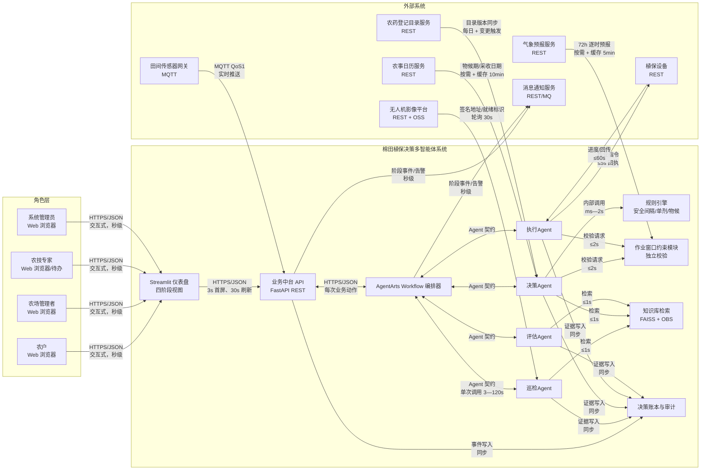

**数据流向（四个闭环方向）**

| 流向 | 载体 | 频率/时效 | 关键约束 |
|------|------|----------|---------|
| 巡田数据流入 | 影像产品元数据 + 传感时序 | 就绪轮询 30s；传感实时 | 仅正射产品，拒绝原始帧；就绪时间作为计时起点 |
| 巡田→决策 | `StressResultPayload`（含阻断状态） | 每次巡田 1 次 | 阻断状态为唯一门禁，阻断即不可调用 |
| 决策→执行 | `PrescriptionPayload` + 窗口校验编号 | 每处方 1 次 | 处方三元组齐备、目录版本冻结、校验结论 10 分钟内有效 |
| 执行→评估 | `WorkOrderReceipt` + 回传流 | 回执 1 次；进度 ≤60s | 回传数据不因评估失败丢弃，先落盘后计算 |

### 2.1.2 服务/组件总体架构

### 分层架构

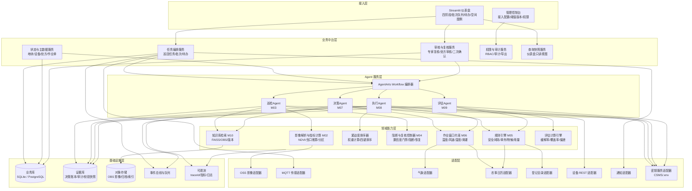

**分层职责与边界**

| 层 | 职责 | 边界（不做什么） | 对外契约 |
|----|------|----------------|---------|
| L1 接入层 | 人机交互、视图渲染、操作确认、文件导出 | 不承载业务判定，不在前端计算紧迫度/安全间隔 | 仅调用 L2 REST API |
| L2 业务中台 | 业务单证生命周期、状态机、审核/复核流程、权限、审计、快照查询 | 不直接解析影像、不直接判定红线、不调用设备 | REST `/api/v1/**` |
| L3 Agent 服务 | 四阶段智能决策与工具调用编排、Workflow 节点执行、人工节点挂起/恢复 | 不承载状态兜底（状态在中台）、不做安全红线最终判定（规则引擎为准） | Agent 契约 `/agents/{name}/invoke` |
| L4 领域能力 | 确定性规则、指标计算、排序、检索、阻断控制 | 不感知 HTTP、不写业务单证状态 | Python 内部接口 + 少量独立 REST（窗口校验） |
| L5 适配层 | 协议转换、重试、限流、签名地址、凭据注入 | 不包含业务规则 | 适配器接口（可 Mock） |
| L6 基础设施 | 存储、消息、可观测 | —— | Repository / EventBus / Tracer |

### 模块清单

| 模块编号 | 模块名 | 职责 | 依赖 | 对外接口 |
|---------|-------|------|------|---------|
| M01 | 巡田任务与就绪校验 | 任务创建、权限与时间窗校验、产品匹配、就绪校验、重试 | M11 鉴权、D1、I1 | `POST /api/v1/patrol-tasks`、`GET /api/v1/patrol-tasks/{no}` |
| M02 | 影像解析与胁迫识别 | 波段读取、分区栅格化、NDVI/虫口指标、等级与置信度、面积裁剪 | D1、C5、C6、I3 | `POST /agents/patrol/invoke` |
| M03 | 巡检Agent | 组织识别流程、调用知识库解释、产出可解释结果与阻断建议 | M02、M04、C5 | 同上（Agent 契约） |
| M04 | 阻断与复核控制 | 置信度门禁、任务级阻断、复核任务、恢复判定、48h 升级 | M11 待办、D7、I2 | `POST /api/v1/reviews`、`GET /api/v1/tasks/{no}/block` |
| M05 | 规则引擎 | 目录绑定、单剂拦截、安全间隔、用量/喷液量、物候约束 | D4、D5、I1、I2 | `POST /rules/evaluate` |
| M06 | 作业窗口约束 | 四项红线、双重校验、候选窗口、快照留痕、阈值版本 | D3、I1、I2 | `POST /window-checks` |
| M07 | 决策Agent 与处方 | 前置门禁、候选选药、三元组生成、降级/拒绝、审核流转、版本冻结 | M05、M06、C5、D5 | `POST /agents/decision/invoke` |
| M08 | 执行Agent 与调度 | 下发前校验、指令模板、幂等、状态机、进度跟踪、批次组建与排序 | M06、C3、D6、I4 | `POST /agents/execution/invoke` |
| M09 | 评估Agent | 复查时效、四项指标、达标判定、建议、回写 | M02（复用识别）、C7、M05 | `POST /agents/assessment/invoke` |
| M10 | 知识库与目录同步 | 五类知识索引、版本管理、目录同步与冲突、降级快照 | I3、FAISS、D5 | `POST /kb/search`、`POST /registry/sync` |
| M11 | 业务中台与仪表盘 | 状态机、审核/复核单证、权限、快照查询、导出 | I1、I2、D7 | `/api/v1/**` |
| M12 | 可观测、审计与账本 | traceId/agentRunId 贯穿、决策账本、审计留存、五项指标 | I2、I3、I5 | 内部接口 + `GET /api/v1/observability/**` |
| M13 | Agent SDK 与运行时适配 | 统一 Agent/Workflow 客户端、双运行时、Mock、重试与超时 | AgentArts、I5 | Python 包 `cipm_sdk` |
| M14 | 接入配置与密钥 | 五类配置管理、连通性校验、凭据引用、变更留痕 | D8、I1 | `/api/v1/access-configs/**` |

### AgentArts Workflow 与四个 Agent 的映射

设计原则：**流程性、跨角色、需要等待人工的链路用 Workflow 编排；单个 Agent 内部的推理与工具调用用 Agent 节点承载；规则判定以确定性 Tool 节点挂在 Workflow 上。**

| Workflow | 触发方式 | 节点序列（节点类型） | 人工节点插入点 | 失败/阻断出口 |
|----------|---------|-------------------|--------------|-------------|
| `patrol_workflow` | 数据就绪事件（自动） | 就绪校验(Tool) → 影像解析(Tool) → 分区识别(Agent: 巡检Agent) → 可解释指标补齐(Tool) → 置信度门禁(Tool) → 结果冻结(Tool) | 置信度 <0.7 或指标缺失 → **Human-Review 节点**（挂起等待 `review.submitted` 事件） | 阻断待复核 / 识别失败 |
| `decision_workflow` | 任务进入 `可决策`（人工或事件） | 前置门禁(Tool) → 目录检索(Agent: 决策Agent + Tool) → 单剂拦截(Tool) → 安全间隔判定(Tool) → 用量与喷液量(Tool) → 窗口校验(Tool→M06) → 处方组装(Agent: 决策Agent) | 降级待确认 → **Human-Expert 节点**；审核调整>30%/非花铃期 → **Human-Expert 节点**；复配拦截 → **Human-Expert 节点（线下手工组合，不回流自动链路）** | 已拒绝 / 待作业窗口 / 降级待确认 |
| `execution_workflow` | 单地块确认下发 或 批次确认 | 下发前置门禁(Tool) → 执行前窗口校验(Tool→M06) → 指令组装(Tool) → 幂等下发(Tool→设备) → 回执登记(Tool) → 进度跟踪循环(Event) | 批次确认 → **Human-Confirm 节点**（一次确认覆盖全批，逐地块清单快照） | 待重新排期 / 设备不可达 / 已中止 |
| `assessment_workflow` | 作业单完成事件 | 回传数据校验(Tool) → 复查影像校验(Tool) → 复查识别(Agent: 巡检Agent 复用) → 指标计算(Tool) → 结论生成(Agent: 评估Agent) → 回写(Tool) | 缓解率<30% → **Human-Expert 节点**；复查阻断 → 等待复核事件 | 部分评估 / 效果待复查 |

**Workflow 节点类型约定**

| 节点类型 | 实现载体 | 是否确定性 | 超时 | 说明 |
|---------|---------|-----------|------|------|
| Tool 节点 | Python 纯函数 / 独立服务 | 是 | 2—120s | 规则、计算、适配器调用；可单测、可回放 |
| Agent 节点 | AgentArts Agent（模型+工具集） | 否（需证据约束） | 60—180s | 必须以结构化 Schema 输出，附 `evidence` 字段 |
| Human 节点 | AgentArts 人工任务 / 中台待办 | —— | 48h 升级 | 挂起 Workflow，靠事件恢复；结论落审计 |
| Event 节点 | 消息订阅 | 是 | —— | 传感读数、设备回传、复核提交等 |

### 2.1.3 实现设计文档
### 2.1.3.1 状态机设计

#### 巡田任务状态机

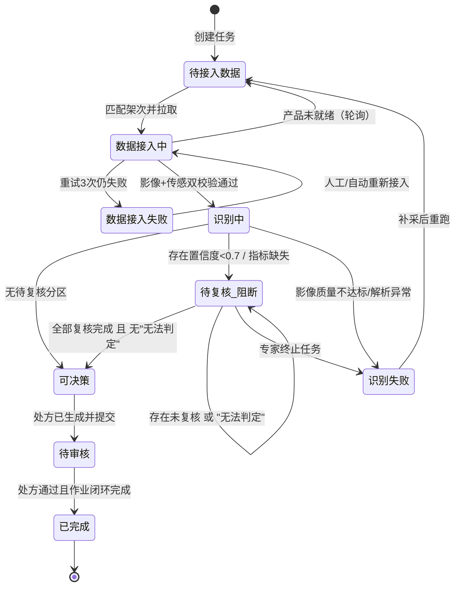

关键约束：`待复核_阻断` 状态下**不存在**任何指向 `待审核` 的迁移边，这是"阻断期间不生成处方"的结构性保证（规格 5.2.1-6、4.2-9）。

#### 作业单状态机

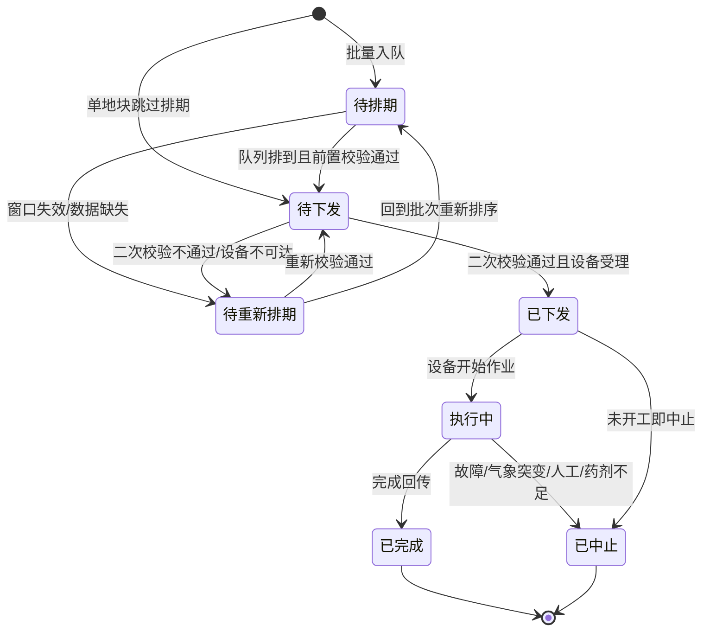

禁止边（由状态机拦截）：`执行中 → 待下发`、`已完成 → 执行中`、`已中止 → 执行中`、`待重新排期 → 已下发`。依据规格 5.4.1-6、6.6-6。

#### 处方状态机

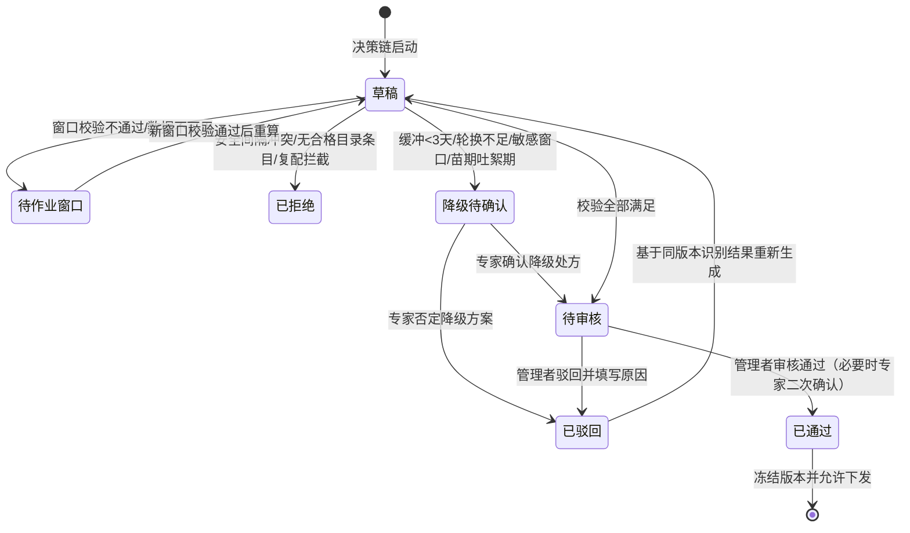

说明：`已拒绝` 为终态，重复请求返回同一拒绝结论（规格 5.3.1-10b）；`已通过` 版本一经下发即冻结，处方修订只能产生新版本（4.5-4）。

#### 批量作业批次状态机

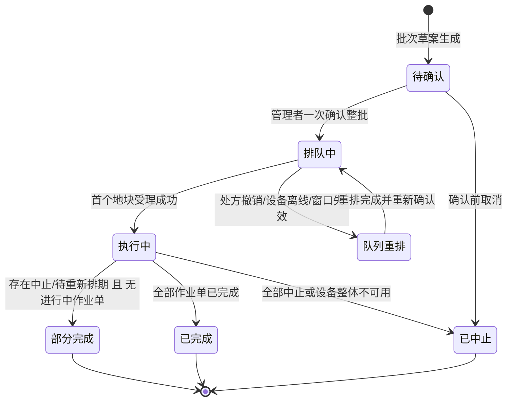

批次状态不允许直接写入，必须由作业单状态**复算**得到（规格 5.10.1-11、6.13-7）。

### 2.1.3.2 多 Agent 交互时序图

为可读性，异常阻断场景拆为 (b1) 巡检阻断与 (b2) 决策阻断两张子图，与原 (b) 属同一异常阻断视图。

#### (a) 多地块批量调度全链路

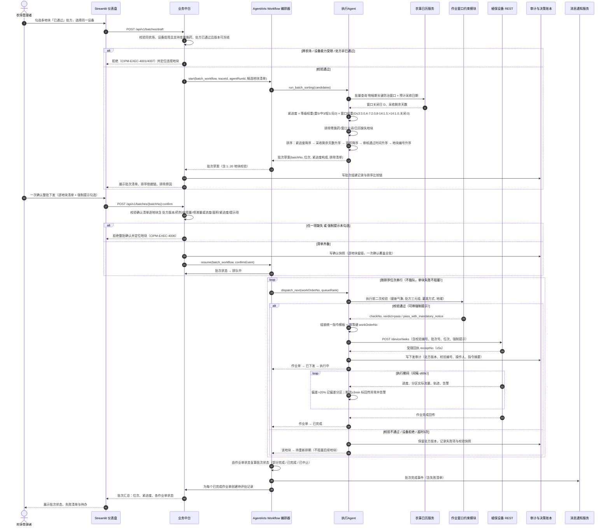

#### (b1) 置信度 <0.7 的巡检阻断与恢复链路

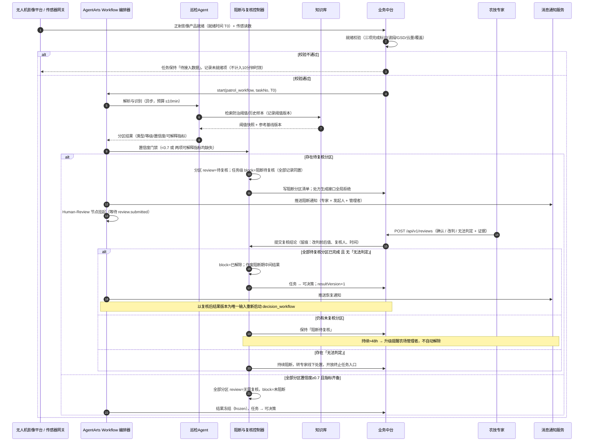

#### (b2) 安全间隔冲突与作业窗口不通过的决策阻断链路

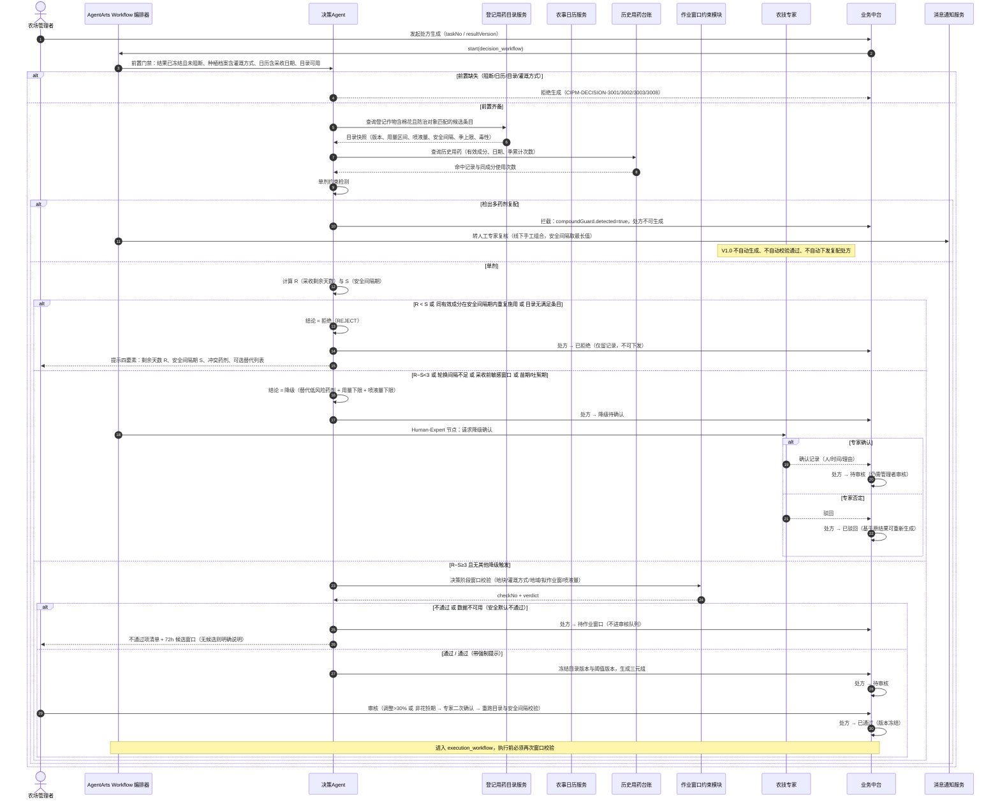

### 2.1.3.3 阻断、复核与恢复的判定逻辑

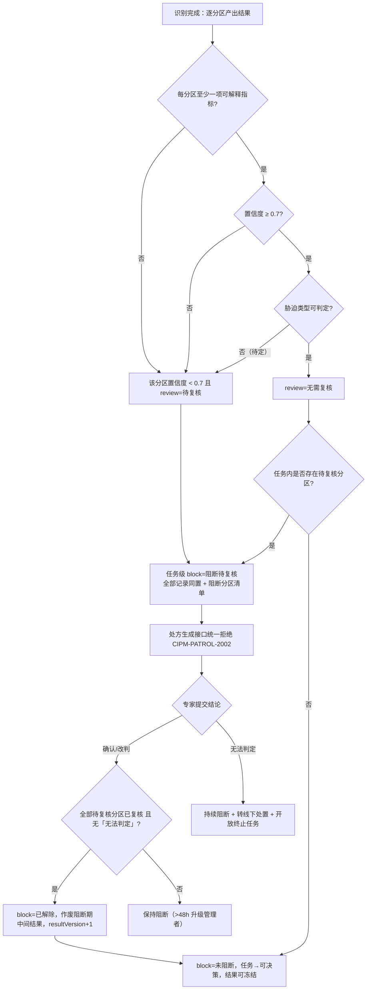

### 2.1.3.4 规则引擎判定表（确定性实现口径）

#### 安全间隔判定（M05 `SafetyIntervalRule`）

设 `R` = 采收剩余天数（预计采收日期 − 拟作业完成日期，自然日），`S` = 引用目录项安全间隔期。

| 优先级 | 判定条件 | 结论 | 系统动作 | 依据条款 |
|-------|---------|------|---------|---------|
| 1 | 目录中不存在 `S ≤ R` 的可用条目（登记作物含棉、对象匹配、有效期内、季次数未超限、非高毒苗期/吐絮期） | 拒绝 | 处方 `已拒绝`；提示"距采收仅剩 R 天，短于最短安全间隔期 S_min 天，禁止施药"+可选替代 | 5.3.1-10、6.5-12 |
| 2 | 选中药剂 `R < S` | 拒绝 | `已拒绝`，仅留记录；重复请求返回同一结论；不自动改用目录外药剂 | 5.3.1-10a/10b |
| 3 | 同有效成分在安全间隔期内重复施用，或季使用次数已达目录项上限 | 拒绝 | `已拒绝`，记录冲突药剂与最近施用日期 | 5.3.1-3c/8c、5.3.3-6 |
| 4 | `0 ≤ R − S < 3`（缓冲不足） | 降级 | 改选 `S' ≤ R` 的低风险药剂（优先 `R−S' ≥ 3`），制剂亩用量取下限、喷液量取下限；`降级待确认` | 5.3.1-9a |
| 5 | 距上次同有效成分用药间隔 < 目录项最小轮换间隔 | 降级 | 改选不同有效成分的低风险条目；`降级待确认` | 5.3.1-9 |
| 6 | 处于采收前敏感窗口 | 降级 | 保守处方；`降级待确认` | 5.3.1-9 |
| 7 | 当前物候期为苗期/吐絮期 | 降级/专家确认 | 必须引用低风险方案（高毒条目禁用），进入专家确认队列 | 5.3.1-7、6.10-13 |
| 8 | `R − S ≥ 3` 且无优先级 5—7 触发 | 满足 | 记录"满足"结论与 R/S 取值 | 5.3.1-8a |

**口径澄清（避免二义性）**：优先级 2 的"拒绝"与优先级 4 的"降级改选替代药剂"不冲突——`R < S` 属"校验不可通过"，一律拒绝；"改选更短安全间隔期药剂"仅发生在校验可通过（`R ≥ S`）后的缓冲不足/轮换/敏感窗口场景，且改选后仍保持 `降级待确认` 状态，需专家确认。拒绝提示中的"可选替代"仅供用户据此重新发起新处方版本，不构成自动放行。

**提示文案模板（四要素强制）**：`距预计采收 {R} 天，安全间隔期 {S} 天，冲突药剂 {productName}，可选替代 {alternatives}`。降级提示同构，替换"冲突"为"降级原因"。

#### 新疆作业窗口判定（M06 `WindowRuleEngine`）

| 规则 | 输入要求 | 通过条件 | 不通过输出 | 依据条款 |
|------|---------|---------|-----------|---------|
| 温度红线 | 拟作业日在 72h 精准预报内 → 前后各 3 天逐日 minT/avgT；超出 → 前后各 5 天趋势预报 | 窗口内**每日** `minT ≥ 12.5℃` 且 `avgT > 23℃` | 违反日期、预报值、阈值；临界（minT ∈ [12.0,13.0]）标注"临界波动，作业前需重校" | 5.9.1-2、5.9.3-4 |
| 风速红线 | 作业时间窗逐时风速（级） | 逐时 `≤ 3 级` | 超限时段清单 | 5.9.1-3 |
| 南疆防漂移 | 地域=南疆 且 作业窗落在 14:00—18:00 且 RH<30% | 通过（带强制提示）：提高雾滴粒径、降低飞行高度、添加抗漂移助剂、避开高温时段 | 非不通过项；提示必须随处方与指令下发并被确认勾选 | 5.9.1-4、5.4.1-10 |
| 滴灌喷液量 | 灌溉方式 + 处方喷液量 + 目录区间 + 设备最大喷液量 | 滴灌：`≤ 区间中值`；非滴灌：`≤ 区间上限`；两者 `≤ 设备上限` | 输出修正建议值（滴灌取中值）；灌溉方式为空 → 不通过 | 5.9.1-5、6.5-8 |
| 数据可用性 | 气象版本与发布时间、阈值版本、地块属性 | 全部存在且预报 ≤6h | 任一缺失 → **不通过**（不替代、不估算） | 4.2-7、6.12-5 |
| 结论聚合 | 上述四项 | 任一红线不通过 → `不通过`；仅南疆提示 → `通过（带强制提示）`；否则 `通过` | 不通过项清单 + 72h 候选窗口（无候选明确说明） | 5.9.1-7、6.12-9/10/11 |

**双重校验规则**：决策阶段 `check_no=D-xxxx`，执行阶段 `check_no=E-xxxx`，执行记录携带 `parent_check_no=D-xxxx` 形成可关联链；两次必须引用同一 `threshold_version`；结论不一致时以执行阶段为准，处方版本不失效、作业窗口重新选择。校验结论有效期：执行阶段校验时间距下发请求 ≤10 分钟（6.6-7）。

#### 单剂约束（V1.0 硬拦截）

| 条件 | 检出 | 动作 |
|------|------|------|
| 同一分区处方组分 ≥ 2 个药剂品类 | `compoundGuard.detected=true` | 处方不生成（`状态`停留草稿并标记拦截）；生成专家复核任务；专家线下手工组合后录入的**人工处方**不进入自动下发链路（需走人工审核 + 执行前校验仍强制执行） |
| 目录项含复配剂型（登记为混剂）但按单一品类使用 | 视为单剂，但必须在处方中记录 `formulation_type=mixture_registered` 并展示有效成分 | 允许；安全间隔取该条目规定值 |
| 组分字段缺失或品类为空 | `invalid` | 拒绝生成（`CIPM-RULE-5005`） |

#### 紧迫度与排序（M08 `UrgencyRanker`）

| 输入 | 取值规则 | 依据 |
|------|---------|------|
| 胁迫等级权重 `w_level` | 重 5 / 中 3 / 轻 1 / 无 0；地块多分区取**最高**等级 | 5.10.1-2/3 |
| 物候期窗口权重 `w_window` | 距关键防治窗口关闭天数 D：`D≤3 → 3.0`；`4—7 → 2.0`；`8—14 → 1.5`；`>14 → 1.0`；窗口已关闭 → 0（排除） | 5.10.1-2 |
| 紧迫度 | `urgency = w_level × w_window`，保留 1 位小数可复算 | 6.13-5 |
| 排序键（字典序） | ① `urgency` 降序 ② 采收剩余天数升序 ③ 地块面积降序 ④ 处方审核通过时间升序 ⑤ 地块编号升序 | 5.10.1-4、5.10.3-3 |
| 排除规则 | `w_level=0`（全部分区无胁迫）或施药量全为 0 或窗口关闭 → 不入队且不计入批次地块数；日历缺失 → 标数据缺失、不参与排序 | 5.10.1-5、5.10.3-2 |
| 变更规则 | 新处方入队 → 全队列重排；处方驳回/撤销、设备离线、窗口失效、执行前校验不通过 → 移出并重排；执行中作业单不插队 | 5.10.1-7/8 |

### 2.1.3.5 处方生成与校验的编排顺序（决策链固定序）

固定顺序保证"前置门禁 → 单剂 → 安全间隔 → 用量 → 窗口 → 冻结"不可颠倒，任一环节失败即短路，避免产生半成品处方：

1. 前置门禁：识别结果已冻结且 `block ∈ {未阻断, 已解除}`、档案含灌溉方式、日历含预计采收日期、目录可用（或 7 天内快照）、目录项与胁迫类型匹配。
2. 单剂约束：命中复配即拦截转专家，链路终止。
3. 目录绑定：确定候选条目（有效期内、季次数未超限、毒性/物候兼容）。
4. 安全间隔：按 2.1.3.4 判定表输出满足/降级/拒绝；拒绝即终止。
5. 用量与喷液量：按胁迫等级、物候期、生长模型计算并截断至区间；滴灌修正；三元组校验（喷液量与稀释浓度同时给出时必须换算一致）。
6. 决策阶段窗口校验：不通过 → `待作业窗口` + 候选窗口，链路终止。
7. 三元组组装与版本冻结：落 `registry_version`、`threshold_version`、`check_no`、`review_evidence`，置 `待审核`。
8. 审核：管理者审核；调整 >30% 或非花铃期 → 专家二次确认 → 重跑第 3—6 步。
9. 通过即冻结处方版本，进入执行链。

### 2.1.3.6 幂等、重试与并发控制

| 场景 | 机制 | 键 | 行为 |
|------|------|----|------|
| 作业指令下发 | 幂等表 + 唯一约束 | `work_order_no` | 重复请求返回首次 `receipt_no` 与受理时间，不重复发设备（5.4.1-4） |
| 影像/传感拉取 | 幂等下载 + 内容指纹 | `sortie_no + object_etag` / `device_no + collected_at` | 重复内容不重复解析；传感同键去重保留首条（5.7.3-3） |
| 处方生成 | 乐观锁 + 版本号 | `result_no + prescription_version` | 并发生成同版本返回同一结果或冲突错误，不产生两份生效处方 |
| 批次组建 | 分布式锁（本地文件锁 / 云端 Redis 锁） | `farm_no + device_no` | 同设备并发组建串行化，保证位次唯一 |
| 复核提交 | 条件更新 | `partition_no + review_status=待复核` | 已复核终态不可覆盖，重复提交返回当前结论 |
| 外部调用失败 | 指数退避重试 | 调用维度 | 设备/影像 3 次；气象/日历/目录 2 次；超时按配置（1—60s），失败按安全默认处置 |

### 2.1.3.7 版本冻结与变更影响链

| 版本对象 | 冻结时点 | 变更影响 | 依据 |
|---------|---------|---------|------|
| 识别结果 `resultVersion` | 被处方引用即冻结 | 重新识别生成新版本；阻断期中间结果不复用 | 5.2.1-9/10 |
| 处方版本 `prescriptionVersion` | 审核通过并下发即冻结 | 修订产生新版本，已执行/已完成不受影响 | 4.5-4 |
| 目录版本 `registryVersion` | 处方引用即冻结 | 条目停用不影响在执行作业单，不得用于新处方 | 4.5-5、5.8.1-5 |
| 阈值版本 `thresholdVersion` | 每次判定引用即记录 | 只可新增版本，不可改历史；红线阈值双人确认 | 5.8.1-3、5.9.1-9 |
| 农事日历 `calendarVersion` | 处方生成即记录 | 采收日期变更 → 未下发处方重跑安全间隔校验；已下发提示复核 | 4.5-6 |
| 气象数据 `weatherVersion` | 每次窗口校验快照 | 两次校验快照并存 | 4.2-8、6.12-5 |
## 2.2 接口设计

### 2.2.1 总体设计

#### 接口分类与调用关系

接口分三类，边界清晰：**A 类（Agent 契约）** 用于 AgentArts 节点间与中台→Agent 调用；**B 类（领域服务）** 为确定性规则与校验的同步接口；**C 类（中台业务）** 面向仪表盘与流程单证。所有接口统一使用 JSON、UTF-8、`/api/v1` 或带版本号的 Agent 路径，禁止在业务接口内使用 Map/字典透传无约束字段。

| 编号 | 接口 | 方法与路径 | 调用方 → 提供方 | 类型 | 稳定性 | 时效要求 |
|------|------|-----------|----------------|------|--------|---------|
| IF-01 | 巡检识别调用 | `POST /agents/patrol/invoke` | 编排器 → 巡检Agent | A | 稳定 | ≤10min（异步） |
| IF-02 | 处方生成调用 | `POST /agents/decision/invoke` | 编排器 → 决策Agent | A | 稳定 | ≤3min |
| IF-03 | 指令下发调用 | `POST /agents/execution/invoke` | 编排器 → 执行Agent | A | 稳定 | ≤5s（含设备回执） |
| IF-04 | 回执与进度回传 | `POST /agents/execution/receipts` | 设备适配器 → 执行Agent | A | 稳定 | 回执即时；进度 ≤60s |
| IF-05 | 评估调用 | `POST /agents/assessment/invoke` | 编排器 → 评估Agent | A | 稳定 | ≤3min |
| IF-06 | 作业窗口校验 | `POST /window-checks` | 决策Agent/执行Agent → M06 | B | 稳定 | ≤2s |
| IF-07 | 规则评估 | `POST /rules/evaluate` | 决策Agent → M05 | B | 稳定 | ≤500ms |
| IF-08 | 知识检索 | `POST /kb/search` | 巡检/决策/评估Agent → M10 | B | 实验 | ≤1s |
| IF-09 | 目录同步 | `POST /registry/sync` | 定时任务/管理员 → M10 | B | 稳定 | 每日 + 变更触发 |
| IF-10 | 批次草案 | `POST /api/v1/batches/draft` | 仪表盘 → 中台 | C | 稳定 | ≤30s（≤50 地块） |
| IF-11 | 批次确认 | `POST /api/v1/batches/{batchNo}:confirm` | 仪表盘 → 中台 | C | 稳定 | ≤3s |
| IF-12 | 人工复核提交 | `POST /api/v1/reviews` | 仪表盘 → 中台 | C | 稳定 | ≤2s |
| IF-13 | 处方审核 | `POST /api/v1/prescriptions/{no}:review` | 仪表盘 → 中台 | C | 稳定 | ≤3s |
| IF-14 | 仪表盘查询 | `GET /api/v1/dashboard` | 仪表盘 → 中台 | C | 稳定 | ≤3s 首屏 |
| IF-15 | 接入配置管理 | `GET/POST/PUT /api/v1/access-configs` | 管理台 → 中台 | C | 稳定 | ≤2s |
| IF-16 | 决策账本查询 | `GET /api/v1/ledger/{bizId}` | 管理台/专家 → M12 | C | 稳定 | ≤2s |
| IF-17 | Workflow 控制 | `POST /workflows/{name}:start`、`:resume`、`GET /workflows/runs/{runId}` | 中台 → 编排器 | A | 稳定 | ≤2s |

#### 统一响应包裹

所有 A/B/C 类接口使用同一外层信封，业务数据一律放在 `data` 内，禁止平铺。

| 字段 | 类型 | 必填 | 说明与校验 |
|------|------|------|-----------|
| `code` | string | 是 | `OK` 或错误码（见下）；成功恒为 `OK` |
| `message` | string | 是 | 人类可读中文提示，错误时须可运营（含关键数值，如剩余天数） |
| `traceId` | string | 是 | W3C `traceparent` 派生的 32 位十六进制；全链路唯一，贯穿四阶段 |
| `agentRunId` | string | 是 | AgentArts 运行实例 ID；非 Agent 调用时由中台生成 `run_platform_*` |
| `bizId` | object | 否 | 业务主键集合：`taskNo` / `prescriptionNo` / `workOrderNo` / `batchNo`（按场景给出） |
| `data` | object | 否 | 契约载荷；错误时可为空或含 `details` |
| `timestamp` | string | 是 | ISO-8601 带时区（`+08:00`） |
| `retryable` | boolean | 是 | 供调用方决定是否重试；红线不通过、状态非法等为 `false` |

```json
{
  "code": "OK",
  "message": "批次草案已生成，共 8 个地块纳入排序，2 个地块被排除",
  "traceId": "4bf92f3577b34da6a3ce929d0e0e4736",
  "agentRunId": "run_agentarts_20261113_0007",
  "bizId": { "batchNo": "BT-20261113-0003" },
  "data": { "batchNo": "BT-20261113-0003", "items": [], "excluded": [] },
  "timestamp": "2026-11-13T10:12:31+08:00",
  "retryable": false
}
```

#### 错误码规范

格式 `CIPM-<DOMAIN>-<4位序号>`；DOMAIN 取值 `PATROL`（巡田/识别）、`DECISION`（处方）、`EXEC`（执行/批次）、`EVAL`（评估）、`RULE`（规则与窗口）、`DATA`（外部数据）、`AUTH`（权限）、`SYS`（系统）。

| 错误码 | 含义 | retryable | 规格依据 |
|-------|------|-----------|---------|
| `CIPM-PATROL-1001` | 正射影像产品未就绪 | true | 5.1.1-3a |
| `CIPM-PATROL-1002` | 波段/分辨率不满足识别要求 | false | 5.2.1-1 |
| `CIPM-PATROL-1003` | 云量超限或影像缺失 | false | 5.2.3-1 |
| `CIPM-PATROL-1004` | 影像覆盖不足，禁止全地块处方 | false | 5.1.3-5 |
| `CIPM-PATROL-1005` | 输入为原始帧，禁止识别 | false | 5.1.1-9 |
| `CIPM-PATROL-2001` | 存在待复核分区，处方生成已暂停 | false | 5.2.1-6b |
| `CIPM-PATROL-2002` | 分区缺乏可解释依据，置信度置低并待复核 | false | 5.2.3-2 |
| `CIPM-PATROL-2003` | 复核结论「无法判定」，阻断持续 | false | 5.2.1-8c |
| `CIPM-PATROL-2004` | 复核超时（>48h），已升级管理者 | false | 5.2.3-3 |
| `CIPM-DECISION-3001` | 识别结果处于阻断状态，拒绝生成 | false | 5.3.1-1a |
| `CIPM-DECISION-3002` | 缺少农事日历或预计采收日期 | true | 5.3.1-1b |
| `CIPM-DECISION-3003` | 登记用药目录不可用且无有效快照 | true | 5.3.1-1c |
| `CIPM-DECISION-3004` | 安全间隔冲突，禁止施药 | false | 5.3.1-10 |
| `CIPM-DECISION-3005` | 降级处方未经专家确认，禁止提交审核 | false | 5.3.1-9b |
| `CIPM-DECISION-3006` | 多剂复配拦截，已转人工专家 | false | 1.4-12 |
| `CIPM-DECISION-3007` | 作业窗口校验不通过/数据不可用 | true | 5.3.1-12、5.9.1-7 |
| `CIPM-DECISION-3008` | 灌溉方式/地域属性缺失 | true | 5.3.1-5b |
| `CIPM-DECISION-3009` | 处方三元组不完整 | false | 6.5-10 |
| `CIPM-EXEC-4001` | 处方未审核/版本不可用 | false | 5.3.1-14a |
| `CIPM-EXEC-4002` | 设备不可达或离线 | true | 5.4.1-1a |
| `CIPM-EXEC-4003` | 执行前作业窗口二次校验不通过 | false | 5.4.1-2a |
| `CIPM-EXEC-4004` | 重复下发，返回首次受理结果 | false | 5.4.1-4 |
| `CIPM-EXEC-4005` | 作业单状态非法流转 | false | 6.6-6 |
| `CIPM-EXEC-4006` | 强制提示未勾选/确认清单缺项 | false | 5.4.1-10、5.10.1-9 |
| `CIPM-EXEC-4007` | 跨农场/跨权属组批或设备能力受限 | false | 5.10.1-12、5.7.3-2 |
| `CIPM-RULE-5003` | 红线阈值版本或地块属性不可用 | false | 5.9.1-1、5.9.3-5 |
| `CIPM-RULE-5004` | 禁止人工豁免温度/风速红线 | false | 5.9.1-10 |
| `CIPM-RULE-5005` | 规则输入非法（品类为空/区间冲突） | false | 5.3.1-2b |
| `CIPM-EVAL-6001` | 复查影像缺失/超期，仅出合规性评估 | true | 5.5.1-10 |
| `CIPM-EVAL-6002` | 复查识别阻断，效果待复查 | false | 5.5.1-4 |
| `CIPM-EVAL-6003` | 指标缺项，仅出部分评估 | true | 5.5.1-5 |
| `CIPM-DATA-7001` | 外部接入超时（按安全默认可转不通过） | true | 4.2-7 |
| `CIPM-AUTH-8001` | 越权访问地块/农场数据 | false | 4.3-4 |
| `CIPM-SYS-9001` | 内部异常/账本写入失败 | true | —— |

#### 契约版本与兼容策略

- 契约字段一律 `schemaVersion`（当前 `1.0`）；新增字段只能追加且必须可选，删除/改名视为破坏性变更需升 `2.0`。
- Agent 节点输出使用严格 Schema 校验（Pydantic `extra="forbid"`），校验失败视为 Agent 调用失败并记录 `agentRunId`，不进入下游。
- 设备接口新增字段按"未知"处理，缺失字段不得导致作业单失败（4.5-2）。

### 2.2.2 接口清单

#### IF-01 巡检Agent → 决策Agent：识别结果载荷（`StressResultPayload`）

**业务说明**：承载单次巡田任务的分区级识别结论、可解释证据、复核与阻断状态，是决策链的唯一输入源。
**前置条件**：正射产品就绪校验通过、传感数据接入完成、任务状态 `识别中`。
**后置条件**：结果版本冻结（`frozen=true`）或任务置 `阻断待复核`；写入决策账本。

| 字段 | 类型 | 必填 | 枚举/校验规则 |
|------|------|------|---------------|
| `schemaVersion` | string | 是 | 固定 `1.0` |
| `taskNo` | string | 是 | 巡田任务编号，全局唯一 |
| `resultNo` | string | 是 | 结果编号 = `taskNo + resultVersion` 组合唯一 |
| `resultVersion` | integer | 是 | ≥1，重新识别递增，不得回退 |
| `orthophoto.sortieNo` | string | 是 | 架次编号，唯一 |
| `orthophoto.readyTime` | string(date-time) | 是 | 正射产品就绪时刻，10 分钟计时起点 |
| `orthophoto.bands` | array[string] | 是 | 必须含 `NIR` 与 `RED` |
| `orthophoto.gsdCm` | number | 是 | ≤5 |
| `orthophoto.cloudPct` | number | 是 | 0—100，>10 判不合格 |
| `orthophoto.coverRatio` | number | 是 | 0—1；<1 时禁止输出全地块处方 |
| `orthophoto.productVersion` | string | 是 | 影像平台产品版本标识 |
| `taskBlock.status` | enum | 是 | `unblocked` / `blocked_pending_review` / `released` |
| `taskBlock.blockingPartitions` | array[string] | 条件必填 | `status=blocked_pending_review` 时必填且非空 |
| `taskBlock.reasonCodes` | array[enum] | 是 | `LOW_CONFIDENCE` / `MISSING_EXPLAINABILITY` / `UNDETERMINED_TYPE` / `SEVERE_REQUIRES_REVIEW` |
| `partitions[].partitionNo` | string | 是 | 结果内唯一，落在地块边界内 |
| `partitions[].areaMu` | number | 是 | >0 |
| `partitions[].geometryRef` | string | 是 | 分区几何快照引用（OBS key，非内联几何） |
| `partitions[].stressType` | enum | 是 | `pest_disease` / `nutrient_deficiency` / `drought` / `waterlogging` / `undetermined` |
| `partitions[].stressLevel` | enum | 是 | `none` / `light` / `medium` / `heavy` |
| `partitions[].confidence` | number | 是 | 0—1；<0.7 强制 `review.status=pending` |
| `partitions[].explainability.ndviDeviation` | object | 条件必填 | 与 `pestDensity` 至少一项；`{value:number, baselineId:string, baselineVersion:string, method:string}` |
| `partitions[].explainability.pestDensity` | object | 条件必填 | `{value:number, unit:"头/百株", basis:string}` |
| `partitions[].thresholdRef` | object | 是 | `{entryId, version}`，防治阈值条目与版本 |
| `partitions[].review` | object | 是 | `{status: none_required/pending/confirmed/overridden/undetermined, reviewer?, reviewedAt?, beforeLevel?, afterLevel?, conclusion?}` |
| `partitions[].frozen` | boolean | 是 | 被处方引用后必须为 `true` |
| `recognitionMeta.durationSec` | number | 是 | 必须 ≤600（从 `readyTime` 起算） |
| `recognitionMeta.dataIntegrity` | enum | 是 | `complete` / `partial_missing` / `unavailable` |
| `recognitionMeta.degraded` | object | 否 | 知识库/阈值降级标识 `{reason, snapshotVersion}` |
| `evidence` | array[object] | 是 | 至少 1 条：`{type, refId, version}`，支撑结果可回放 |

**异常映射**：`CIPM-PATROL-1001/1002/1003/1004/1005`（拒绝识别）、`2001/2002/2003`（阻断）；`frozen=true` 后再次写入返回 `CIPM-DECISION-3001`。

```json
{
  "schemaVersion": "1.0",
  "taskNo": "PT-20261113-0007",
  "resultNo": "SR-20261113-0007-v2",
  "resultVersion": 2,
  "orthophoto": {
    "sortieNo": "FL-20261113-021",
    "readyTime": "2026-11-13T08:05:00+08:00",
    "bands": ["NIR", "RED", "GREEN"],
    "gsdCm": 3.2,
    "cloudPct": 4.0,
    "coverRatio": 1.0,
    "productVersion": "ortho-2026.11.13-021"
  },
  "taskBlock": {
    "status": "blocked_pending_review",
    "blockingPartitions": ["Z03"],
    "reasonCodes": ["LOW_CONFIDENCE"]
  },
  "partitions": [
    {
      "partitionNo": "Z01",
      "areaMu": 12.4,
      "geometryRef": "obs://cipm-geo/PT-20261113-0007/Z01.geojson",
      "stressType": "pest_disease",
      "stressLevel": "heavy",
      "confidence": 0.91,
      "explainability": {
        "pestDensity": { "value": 46.0, "unit": "头/百株", "basis": "黄板计数×百株折算系数 1.15" }
      },
      "thresholdRef": { "entryId": "TH-APHID-2026", "version": "v3" },
      "review": { "status": "none_required" },
      "frozen": false
    },
    {
      "partitionNo": "Z03",
      "areaMu": 9.8,
      "geometryRef": "obs://cipm-geo/PT-20261113-0007/Z03.geojson",
      "stressType": "undetermined",
      "stressLevel": "light",
      "confidence": 0.62,
      "explainability": {
        "ndviDeviation": { "value": -0.06, "baselineId": "BL-COTTON-FLOWER-2026", "baselineVersion": "v2", "method": "分区均值与同物候期健康基线差值" }
      },
      "thresholdRef": { "entryId": "TH-NDVI-GENERAL", "version": "v5" },
      "review": { "status": "pending" },
      "frozen": false
    }
  ],
  "recognitionMeta": {
    "durationSec": 247,
    "dataIntegrity": "complete",
    "degraded": null
  },
  "evidence": [
    { "type": "threshold", "refId": "TH-APHID-2026", "version": "v3" },
    { "type": "baseline", "refId": "BL-COTTON-FLOWER-2026", "version": "v2" }
  ]
}
```

#### IF-02 决策Agent 输出：处方图载荷（`PrescriptionPayload`）

**业务说明**：以分区三元组为核心的可执行处方，契约上强制三元组齐备，并绑定目录版本、安全间隔结论与窗口校验编号。
**前置条件**：`taskBlock.status ∈ {unblocked, released}`、结果 `frozen=true`、日历与目录可用、灌溉方式非空。
**后置条件**：状态置 `待审核` / `降级待确认` / `待作业窗口` / `已拒绝`；冻结目录与阈值版本；写决策账本。

| 字段 | 类型 | 必填 | 枚举/校验规则 |
|------|------|------|---------------|
| `prescriptionNo` | string | 是 | 全局唯一；同一作业单仅可引用一个生效版本 |
| `prescriptionVersion` | integer | 是 | ≥1，同识别结果下递增 |
| `taskNo` / `resultNo` / `resultVersion` | string/integer | 是 | 必须指向已冻结且未阻断结果 |
| `status` | enum | 是 | `draft` / `pending_window` / `degraded_pending_confirm` / `pending_review` / `approved` / `rejected` / `refused` |
| `registrySnapshot.version` | string | 是 | 目录整体版本，冻结留痕 |
| `registrySnapshot.syncedAt` | string(date-time) | 是 | 同步时间 |
| `registrySnapshot.degraded` | boolean | 是 | 使用快照时 `true`，`status` 不得为 `approved` 前未经专家确认 |
| `compoundGuard.detected` | boolean | 是 | `true` 时 `zones` 不得生成，`status=refused` |
| `compoundGuard.components` | array[object] | 条件必填 | 检测到的多剂组分 `{category, registryItemNo}` |
| `compoundGuard.action` | enum | 是 | `none` / `intercepted_to_expert` |
| `safetyCheck.conclusion` | enum | 是 | `satisfied` / `degraded` / `refused` |
| `safetyCheck.remainingDays` | integer | 是 | R，由日历计算，不得人工填写 |
| `safetyCheck.safetyIntervalDays` | integer | 是 | S，1—30，与目录项一致 |
| `safetyCheck.bufferDays` | integer | 是 | `R−S`，可为负 |
| `safetyCheck.conflictProduct` | object | 条件必填 | 拒绝时必须给出 `{registryItemNo, category}` |
| `safetyCheck.degradeReasons` | array[enum] | 条件必填 | `BUFFER_LT_3` / `ROTATION_INTERVAL` / `PRE_HARVEST_SENSITIVE` / `PHENOLOGY_LOW_RISK` |
| `safetyCheck.alternatives` | array[object] | 是 | 可选替代清单（可空），`{registryItemNo, category, safetyIntervalDays, doseRange}` |
| `windowCheck.checkNo` | string | 是 | 决策阶段校验编号 `WC-D-*`，指向通过或带提示的校验记录 |
| `windowCheck.conclusion` | enum | 是 | `pass` / `pass_with_mandatory_notice` / `fail` |
| `windowCheck.thresholdVersion` | string | 是 | 红线阈值版本 |
| `windowCheck.parentCheckNo` | string | 否 | 执行阶段回填时用于关联决策校验 |
| `windowCheck.mandatoryNotices` | array[object] | 条件必填 | `{code:"DRIFT_GUARD_SOUTH", measures:[4 项], ackRequired:true}` |
| `windowCheck.candidateWindows` | array[object] | 条件必填 | 不通过时必填，可为空数组并附 `noCandidateReason` |
| `zones[].zoneNo` | string | 是 | 与识别结果分区编号一致 |
| `zones[].zeroApplication` | boolean | 是 | `stressLevel=none` 时必须 `true`，且 `product` 为空、不计作业面积 |
| `zones[].product.registryItemNo` | string | 条件必填 | 非零施药时必填，必须为目录内条目 |
| `zones[].product.registryVersion` | string | 条件必填 | 与 `registrySnapshot.version` 一致 |
| `zones[].product.category` | object | 条件必填 | `{aiName, formulation}`，V1.0 每分区仅 1 个品类 |
| `zones[].product.registrationNo` | string | 条件必填 | 新疆现行登记证号 |
| `zones[].product.toxicity` | enum | 条件必填 | `low` / `medium` / `high`；苗期/吐絮期不得 `high` |
| `zones[].doseMlPerMu` | number | 条件必填 | 毫升/亩；必须落在目录区间，且 ≤ 当期物候期单次上限 |
| `zones[].sprayVolumeLPerMu` | number | 条件必填 | 升/亩；与 `dilutionRatio` 至少一项 |
| `zones[].dilutionRatio` | number | 条件必填 | 倍液；与 `sprayVolumeLPerMu` 同时给出时必须按亩用量换算一致 |
| `zones[].safetyIntervalDays` | integer | 条件必填 | 与目录项一致，1—30 |
| `zones[].seasonUsageBefore` | integer | 是 | 本季已用次数，用于与目录上限比对 |
| `zones[].doseTruncation` | object | 否 | `{applied:boolean, reason:"below_min"|"above_max", originalValue, finalValue}` |
| `zones[].volumeCorrection` | object | 否 | `{applied:boolean, reason:"drip_midpoint"|"device_max", originalValue, finalValue}` |
| `reviewEvidence` | object | 条件必填 | 引用复核后结果时必填：`{reviewer, reviewedAt, partitionNo, beforeLevel, afterLevel, conclusion}` |
| `evidenceRefs.thresholdVersion` | string | 是 | 阈值版本 |
| `evidenceRefs.baselineVersion` | string | 是 | NDVI 健康基线版本 |
| `evidenceRefs.kbRefs` | array[object] | 是 | 知识引用 `{entryId, version}` |
| `evidenceRefs.historyPrescriptionRef` | string | 否 | 同地块历史处方（存在时必填） |

**校验规则（服务端强制）**：三元组完整性（`product` + `doseMlPerMu` + (`sprayVolumeLPerMu` xor 至少其一)）；非零分区必须引用目录项；滴灌喷液量 ≤ 中值；`zones` 数量 ≥1；喷液量与稀释浓度换算偏差 >1% 拒绝。

```json
{
  "prescriptionNo": "RX-20261113-0009",
  "prescriptionVersion": 1,
  "taskNo": "PT-20261113-0007",
  "resultNo": "SR-20261113-0007-v2",
  "resultVersion": 2,
  "status": "degraded_pending_confirm",
  "registrySnapshot": { "version": "XJ-REG-2026.11.01", "syncedAt": "2026-11-13T06:00:00+08:00", "degraded": false },
  "compoundGuard": { "detected": false, "components": [], "action": "none" },
  "safetyCheck": {
    "conclusion": "degraded",
    "remainingDays": 9,
    "safetyIntervalDays": 7,
    "bufferDays": 2,
    "conflictProduct": null,
    "degradeReasons": ["BUFFER_LT_3"],
    "alternatives": [
      { "registryItemNo": "XJ-IMI-0453", "category": { "aiName": "吡虫啉", "formulation": "可湿性粉剂" }, "safetyIntervalDays": 5, "doseRange": [10, 20] }
    ]
  },
  "windowCheck": {
    "checkNo": "WC-D-20261113-0044",
    "conclusion": "pass_with_mandatory_notice",
    "thresholdVersion": "XJ-WIN-THR-2026.04",
    "parentCheckNo": null,
    "mandatoryNotices": [
      { "code": "DRIFT_GUARD_SOUTH", "measures": ["提高雾滴粒径", "降低飞行高度", "添加抗漂移助剂", "避开高温时段"], "ackRequired": true }
    ],
    "candidateWindows": []
  },
  "zones": [
    {
      "zoneNo": "Z01",
      "zeroApplication": false,
      "product": { "registryItemNo": "XJ-ACE-0381", "registryVersion": "XJ-REG-2026.11.01", "category": { "aiName": "啶虫脒", "formulation": "乳油" }, "registrationNo": "PD2026XXXX", "toxicity": "low" },
      "doseMlPerMu": 12.0,
      "sprayVolumeLPerMu": 1.6,
      "dilutionRatio": null,
      "safetyIntervalDays": 7,
      "seasonUsageBefore": 1,
      "doseTruncation": { "applied": true, "reason": "below_min", "originalValue": 10.0, "finalValue": 12.0 },
      "volumeCorrection": { "applied": true, "reason": "drip_midpoint", "originalValue": 2.0, "finalValue": 1.6 }
    },
    { "zoneNo": "Z04", "zeroApplication": true, "product": null, "doseMlPerMu": 0, "sprayVolumeLPerMu": 0, "dilutionRatio": null, "safetyIntervalDays": null, "seasonUsageBefore": 0 }
  ],
  "reviewEvidence": { "reviewer": "expert_zhang", "reviewedAt": "2026-11-13T09:20:00+08:00", "partitionNo": "Z03", "beforeLevel": "light", "afterLevel": "medium", "conclusion": "overridden" },
  "evidenceRefs": {
    "thresholdVersion": "TH-APHID-2026@v3",
    "baselineVersion": "BL-COTTON-FLOWER-2026@v2",
    "kbRefs": [{ "entryId": "KB-PRESC-HIST-PLOT-0912", "version": "v1" }],
    "historyPrescriptionRef": "RX-20261020-0021"
  }
}
```

#### IF-03 执行Agent：下发指令与回执载荷（`DispatchCommand` / `DispatchReceipt`）

**业务说明**：单地块与批量共用同一指令模板；批次仅附加 `batchNo`、`queueRank`、`urgency` 三个字段（5.10.1-6）。
**前置条件**：处方 `approved` 且版本冻结、设备在线且支持变量施药、执行前窗口校验通过（≤10 分钟）、管理者二次确认、强制提示已勾选。
**后置条件**：作业单 `已下发`；写受理回执与审计。

| 字段 | 类型 | 必填 | 枚举/校验规则 |
|------|------|------|---------------|
| `templateVersion` | string | 是 | 指令模板版本（单地块/批量一致） |
| `workOrderNo` | string | 是 | 全链路主键，幂等键 |
| `batchNo` | string | 否 | 批量时必填；同一作业单不得属多批次 |
| `queueRank` | integer | 否 | 批量时必填，正整数且批次内唯一 |
| `urgency` | number | 否 | 批量时必填，可复算，附 `{levelWeight, windowWeight}` |
| `farmNo` / `plotNo` / `deviceNo` | string | 是 | 地块与处方一致；设备启用且 `supportsVariableRate=true` |
| `prescriptionRef.prescriptionNo/version/frozenAt` | string | 是 | 必须为 `approved` 冻结版本 |
| `zones[]` | array[object] | 是 | 非零分区，含 `zoneNo / product / doseMlPerMu / sprayVolumeLPerMu / dilutionRatio` |
| `schedule.windowStart/windowEnd` | string(date-time) | 是 | 必须落在处方建议作业窗内 |
| `flight.heightM` / `flight.speedMps` | number | 是 | 落在药械安全约束内 |
| `safetyIntervalDays` | integer | 是 | 提示用途，与处方一致 |
| `windowCheckRef.checkNo` | string | 是 | 执行阶段 `WC-E-*`；`checkedAt` 距请求 ≤10 分钟 |
| `windowCheckRef.verdict` | enum | 是 | `pass` / `pass_with_mandatory_notice` |
| `windowCheckRef.parentCheckNo` | string | 是 | 决策阶段校验编号，形成关联链 |
| `mandatoryNotices[]` | array[object] | 条件必填 | 处方存在提示项时必填，且必须与处方一致 |
| `mandatoryAck` | object | 条件必填 | `{confirmedBy, confirmedAt, checked:true}`；未勾选拒绝下发 |
| `operatorConfirm` | object | 是 | `{managerId, confirmedAt}`，批量确认覆盖全批 |
| `idempotencyKey` | string | 是 | 默认等于 `workOrderNo` |

**回执 `DispatchReceipt`**：`{workOrderNo, accepted:boolean, receiptNo, deviceTaskId, deviceCode, message, acceptedAt, retryable}`。拒绝原因码由设备返回（药剂不支持/药箱不足/任务冲突），不得改变作业单状态（5.4.3-3）。

**进度与回传 `WorkOrderFeedback`**：`{workOrderNo, seq(单调递增), reportedAt, progressPct, actualAreaMu, zoneFlows[{zoneNo, actualLpm, deviationPct}], flight{actualHeightM, actualSpeedMps}, trackRef, alarms[{code,description}], integrity:"complete"|"partial_missing", missingItems[]}`。

```json
{
  "templateVersion": "CMD-TPL-1.0",
  "workOrderNo": "WO-20261113-0031",
  "batchNo": "BT-20261113-0003",
  "queueRank": 2,
  "urgency": 15.0,
  "urgencyBasis": { "levelWeight": 5, "windowWeight": 3.0, "windowCloseInDays": 2 },
  "farmNo": "FARM-014",
  "plotNo": "PLOT-0912",
  "deviceNo": "UAV-014-02",
  "prescriptionRef": { "prescriptionNo": "RX-20261113-0009", "version": 1, "frozenAt": "2026-11-13T10:40:00+08:00" },
  "zones": [
    { "zoneNo": "Z01", "product": { "registryItemNo": "XJ-ACE-0381", "category": { "aiName": "啶虫脒", "formulation": "乳油" } }, "doseMlPerMu": 12.0, "sprayVolumeLPerMu": 1.6, "dilutionRatio": null }
  ],
  "schedule": { "windowStart": "2026-11-14T09:00:00+08:00", "windowEnd": "2026-11-14T11:30:00+08:00" },
  "flight": { "heightM": 3.5, "speedMps": 4.5 },
  "safetyIntervalDays": 7,
  "windowCheckRef": { "checkNo": "WC-E-20261114-0102", "verdict": "pass_with_mandatory_notice", "checkedAt": "2026-11-14T08:52:00+08:00", "parentCheckNo": "WC-D-20261113-0044" },
  "mandatoryNotices": [
    { "code": "DRIFT_GUARD_SOUTH", "measures": ["提高雾滴粒径", "降低飞行高度", "添加抗漂移助剂", "避开高温时段"], "ackRequired": true }
  ],
  "mandatoryAck": { "confirmedBy": "manager_li", "confirmedAt": "2026-11-14T08:55:00+08:00", "checked": true },
  "operatorConfirm": { "managerId": "manager_li", "confirmedAt": "2026-11-13T18:10:00+08:00" },
  "idempotencyKey": "WO-20261113-0031"
}
```

**回执示例**

```json
{
  "schemaVersion": "1.0", "workOrderNo": "WO-20261113-0031",
  "accepted": true, "receiptNo": "DEV-RCPT-77120", "deviceTaskId": "UAV-014-02-T-5531",
  "deviceCode": "0", "message": "任务已受理，预计 09:02 起飞",
  "acceptedAt": "2026-11-14T08:58:03+08:00", "retryable": false
}
```

#### IF-04 评估Agent：回溯评估载荷（`AssessmentPayload`）

**业务说明**：以作业前冻结结果与复查结果为基线，计算四项指标并给出达标结论与下一轮建议。
**前置条件**：作业单 `已完成/已中止`；回传数据已落盘；复查影像有效性通过（晚于完成时间、不早于安全间隔期结束日、≤30 天）。
**后置条件**：报告归档；结论回写地块档案；必要时生成专家复核任务。

| 字段 | 类型 | 必填 | 枚举/校验规则 |
|------|------|------|---------------|
| `reportNo` | string | 是 | 全局唯一；一个作业单可多份，仅一份 `isFinal=true` |
| `workOrderNo` | string | 是 | 已完成或已中止作业单 |
| `beforeRef` | object | 是 | `{resultNo, resultVersion, frozenAt}`，作业前冻结结果 |
| `afterRef` | object | 是 | `{resultNo, resultVersion, capturedAt, blockStatus}`，`blockStatus≠blocked_pending_review` |
| `afterRef.timeliness` | object | 是 | `{valid:boolean, daysAfterCompletion, daysBeforeHarvest, reason?}` |
| `prescriptionEvidence` | object | 是 | `{prescriptionNo, version, registryVersion, zones[{zoneNo, doseMlPerMu, sprayVolumeLPerMu, dilutionRatio}]}` |
| `metrics.suppressionBefore/After` | number | 是 | 胁迫指数，按已作业区域计算 |
| `metrics.suppressionRate` | number | 是 | -100%—100%，未作业区域不计入分母 |
| `metrics.coveragePct` | number | 是 | 0—100 |
| `metrics.flowDeviationPct` | number | 是 | ≥0；缺回传流量数据时该报告 `verdict=partial` |
| `metrics.severeDeviationZones` | array[string] | 是 | 偏差 >20% 的分区编号；非空则不得达标 |
| `metrics.unoperatedAreaRatio` | number | 是 | 0—1，单独评估，不进分母 |
| `verdict` | enum | 是 | `qualified` / `unqualified` / `partial` / `pending_recheck` |
| `verdictRule` | object | 是 | 记录判定输入：`{ratePct, coveragePct, severeZoneCount, ruleVersion}` |
| `nextRound.nextPatrolDate` | string(date) | 是 | 不得早于安全间隔期结束日 |
| `nextRound.needSupplement` | boolean | 是 | 缓解率 <60% 时必须 `true`，且补充作业需重新安全间隔校验 |
| `confidenceFlags` | array[enum] | 是 | `SECOND_OPERATION` / `WEATHER_MUTATION` / `RECOGNITION_BLOCKED` / `DATA_MISSING` |
| `dataGaps` | array[string] | 是 | 缺失项清单，`partial` 时非空 |
| `isFinal` | boolean | 是 | 最终结论标识 |

**异常映射**：`CIPM-EVAL-6001`（复查缺失 → `pending_recheck` 或合规性评估）、`6002`（复查阻断）、`6003`（指标缺项 → `partial`）。

```json
{
  "reportNo": "AR-20261120-0004",
  "workOrderNo": "WO-20261113-0031",
  "beforeRef": { "resultNo": "SR-20261113-0007-v2", "resultVersion": 2, "frozenAt": "2026-11-13T10:30:00+08:00" },
  "afterRef": { "resultNo": "SR-20261121-0011-v1", "resultVersion": 1, "capturedAt": "2026-11-21T09:10:00+08:00", "blockStatus": "unblocked", "timeliness": { "valid": true, "daysAfterCompletion": 7, "daysBeforeHarvest": 26 } },
  "prescriptionEvidence": { "prescriptionNo": "RX-20261113-0009", "version": 1, "registryVersion": "XJ-REG-2026.11.01", "zones": [{ "zoneNo": "Z01", "doseMlPerMu": 12.0, "sprayVolumeLPerMu": 1.6, "dilutionRatio": null }] },
  "metrics": { "suppressionBefore": 0.72, "suppressionAfter": 0.24, "suppressionRate": 0.667, "coveragePct": 97.2, "flowDeviationPct": 6.4, "severeDeviationZones": [], "unoperatedAreaRatio": 0.028 },
  "verdict": "qualified",
  "verdictRule": { "ratePct": 66.7, "coveragePct": 97.2, "severeZoneCount": 0, "ruleVersion": "EVAL-RULE-1.0" },
  "nextRound": { "nextPatrolDate": "2026-12-01", "needSupplement": false },
  "confidenceFlags": [],
  "dataGaps": [],
  "isFinal": true
}
```

#### IF-06 作业窗口校验（M06）

| 项目 | 内容 |
|------|------|
| 签名 | `POST /window-checks` |
| 请求 | `{schemaVersion, caller:"decision"|"execution", plotNo, region:"south"|"north", irrigationType:"drip"|"non_drip", plannedWindow:{start,end}, prescriptionRef?, workOrderNo?, sprayVolumeLPerMu, deviceMaxSprayVolumeLPerMu, idempotencyKey}` |
| 响应 `data` | `{checkNo, verdict:"pass"|"pass_with_mandatory_notice"|"fail", thresholdVersion, weatherVersion, weatherPublishedAt, dailyTemps:[{date,minT,avgT}], hourlyWind:[{hour,speedLevel,overLimit}], hourlyHumidity:[{hour,rh}], failedItems:[{rule,violatedValue,threshold,exceedPeriod}], candidateWindows:[{start,end}], noCandidateReason?, mandatoryNotices:[{code,measures}]}` |
| 前置 | 地块地域与灌溉方式非空；阈值版本可读；处方喷液量与设备上限可取 |
| 后置 | 校验记录与快照落库（≥2 年）；`checkNo` 可被处方/作业单引用；执行阶段记录 `parentCheckNo` |
| 异常 | `CIPM-RULE-5003`（数据/属性不可用，按不通过返回）、`CIPM-RULE-5004`（检测到豁免意图）、`CIPM-DATA-7001`（气象超时，按不通过返回） |
| 性能 | 单次 ≤2s（气象按地块+小时粒度缓存 5 分钟） |

#### IF-07 规则评估（M05）

| 项目 | 内容 |
|------|------|
| 签名 | `POST /rules/evaluate` |
| 请求 | `{ruleSet:"safety_interval"|"compound_guard"|"dose"|"phenology"|"full", plotNo, stressType, stressLevel, phenology, irrigationType, remainingDays, historyUsage:[{aiName,appliedAt,seasonCount}], candidates:[{registryItemNo, doseRange, sprayRange, dilutionRange, safetyIntervalDays, seasonMax, toxicity, validity}]}` |
| 响应 | `{conclusion:"satisfied"|"degraded"|"refused", safety:{remainingDays, safetyIntervalDays, bufferDays, conflictProduct, alternatives[], degradeReasons[]}, compound:{detected, components[]}, dose:{finalDose, truncation}, volume:{finalVolume, dilutionRatio, correction}, violations[]}` |
| 说明 | 纯确定性函数，同一输入必得同一输出，用于单元测试与回放复算 |

#### IF-10 / IF-11 批次草案与确认

| 项目 | 内容 |
|------|------|
| 草案签名 | `POST /api/v1/batches/draft`，请求 `{farmNo, deviceNo, prescriptionNos[], operator}` |
| 草案响应 | `{batchNo, deviceNo, items:[{plotNo, workOrderNo, prescriptionNo, prescriptionVersion, maxStressLevel, urgency, levelWeight, windowWeight, windowCloseInDays, queueRank, harvestRemainingDays, areaMu, approvedAt}], excluded:[{plotNo, reason}], state:"pending_confirm", sortKeyChain:[...]}` |
| 确认签名 | `POST /api/v1/batches/{batchNo}:confirm`，请求 `{managerId, acknowledgements:[{workOrderNo, mandatoryAckChecked:true}], confirmListVersion}` |
| 确认响应 | `{batchNo, state:"queued", confirmedAt, dispatchPlan:[{workOrderNo, queueRank}]}` |
| 关键校验 | 同农场、单设备、≤20 地块、处方全部 `approved` 且未冻结失效、确认清单逐地块齐备、`confirmListVersion` 与草案一致（防止确认后追加地块） |
| 异常 | `CIPM-EXEC-4001/4006/4007`、`CIPM-DECISION-3007` |
| 性能 | 草案 ≤30s（50 地块） |

#### IF-12 人工复核提交

`POST /api/v1/reviews`，请求 `{taskNo, resultNo, resultVersion, partitionNo, conclusion:"confirmed"|"overridden"|"undetermined", afterLevel?, reason, reviewer, reviewerRole:"expert"}`。
响应 `{taskNo, partitionNo, reviewStatus, taskBlockStatus, remainingPendingPartitions, resultVersion}`。
校验：仅农技专家可提交；`conclusion=overridden` 时 `afterLevel` 必填且必须为四级枚举；已终态复核不可覆盖；提交后若全部完成且无 `undetermined`，任务自动 `block=released` 且 `resultVersion+1`（作废中间结果）。异常 `CIPM-PATROL-2003`、`CIPM-AUTH-8001`。

#### IF-13 处方审核

`POST /api/v1/prescriptions/{no}:review`，请求 `{prescriptionVersion, decision:"approve"|"reject", adjustments:[{zoneNo, field:"doseMlPerMu", afterValue, reason}], reviewer, reviewerRole:"manager"}`。
响应 `{prescriptionNo, status, requiresExpertConfirm:boolean, revalidation:{registry:boolean, safety:boolean}, frozenAt?}`。
校验：调整幅度 >30% 或物候期非花铃期 → `requiresExpertConfirm=true` 且禁止直接 `approve`；调整后必须重跑目录区间与安全间隔校验（重新生成校验记录）。

#### IF-14 / IF-15 / IF-16 / IF-17 简表

| 接口 | 关键字段 | 说明 |
|------|---------|------|
| IF-14 仪表盘查询 | `GET /api/v1/dashboard?farmNo&role&stage` → `{plots:[{plotNo, stages:{patrol,prescription,execution,assessment}, badges:[BLOCKED|DEGRADED|REFUSED|RESCHEDULED], updatedAt}], todos:[...], alerts:[...], snapshotAt}` | 只读快照表，≤3s；渲染失败降级清单 |
| IF-15 接入配置 | `{configNo, type:"image_oss"|"sensor_mqtt"|"device_rest"|"calendar_rest"|"registry_rest", endpoint, credentialRef, timeoutSec(1—60), retryCount(0—3), topicScope?, deviceCapability?, snapshotTtlDays(1—7), state}` | 凭据仅存引用；启用前连通性校验；跨农场 topic 拒绝 |
| IF-16 决策账本 | `GET /api/v1/ledger/{bizId}` → `{inputs:[{type,version,ref}], ruleVersions, agentRuns:[{agentRunId, promptVersion, modelId, output, confidence}], conclusions, auditTrail}` | 支持按 `taskNo/prescriptionNo/workOrderNo` 回溯 |
| IF-17 Workflow 控制 | `start/resume/status` → `{runId, workflow, status:"running"|"waiting_human"|"completed"|"failed", waitingNode?, checkpointRef}` | 人工节点挂起与恢复；失败保留已完成阶段成果，可断点重试（4.2-2） |
## 2.3 数据模型

### 2.3.1 设计目标

1. **以作业单号为全链路主键**：`workOrderNo` 贯穿处方、下发、回传、评估；上游以 `taskNo`、`prescriptionNo`、`batchNo` 建立可追溯链，任一编号均可反查全链路。
2. **领域对象与规格术语一致**：模型类名与 spec 第 2 章术语一一对应（`StressResult`、`PrescriptionZone`、`WindowCheck`、`BatchOrder`），禁止出现与领域无关的中间表名污染业务语义。
3. **版本冻结可复算**：识别结果、处方、目录、阈值、日历、气象六类版本均以显式字段留痕，支持任意时点用同一输入复算同一结论。
4. **证据与状态分离**：状态存业务库（可变更），证据存决策账本/校验快照（只追加，不更新）。
5. **性能与容量目标**：≥50 农场 / 500 地块并行接入；单农场同时巡田 ≤5；单架次结果分区 ≤200；批次 ≤20 地块；业务日志 180 天、审计与校验快照 ≥2 年（冷热分层）。
6. **兼容性**：本特性为新建，无存量数据迁移；但外部字段缺失一律按"未知"处理，不阻断作业单（4.5-2）。

### 2.3.2 模型实现

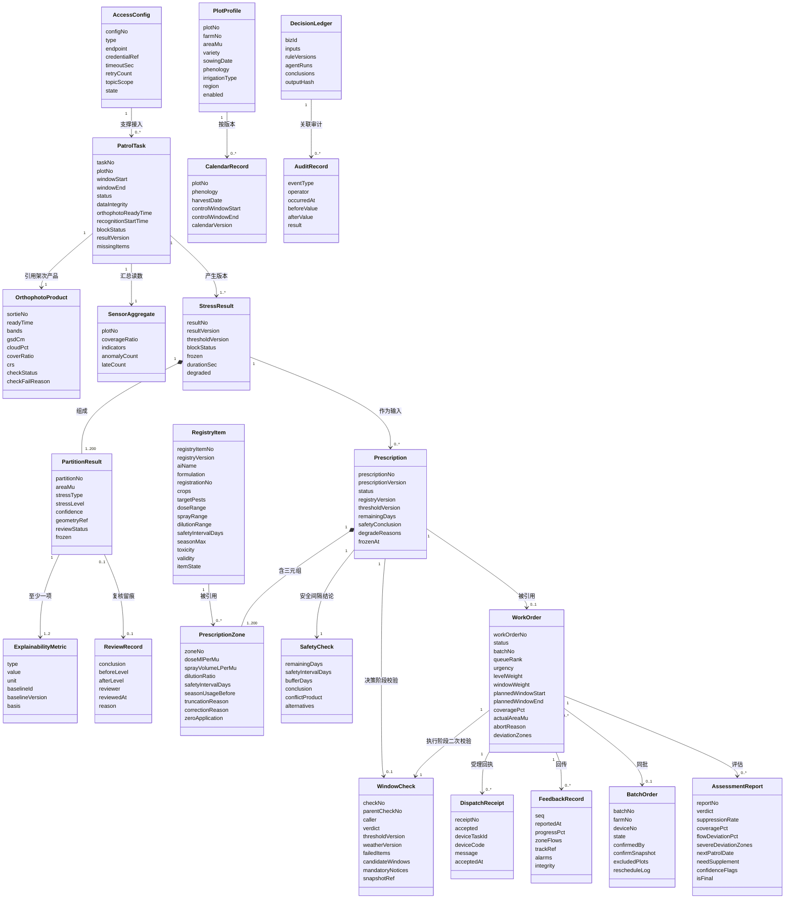

**领域对象与持久化映射**

| 领域对象 | 持久化形态 | 主键/唯一约束 | 更新策略 | 留存 |
|---------|-----------|--------------|---------|------|
| `PatrolTask` | 关系表 | `task_no` 唯一；同地块重叠未完成任务唯一约束 | 状态机条件更新（乐观锁 `row_version`） | 业务日志 180 天，审计 2 年 |
| `OrthophotoProduct` | 关系表 + OBS 元数据引用 | `sortie_no` 唯一 | 只插入，校验结论追加 | 2 年（元数据）；影像原件由 OSS 保留 |
| `StressResult` / `PartitionResult` | 关系表 + 分区几何 OBS GeoJSON | `result_no`，`(result_no, partition_no)` 唯一 | 冻结后只读；新版本追加 | ≥2 年 |
| `ReviewRecord` | 关系表（只追加） | `(result_no, partition_no, seq)` | 不可更新，终态后不可覆盖 | 2 年 |
| `RegistryItem` | 目录快照表（按版本分区） | `(registry_item_no, registry_version)` | 版本整体写入，不覆盖历史 | 长期（≥2 年） |
| `CalendarRecord` | 快照表 | `(plot_no, calendar_version)` | 追加，变更留痕 | 2 年 |
| `Prescription` / `PrescriptionZone` | 关系表 + 导出物（栅格/清单）OBS | `prescription_no`，`(prescription_no, version, zone_no)` | 通过即冻结，新版本追加 | 2 年 |
| `WindowCheck` | 校验快照表（只追加） | `check_no`；`parent_check_no` 索引 | 不可更新 | ≥2 年（规格 5.9.1-8） |
| `WorkOrder` | 关系表 | `work_order_no`；`batch_no + queue_rank` 唯一 | 状态机条件更新 | 2 年 |
| `DispatchReceipt` / `FeedbackRecord` | 关系表 + 轨迹 OBS | `(work_order_no, receipt_no)`、`(work_order_no, seq)` | 只追加 | 回传完整留存（4.2-4），≥2 年 |
| `BatchOrder` | 关系表 + 确认快照 JSON | `batch_no` | 状态复算，重排记录追加 | 2 年 |
| `AssessmentReport` | 关系表 + 报告文件 OBS | `report_no`；`(work_order_no, is_final)` 唯一过滤 | 追加；最终结论单条 | 2 年 |
| `DecisionLedger` | 只追加表 + 对象存储归档 | `biz_id + seq` | 不可更新、不可删除 | 2 年（WORM 归档） |
| `AuditRecord` | 只追加表 + 归档 | `audit_id`；`(event_type, biz_id)` 索引 | 不可更新 | 2 年（4.3-3/7/8） |

**索引与查询设计要点**

- 仪表盘首屏：按 `farm_no + stage + updated_at` 建覆盖索引，另建物化快照表 `dashboard_snapshot`（每 30 秒刷新），首屏只读物化表，保证 ≤3s。
- 批次队列：`batch_no + queue_rank` 唯一索引；紧迫度排序在内存完成（≤50 地块），结果落 `batch_item` 表并记录 `sort_key_chain`。
- 追溯：`task_no` / `prescription_no` / `work_order_no` / `batch_no` 四类编号均建反向索引，支持"从任一编号直达全链路"。
- 分区几何不入业务库内联存储，只存 OBS key + 面积 + 外包框，避免大字段拖慢查询；渲染时按需签名取用。
- 审计冷热分层：热数据（90 天）在库；冷数据按日打包写 OBS（`cipm-audit/{yyyy}/{mm}/{dd}.jsonl.gz`）并保留对象锁 ≥2 年，库内保留索引指针。

## 2.4 华为云部署与工程约束

### 2.4.1 标准化 SDK 封装（`cipm_sdk`）

四个 Agent 与编排器之间的调用统一收敛到一个内部 SDK，业务代码不直接发 HTTP。目的是：本地与云端共用同一份调用代码，仅切换运行时实现。

| SDK 模块 | 职责 | 关键 API | 双实现 |
|---------|------|---------|--------|
| `cipm_sdk.contracts` | Pydantic 契约模型（四类载荷、响应信封、错误码枚举） | `StressResultPayload`、`PrescriptionPayload`、`DispatchCommand`、`AssessmentPayload`、`Envelope[T]` | 唯一实现（本地/云端共用） |
| `cipm_sdk.runtime` | 运行时路由与生命周期 | `Runtime.current()`、`invoke_agent()`、`start_workflow()`、`resume_workflow()` | `LocalRuntime` / `AgentArtsRuntime` |
| `cipm_sdk.agent_client` | Agent 调用（超时、重试、熔断、Schema 校验） | `AgentClient.invoke(name, payload, timeout_s)`、`invoke_async()` | 共用，传输层不同 |
| `cipm_sdk.tools` | 确定性工具注册（规则、排序、窗口校验、目录查询） | `@tool(name, schema)`、`ToolRegistry.call()` | 共用；云端映射为 Workflow Tool 节点 |
| `cipm_sdk.observability` | traceId/agentRunId 传播、埋点、日志脱敏 | `with_trace()`、`emit_metric()`、`redact()` | 本地输出到文件；云端接 LTS/APM |
| `cipm_sdk.storage` | OSS/OBS 统一对象访问（签名地址、分段上传） | `ObjectStore.put/get/signed_url()` | 本地文件系统 / 华为云 OBS |
| `cipm_sdk.secrets` | 凭据解析（引用 → 明文只在内存） | `SecretProvider.resolve(ref)` | `.env` / CSMS |
| `cipm_sdk.mocking` | Mock 数据源与回放 | `MockRegistry`、`RecordReplay` | 仅本地/联调 |

**关键约束**：Agent 节点输出必须经 `contracts` 严格校验（`extra="forbid"`）后才进入下游；校验失败统一转 `CIPM-SYS-9001` 并记录原始输出到 `agentRuns.evidence`，不静默降级。

### 2.4.2 配置化外部接入、环境变量与密钥管理

规格 4.5-1 要求新增同类数据源不改业务规则，因此**全部外部接入走适配器 + 配置驱动**：适配器只实现协议与字段映射，业务规则（红线、安全间隔、紧迫度）不读配置。

| 环境变量 | 示例 | 作用 | 本地默认 |
|---------|------|------|---------|
| `CIPM_RUNTIME` | `local` / `agentarts` | 运行时开关 | `local` |
| `CIPM_MOCK` | `1` / `0` | 是否启用全量 Mock 数据源 | `1` |
| `CIPM_AGENTARTS_ENDPOINT` | `https://agentarts.cn-north-4.myhuaweicloud.com` | 编排平台地址 | 空 |
| `CIPM_AGENTARTS_PROJECT_ID` | `proj-xxxx` | 工作空间/项目 | 空 |
| `CIPM_LLM_ENDPOINT` / `CIPM_LLM_MODEL` | OpenAI 兼容端点 / 模型名 | Agent 推理后端 | 空（Mock 模式不调用） |
| `CIPM_DB_URL` | `sqlite:///./data/cipm.db` / `postgresql://...` | 业务库 | SQLite |
| `CIPM_OBS_ENDPOINT` / `CIPM_OBS_BUCKET` | `obs.cn-north-4.myhuaweicloud.com` / `cipm-prod` | 对象存储 | 本地 `./data/objects` |
| `CIPM_IMAGE_SOURCE` | `mock` / `obs` | 影像接入方式 | `mock` |
| `CIPM_MQTT_BROKER` / `CIPM_MQTT_TOPIC_PREFIX` | `ssl://...:8883` / `cipm/{farm}/{plot}` | 传感接入 | 内存伪 MQTT |
| `CIPM_DEVICE_REST_BASE` | `https://device.example/api` | 植保设备 | Mock 设备 |
| `CIPM_WEATHER_BASE` / `CIPM_CALENDAR_BASE` / `CIPM_REGISTRY_BASE` | 各服务基地址 | 气象/日历/目录 | Mock 服务 |
| `CIPM_KB_INDEX_URI` | `obs://cipm-kb/faiss/2026.11` | 知识库索引 | 本地 FAISS 目录 |
| `CIPM_SECRET_PROVIDER` | `env` / `csms` | 凭据来源 | `env` |
| `CIPM_AUDIT_RETENTION_DAYS` | `730` | 审计留存天数（≥730） | `730` |
| `CIPM_TRACE_EXPORT` | `file` / `apm` | 追踪导出 | `file` |

**密钥管理规则**：配置文件与数据库只允许出现 `cred://<alias>` 形式的凭据引用；`SecretProvider` 在内存中解析并只在出站请求头注入，日志统一经 `redact()` 过滤（屏蔽 `authorization`、`x-obs-*`、签名地址 query、设备 api key）。前端仅展示掩码与最后修改时间（5.7.1-3、4.3-1/6）。签名地址有效期 ≤24 小时且不落日志（4.3-2、6.2-2）。

### 2.4.3 可观测与审计

| 能力 | 实现 | 落地要求 |
|------|------|---------|
| 链路追踪 | `traceId` 由中台入口生成（W3C traceparent），透传至 Workflow 与四 Agent；`agentRunId` 由编排器返回并回填到每个节点日志 | 任一业务编号可检索全链路日志（4.4-1） |
| 决策账本 | 每次 Agent 决策写入：输入数据版本、阈值/目录/基线版本、模型与提示版本、输出结论、置信度、输出哈希 | 支持回放与复算（4.4-2） |
| 校验快照 | 每次窗口校验写全量输入与结论（逐日温度、逐时风速湿度、阈值版本、失败项、候选窗口） | ≥2 年，决策/执行两份并存（4.2-8、5.9.1-8） |
| 审计 | 处方修改、降级、拒绝、复核、阻断解除、批量确认、红线豁免尝试、目录/阈值变更（双人确认）全部落审计，含操作人/时间/前后值/结果 | ≥2 年，只追加，WORM 归档（4.3-3/7/8） |
| 五项运行指标 | 巡田成功率、处方审核通过率、条件阻断率、作业下发成功率、评估完成率（按农场/日粒度） | 仪表盘可见，支持趋势（4.4-3） |
| 告警 | 数据缺失、识别失败、设备不可达、作业中断、校验服务不可用 → 5 分钟内告警 | 通知适配器 + 告警去重（4.4-4） |
| 日志规范 | 结构化 JSON（`traceId, agentRunId, bizId, module, event, durationMs, result`）；UTF-8；业务日志 ≥180 天 | 禁止打印处方明文密钥与完整签名串 |

### 2.4.4 DFX 指标落地手段

| DFX 指标 | 落地手段 | 预算分解 | 验收方式 |
|---------|---------|---------|---------|
| 单架次识别 ≤10 分钟（T0=产品就绪） | 异步任务 + 阶段预算 + 分块并行 + 断点续算 | 下载/校验 120s、波段读取与分区化 240s、指标计算 120s、阈值判定与解释 90s、组装与冻结 30s（合计 ≤600s） | 以 `readyTime` 到 `frozen` 计时；500 张/2GB 用例 |
| 处方图 ≤3 分钟（≤200 分区） | 规则批处理 + 目录/日历预取 + 纯函数判定 | 取数预热 20s、逐分区规则 40s、窗口校验 2s、组装 30s（含 LLM 叙述 ≤60s） | 200 分区压测 |
| 下发到回执 ≤5 秒 | 连接池 + 预序列化 + 重试 3 次（首次 2s 超时）+ 幂等 | 指令组装 200ms、网络 1.5s、设备处理 2s | 设备 Mock 与真机各一轮 |
| 窗口校验 ≤2 秒 | 气象按地块/小时缓存 5 分钟 + 阈值内存 + 纯计算 | 取数命中 50ms（未命中 800ms）、判定 20ms | 单次校验 P95 ≤2s |
| 批次 50 地块 ≤30 秒 | 单次批量查询日历 + 内存排序 + 批量落库 | 查询 8s、排序 <100ms、落库 3s | 50 地块压测 |
| 仪表盘首屏 ≤3 秒 / 刷新 ≤30 秒 | 物化快照表 + 只读接口 + 前端缓存 | 查询 ≤800ms、渲染 ≤1.5s | Lighthouse/接口 P95 |
| 传感可见 ≤60 秒 | MQTT QoS1 + 消费批量写 + 去重 + 快照刷新 | 端到端排队 ≤5s、写入 ≤1s、快照 30s | 埋点实测 |
| 可用性 99.5% / 恢复 ≤30 分钟 | 无状态服务多副本 + 状态机持久化 + 幂等重放 + 定时备份 | —— | 故障演练：杀实例、断中间件 |
| 下发不重复 | 幂等表唯一约束 + 设备侧 `workOrderNo` 去重 | —— | 并发重复请求测试 |
| 失败可断点重试 | Workflow checkpoint + 阶段产物落库 | —— | 在第 5 步注入失败后重试 |
| 双人确认与不可豁免 | 阈值版本变更 API 强制两个不同角色签名；无豁免接口 | —— | 单角色请求被拒（`CIPM-RULE-5004`） |

### 2.4.5 本地可运行（Mock）与云端 Agent Runtime 的差异开关

| 维度 | 本地模式（`CIPM_RUNTIME=local`,`CIPM_MOCK=1`） | 云端模式（`agentarts`） | 切换方式 |
|------|---------------------------------------------|------------------------|---------|
| Agent 执行 | 进程内 `LocalRuntime` 顺序/条件执行，工具为纯函数 | AgentArts Workflow 节点 + Agent Runtime 托管 | `Runtime.current()` 工厂 |
| 模型 | `MockLLM`（模板化输出，可回放固定结果） | 盘古/第三方模型（OpenAI 兼容端点） | `CIPM_LLM_*` |
| 人工节点 | 中台待办表 + Streamlit 操作，进程内事件唤醒 | AgentArts 人工任务节点 + `resume` 回调 | `HumanGateway` 接口 |
| 存储 | SQLite + 本地对象目录 | RDS for PostgreSQL / GaussDB + OBS | `Repository`/`ObjectStore` 工厂 |
| 消息 | 进程内事件总线 + 文件队列 | DMS for Kafka / MQTT 托管 | `EventBus` 工厂 |
| 影像 | `MockImageSource`（内置样例 NDVI 栅格与元数据） | OSS/OBS 签名地址 + 容器化解析服务 | `ImageSource` 工厂 |
| 密钥 | `.env` + 内存解析 | CSMS 凭据引用 | `CIPM_SECRET_PROVIDER` |
| 追踪 | JSONL 文件 + 控制台 | APM/LTS | `CIPM_TRACE_EXPORT` |
| DFX 规模 | 单机，≤10 地块 / ≤50 分区演示数据集 | 500 地块，容器多副本 | 配置 + 部署清单 |

**硬性要求**：Mock 模式下必须能完整走通"巡田→阻断→复核→处方→降级→审核→批次→下发→回传→评估"全链路，**零外部依赖**（不联网、不装数据库、不配密钥），单命令启动。

### 2.4.6 推荐仓库结构

```text
cotton_ipm_mas/
├─ apps/
│  ├─ console/            # Streamlit 四阶段视图、批次队列、待办、复核/审核操作
│  ├─ platform_api/       # FastAPI 业务中台（状态机、单证、权限、快照查询）
│  └─ window_service/     # M06 独立校验服务（可被决策/执行两侧调用）
├─ agents/
│  ├─ patrol/             # 巡检Agent：解析→指标→判定→解释→阻断建议
│  ├─ decision/           # 决策Agent：选药→三元组→降级/拒绝→组装
│  ├─ execution/          # 执行Agent：指令模板→幂等下发→回执与跟踪→批次排序
│  └─ assessment/         # 评估Agent：四项指标→达标判定→建议→回写
├─ domain/                # 领域模型、状态机、规则引擎、排序器（纯 Python，无 IO）
├─ adapters/              # image_oss / sensor_mqtt / device_rest / weather / calendar / registry / notify
├─ knowledge/             # FAISS 索引构建、检索、版本管理、目录同步
├─ sdk/                   # cipm_sdk（contracts/runtime/agent_client/tools/observability/storage/secrets）
├─ mock/                  # Mock 数据生成器、Mock 服务、固定回放样本
├─ workflows/             # AgentArts Workflow 定义（YAML/JSON）与本地等价编排图
├─ ops/                   # Dockerfile、compose、环境变量样例、部署与可观测配置
└─ tests/                 # 单元（规则/状态机/排序）、契约、端到端（Mock 全链路）
```

### 2.4.7 部署形态

- **本地**：`docker compose`（可选）或直接 `streamlit run` + `uvicorn` 双进程 + Mock 数据；数据目录挂载 `./data`。
- **云端**：四 Agent 与 Workflow 部署到 Agent Runtime（容器镜像包含 `sdk` 与 `domain`，禁用外网直连，仅通过 VPC 访问 OBS/MQTT/RDS）；业务中台与窗口校验服务独立容器多副本；前端 Streamlit 容器置于内网 ELB 之后；OBS 分桶（影像、几何、报告、审计归档四桶，按生命周期策略转归档存储）。
- **发布与回滚**：契约先行灰度——先发布 `sdk/contracts` 兼容版本，再发布 Agent，最后发布中台；Workflow 定义与阈值版本同批次打标，回滚只回滚代码不回滚阈值历史（阈值只增版本）。

## 2.5 关键设计决策与风险

| 编号 | 决策 | 理由 | 代价/风险 | 缓解 |
|------|------|------|----------|------|
| D1 | 安全红线、排序、状态机全部用确定性代码，LLM 不参与判定 | 规格要求"不可豁免、可复现、可审计"；LLM 无法保证数值边界 | 灵活性下降 | 规则参数全部版本化，专家可调阈值而非改代码 |
| D2 | 作业窗口约束独立为服务，决策/执行共用同一实现 | 避免双重实现漂移（5.9.1-1）；快照统一 | 多一次网络调用 | 本地进程内直调 + 云端 VPC 内调用，2s 预算充足 |
| D3 | 紧迫度与优先级在内存计算、结果落链 | 50 地块排序需确定且可复现，落库只存结果与比较链 | 大批量需扩内存 | 上限 20 地块/批次，天然有界 |
| D4 | 分区几何只存 OBS 引用 | 避免大字段拖慢查询；便于按权限签名取用 | 渲染依赖对象存储可用性 | 仪表盘渲染失败降级为清单（5.6.3-3） |
| D5 | 复配在 V1.0 只拦截不自动处理 | 规格 1.4-12 明确边界 | 现场可能确有复配需求 | 专家手工组合 + 人工处方流程；V2 再评估 |
| D6 | 阻断采用"任务级全量阻断"而非分区隔离 | 规格 5.2.1-6 明确禁止部分处方 | 一个低置信分区影响整任务 | 复核 SLA（48h 升级）+ 待办置顶 |
| D7 | 本地/云端双运行时共用契约 | 保证 Mock 阶段产出的代码可直接上云 | 需维护两套 Runtime | 契约测试覆盖两实现；CI 双跑 |
| R1 | Python 3.14 与地理/向量库二进制兼容性不确定 | 环境实测版本较新 | `rasterio`/`gdal`/`faiss` 可能无 wheel | 解析与向量检索容器化（固定 3.11 运行时）；核心服务纯 Python 依赖 |
| R2 | 外部服务（影像/气象/日历/目录/设备）上线时间不确定 | 项目依赖 7 个外部系统 | 阻塞联调 | Mock 优先 + 适配器契约冻结 + 回放样本 |
| R3 | 气象预报精度导致执行阶段频繁不通过 | 红线严格且以执行为准 | 批次下发成功率下降 | 候选窗口提前 72h 规划 + 临界波动提示 + 失败转待重新排期 |
| R4 | LLM 输出不稳定影响 Agent 节点可用性 | Agent 节点需输出严格 JSON | 解析失败风险 | 结构化输出约束 + 校验失败重试 1 次 + 兜底模板（仅叙述字段，不含判定） |