# 棉田植保决策多智能体系统 需求规格说明书

# **1. 组件定位**

## **1.1 核心职责**

本组件负责解析棉田低空多光谱正射影像与田间传感数据、生成绑定新疆现行登记用药目录的变量施药处方并驱动植保设备作业，实现"巡田—处方—作业—评估"的业务闭环。

## **1.2 核心输入**

1. **正射影像产品信息**：来源于无人机影像平台，包含架次编号、正射影像产品访问地址、拼接完成标识、辐射定标完成标识、几何校正完成标识、投影坐标系、拍摄时间、覆盖地块、波段清单、地面分辨率与云量。
2. **田间传感器数据**：来源于田间传感器网关（MQTT 订阅），包含土壤温湿度、空气温湿度、光照强度、风速风向、降雨量与虫情计数等时序读数。
3. **地块级气象预报**：来源于第三方气象服务，包含地块未来 24/48/72 小时的温度、降水概率、降水量、风速与空气湿度；用于作业窗口约束校验的预报必须包含逐日最低气温、逐日平均气温、逐时风速与逐时相对湿度。
4. **棉花种植档案**：来源于农场维护的种植记录，包含品种、播种日期、当前物候期、种植密度、灌溉方式（滴灌棉田模式或非滴灌模式）、地域分区（南疆或北疆）与历史产量。
5. **农事日历数据**：来源于农事日历服务，包含地块当前物候期、预计采收日期、关键农事窗口（打顶、灌溉、采收）及其版本。
6. **地块历史用药记录**：来源于农场用药台账，包含历次施药的药剂品类、有效成分、施药日期、施药面积、实际用量与执行作业单号。
7. **登记用药目录数据**：来源于新疆现行农药登记目录服务，包含登记作物含棉花的目录条目、制剂亩用量区间、推荐喷液量或稀释浓度区间、安全间隔期、每季最多使用次数与有效期限。
8. **用户操作指令**：来源于农户、农场管理者、农技专家，包含发起巡田任务、复核胁迫判定、审核与调整处方、确认下发作业（单地块或批量）、发起效果复查、查看报告。
9. **植保设备作业回传**：来源于植保设备，包含受理回执、实际喷幅与流量、作业轨迹、作业面积、作业告警与完成状态。
10. **农艺知识检索请求**：来源于决策过程，用于检索防治阈值、药剂使用规范、历史处方、历史胁迫样本与登记用药目录条目。

## **1.3 核心输出**

1. **胁迫识别结果**：输出至仪表盘与决策环节，包含胁迫区域空间范围、胁迫类型、胁迫等级、置信度、至少一项可解释原始指标、复核状态与下游阻断状态。
2. **变量施药处方图**：输出至仪表盘与执行环节，包含管理分区清单、各分区处方三元组（药剂品类 + 制剂亩用量 + 喷液量或稀释浓度）、绑定的登记用药目录项版本、安全间隔期校验结论、作业窗口校验结论、作业优先级与安全约束；处方不得仅以胁迫等级或施药量系数形式输出。
3. **作业指令**：输出至植保设备（REST API），包含作业地块、分区处方三元组、作业时间窗、飞行高度与速度约束、安全间隔要求、作业窗口校验结论编号、强制提示项与批次编号（批量作业时）。
4. **批量作业批次与排序结果**：输出至仪表盘与执行环节，包含批次编号、地块与作业单清单、紧迫度分值、排序位次与批次状态。
5. **作业效果评估报告**：输出至农户与农场管理者，包含作业覆盖率与偏差、胁迫缓解程度、达标结论与下一轮巡田建议。
6. **仪表盘视图与告警**：输出至前端页面，包含四阶段状态、复核阻断提示、批次队列、进度、异常提示与待办事项。
7. **业务事件**：输出至消息通知服务与下游系统，包含巡田完成、识别结果阻断、复核恢复、处方审核通过、作业窗口校验不通过、作业下发、作业完成、评估完成、批次组建、批次完成。

## **1.4 职责边界**

1. 本组件不负责无人机飞行控制、航线规划与空域申报，相关能力由无人机作业平台承担。
2. 本组件不负责影像原始帧处理。本系统假定输入为已拼接、已定标的无人机多光谱正射影像产品，原始帧拼接、辐射定标、几何校正与空三解算均由无人机影像平台完成。
3. 本组件不负责农药采购、库存管理、包装废弃物回收与农药经营许可管理。
4. 本组件不负责植保设备的硬件控制逻辑、固件升级与故障维修，仅通过设备对外接口下发作业指令。
5. 本组件不负责气象数值预报的生产，仅消费第三方气象服务提供的预报结果。
6. 本组件不负责农药登记目录的行政审批、登记证核发与目录发布，仅消费目录服务提供的现行有效条目。
7. 本组件不负责农事日历的编制与农事作业执行，仅消费农事日历服务提供的物候期与预计采收日期。
8. 本组件不负责农残检测、绿色认证与政府监管数据报送。
9. 本组件不负责施肥、灌溉、打顶等非植保农事环节的决策与执行。
10. 本组件不直接面向终端消费者提供溯源查询服务，仅向下游溯源系统提供作业事件。
11. 本组件不对无人机影像采集设备的成像质量、飞行参数与曝光设置负责，仅对正射影像产品就绪后的解析与判定负责。
12. V1.0 版本边界：本组件仅支持单剂处方（同一分区内药剂品类仅为一个登记用药目录项）的生成与下发。若业务涉及多剂复配，系统必须拦截并转人工专家复核，由专家手动组合，安全间隔期取组合中所有药剂安全间隔期的最大值执行；V1.0 不得自动生成、自动校验通过或自动下发复配处方。

# **2. 领域术语**

**巡检Agent**
: 巡检Agent是承担多光谱正射影像解析、胁迫区域识别、胁迫等级判定与可解释指标输出的业务执行者，对应"巡田"阶段。
: 备注：文档中也称"巡田Agent"。

**决策Agent**
: 决策Agent是承担胁迫识别结果、棉花生长模型、农事日历与气象预报融合，并生成处方三元组、完成合规校验的业务执行者。

**执行Agent**
: 执行Agent是承担处方到设备作业指令转换、单地块与多地块批量队列调度、指令下发与执行状态跟踪的业务执行者。

**评估Agent**
: 评估Agent是承担作业后效果回溯、偏差分析与闭环改进建议生成的业务执行者。

**多光谱影像**
: 多光谱影像是由无人机搭载多光谱相机在同一架次内采集的、至少包含近红外与红光波段的棉田影像集合。

**正射影像产品**
: 正射影像产品是无人机影像平台已完成原始帧拼接、辐射定标与几何校正、可直接用于业务判定的成品影像，系统以"就绪"状态作为识别计时的起点。
: 备注：系统不消费原始帧，也不感知拼接与定标过程。

**巡田任务**
: 巡田任务是为指定地块在指定时间窗内完成一次正射影像接入与胁迫识别的业务任务。

**胁迫**
: 胁迫是由病虫害、缺素、干旱、渍害等非正常因素引起的棉株生理或形态异常状态。

**胁迫等级**
: 胁迫等级是对胁迫严重程度的分级判定，取值必须为无、轻度、中度、重度四级之一。

**可解释原始指标**
: 可解释原始指标是支撑胁迫等级判定的、可被业务人员直接理解的原始量化依据，取值必须至少包含 NDVI 偏离值或虫口密度推算值之一。

**阻断**
: 阻断是当识别结果存在待复核分区时，系统暂停下游处方生成的业务控制状态，阻断期间不得生成任何处方。

**管理分区**
: 管理分区是按棉田空间划分的、可独立设置处方三元组的最小作业单元。

**处方图**
: 处方图是以管理分区为单元、标注处方三元组与合规校验结论、用于指导变量施药的作业指导图。

**处方三元组**
: 处方三元组是决策Agent 对每个管理分区必须同时给出的三项内容，即药剂品类、制剂亩用量与喷液量或稀释浓度，三项缺一不可。

**制剂亩用量**
: 制剂亩用量是每单位面积施用的农药制剂商品量，单位为毫升/亩，必须落在登记用药目录项标注的区间内。

**喷液量**
: 喷液量是每单位面积施用的药液总量，单位为升/亩，用于指导设备流量设定。

**稀释浓度**
: 稀释浓度是药液中药剂与水的配比倍数，单位为倍液，用于指导现场配药。

**登记用药目录项**
: 登记用药目录项是新疆现行农药登记目录中登记作物含棉花的一条有效条目，规定药剂品类、防治对象、制剂亩用量区间、推荐喷液量或稀释浓度、安全间隔期与每季最多使用次数。

**安全间隔期**
: 安全间隔期是自施药完成之日起至允许采收之日止必须间隔的最少天数，取值以登记用药目录项的规定为准。

**采收剩余天数**
: 采收剩余天数是拟作业完成日期至农事日历预计采收日期之间的自然日天数。

**单剂处方**
: 单剂处方是同一管理分区内仅含一个药剂品类的处方，是 V1.0 唯一允许自动生成与下发的处方形态。

**复配处方**
: 复配处方是同一管理分区内同时使用两种及以上药剂品类的处方。V1.0 不支持自动生成与自动下发，检测到复配需求时必须拦截并转人工专家复核，由专家手动组合，安全间隔期按组合中所有药剂的最长值执行。

**农事日历**
: 农事日历是地块按时间顺序编排的物候期、农事活动与预计采收日期的业务记录，是物候期窗口与安全间隔校验的必需输入。

**紧迫度**
: 紧迫度是批量作业队列的排序分值，等于胁迫等级权重与物候期窗口权重的乘积，分值越高越优先下发。

**批量作业批次**
: 批量作业批次是同一农场、同一设备下多个地块作业单按紧迫度排序后形成的调度集合，由批次编号唯一标识。

**新疆作业窗口约束**
: 新疆作业窗口约束是喷药前后气温、作业时段风速、南疆午后湿度与滴灌棉田喷液量四类硬性校验规则的集合，由独立校验模块在决策前与下发前双重执行。

**滴灌棉田模式**
: 滴灌棉田模式是地块灌溉方式为滴灌的属性取值，该取值直接影响制剂亩用量与喷液量的取值区间。

**变量施药**
: 变量施药是按照管理分区的处方量差异化调节喷施流量的作业方式。

**作业架次**
: 作业架次是一次无人机影像采集任务，由架次编号唯一标识，并与地块、采集时间绑定。

**作业单**
: 作业单是一次植保设备作业的业务单据，是贯穿"处方—下发—执行—评估"的业务主键。

**闭环评估**
: 闭环评估是将作业回传数据与作业前胁迫基线进行对比、量化作业效果并反馈到下一轮决策的过程。

**棉花生长模型**
: 棉花生长模型是描述棉花在不同物候期生长指标与胁迫响应关系的业务模型。

**物候期**
: 物候期是棉花生长发育的阶段划分，取值必须为苗期、蕾期、花铃期、吐絮期之一。

**防治阈值**
: 防治阈值是判定是否需要采取药剂防治措施的胁迫指标临界值，由农技专家维护。

# **3. 角色与边界**

## **3.1 核心角色**

- **农户**：发起巡田与作业申请，查看本地块处方图与评估报告，确认小地块作业调整。
- **农场管理者**：审核处方图、批准单地块与批量作业下发、维护地块与设备档案、确认作业窗口红线阈值变更、查看全场四阶段总览与批次队列。
- **农技专家**：维护防治阈值与药液配比规则，复核重度胁迫与阻断分区，确认降级处方，提出作业窗口红线阈值变更。
- **系统管理员**：维护数据接入配置、账号与权限、运行告警处理。

## **3.2 外部系统**

- **无人机影像平台**：提供正射影像产品访问地址、完成标识、架次编号与采集元数据；接收作业后复查影像采集请求。
- **田间传感器网关**：通过 MQTT topic 推送田间环境与虫情时序读数。
- **气象预报服务**：提供地块级未来 72 小时气象预报，包含逐日最低气温、日均气温、逐时风速与相对湿度。
- **农事日历服务**：提供地块物候期、预计采收日期与关键农事窗口。
- **农药登记目录服务**：提供新疆现行登记用药目录中棉花相关条目及其版本与有效期。
- **植保设备**：通过 REST API 接收作业指令并回传受理回执、作业进度与完成数据。
- **农业知识库**：提供防治阈值、药剂使用规范、历史处方与历史胁迫样本的检索结果。
- **消息通知服务**：向用户推送阶段完成、复核阻断、待办事项与异常告警。

## **3.3 交互上下文**

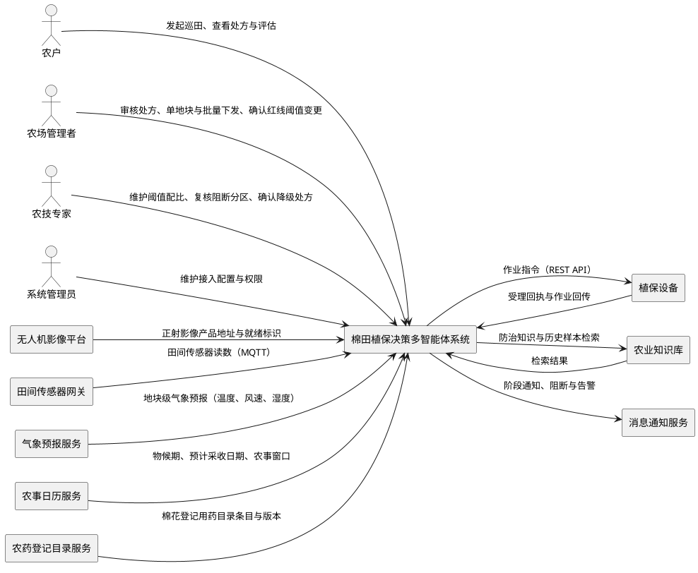

# **4. DFX约束**

## **4.1 性能**

1. 单架次正射影像解析与胁迫识别必须在 10 分钟内完成。本项指标的计时起点为"正射影像产品就绪"时刻，即影像平台已完成拼接、辐射定标与几何校正并交付可访问地址的时刻；影像平台侧的处理耗时不计入本项指标。输入规模上限为 500 张影像、总计 2 GB。
2. 单张地块处方图（不超过 200 个管理分区）生成必须在 3 分钟内完成。
3. 作业指令下发到植保设备并取得受理回执的耗时必须不超过 5 秒。
4. 单次新疆作业窗口约束校验（含气象取数与红线判定）必须在 2 秒内完成。
5. 不超过 50 个地块的批量队列紧迫度计算、排序与批次生成必须在 30 秒内完成。
6. 仪表盘首屏加载必须在 3 秒内完成，四阶段状态刷新间隔必须不超过 30 秒。
7. 系统必须支持不少于 50 个农场、500 个地块的并行接入，单农场同时进行的巡田任务上限为 5 个。
8. 传感器读数从产生到在仪表盘可见的延迟必须不超过 60 秒。

## **4.2 可靠性**

1. 系统月度可用性必须不低于 99.5%。
2. 单个智能体环节失败时，系统必须保留已完成阶段的成果，并允许从失败阶段重试，不得要求用户从头发起全流程。
3. 作业指令下发必须保证同一作业单不重复下发；重复请求必须返回原受理结果。
4. 作业回传数据必须完整留存，不得因评估失败而丢弃。
5. 系统故障恢复时间必须不超过 30 分钟，恢复后作业单状态必须与故障前最后确认状态一致。
6. 影像与传感器数据必须保留原始副本，处理链路上的中间结果丢失不影响原始数据可用性。
7. 新疆作业窗口约束校验必须采用"安全默认为不通过"策略：校验所需的气象数据、红线阈值版本或地块属性任一不可用时，必须判定为不通过并阻止下发，不得放行。
8. 决策阶段与执行阶段的作业窗口校验结论不一致时，必须以执行阶段结论为准，且两次校验快照必须同时保留。
9. 识别结果处于阻断状态时，系统必须保证不产生任何引用该结果的有效处方；恢复后重新生成处方不得复用阻断期间的中间计算结果。

## **4.3 安全性**

1. 所有外部数据接入必须使用系统分配的凭据，禁止在界面或日志中明文展示设备 API 密钥与影像访问密钥。
2. 正射影像产品地址访问必须使用带有效期的签名地址，签名有效期必须不超过 24 小时。
3. 作业指令下发必须经过农场管理者二次确认，并记录操作人、操作时间、指令内容与确认结果，审计记录保留不少于 2 年。批量作业的一次确认必须覆盖批次内全部地块，确认清单必须逐地块留痕。
4. 系统必须按角色实施最小权限控制：农户仅可访问本地块数据，农场管理者仅可访问本农场数据，农技专家可访问授权区域内数据。
5. 农药名称、制剂亩用量、喷液量与安全间隔期属于关键业务信息，任何修改必须留痕并可追溯修改前后值。
6. 敏感数据传输必须使用加密通道，存储的认证凭据必须加密保存。
7. 登记用药目录条目、作业窗口红线阈值与安全间隔期规则的任何变更必须双人确认（农技专家提出、农场管理者确认），并记录变更前后值、变更人与时间，审计记录保留不少于 2 年。
8. 处方降级、拒绝下发、作业窗口校验不通过、人工复核结论与阻断解除操作必须全量审计，审计记录保留不少于 2 年。

## **4.4 可维护性**

1. 每个巡田任务、作业单、批量作业批次必须拥有唯一业务编号，并在全链路日志中贯穿，支持按编号回溯。
2. 智能体的每次决策必须留存可回放的决策依据，包含输入数据版本、使用的阈值版本与目录版本、生成结论与置信度。
3. 系统必须提供巡田成功率、处方审核通过率、条件阻断率、作业下发成功率、评估完成率五项运行指标。
4. 关键异常（数据缺失、识别失败、设备不可达、作业中断、校验服务不可用）必须在 5 分钟内触发告警。
5. 业务日志保留不少于 180 天，审计日志保留不少于 2 年。
6. 每次新疆作业窗口约束校验必须留存可回放的校验快照，包含气象数据版本与发布时间、红线阈值版本、输入的地块属性、校验结论与不通过项清单。
7. 批量队列的紧迫度计算过程必须可回溯到胁迫等级、物候期窗口权重与排序比较链。

## **4.5 兼容性**

1. 外部数据接入必须通过可配置的接入配置项完成，新增同类设备或数据源不得要求修改业务规则。
2. 植保设备接口的新增字段必须向后兼容，旧版本设备未提供的字段必须按"未知"处理，不得导致作业单失败。
3. 处方图必须支持导出为通用栅格处方格式与分区清单格式两种形态，两种形态均必须完整包含处方三元组，以适配不同品牌植保设备。
4. 已下发作业单引用的处方版本必须冻结，处方后续修订不得影响已在执行或已完成的作业单。
5. 登记用药目录版本升级后，已下发作业单引用的目录条目版本必须冻结；目录条目停用不得影响在执行作业单，但不得再用于新处方。
6. 农事日历中预计采收日期变更后，系统必须对受影响且未下发的处方重新执行安全间隔校验；已下发作业单不受影响，但必须提示管理者复核。
# **5. 核心能力**

## **5.1 巡田任务与数据接入**

### **5.1.1 业务规则**

1. **任务发起规则**：农户或农场管理者必须为指定地块在指定时间窗内发起巡田任务，任务必须关联唯一地块编号且时间窗不得晚于当前时间 7 天。
   a. 验收条件：用户为本地块发起巡田任务且时间窗合法 → 系统创建任务并返回任务编号与"待接入数据"状态。
2. **地块权限规则**：发起人必须对目标地块具备访问权限，越权发起必须被拒绝。
   a. 验收条件：用户对非授权地块发起巡田 → 系统拒绝并提示无地块权限。
3. **正射影像产品匹配规则**：系统必须按地块编号与时间窗匹配无人机架次，匹配到的架次必须已交付正射影像产品，且该产品覆盖该地块全部面积、云量不超过 10%、地面分辨率不高于 5 厘米。
   a. 验收条件：架次仅有原始影像、正射影像产品就绪标识为假 → 该架次不得作为任务数据源，系统提示"正射影像产品未就绪"。
   b. 验收条件：架次仅覆盖地块部分面积 → 该架次不得作为任务数据源，系统提示影像覆盖不足。
4. **正射影像就绪校验规则**：系统必须校验正射影像产品的完整性元数据，包含拼接完成标识、辐射定标完成标识、几何校正完成标识、投影坐标系、波段清单、覆盖范围与云量；任一标识为假或元数据缺失必须判定为未就绪。
   a. 验收条件：产品缺少几何校正完成标识 → 系统判定未就绪，任务保持"待接入数据"状态。
   b. 验收条件：产品元数据全部通过 → 系统记录"正射影像就绪时间"，该时间作为 10 分钟识别时效的计时起点。
5. **传感数据完整性规则**：任务时间窗前后的传感器读数必须覆盖任务时间窗内不少于 90% 的时段，且每个地块至少包含土壤湿度、空气温度、风速三类指标。
   a. 验收条件：时间窗内读数覆盖率低于 90% → 系统将数据完整性标记为不足并提示补采。
6. **数据就绪规则**：正射影像产品校验通过且传感器数据完成接入后，系统必须自动启动胁迫识别，无需用户再次触达。
   a. 验收条件：正射影像与传感数据校验全部通过 → 任务状态自动流转为"识别中"，并记录识别开始时间。
7. **重试规则**：数据接入失败时系统必须允许在不重建任务的前提下重新接入，最多自动重试 3 次。
   a. 验收条件：影像地址首次拉取失败 → 系统自动重试，3 次均失败后将任务置为"数据接入失败"并通知发起人。
8. **禁止项**：禁止在数据未通过校验的情况下进入胁迫识别环节。
   a. 验收条件：存在缺失波段的影像提交识别 → 系统拦截并返回校验失败原因。
9. **禁止项**：禁止在本组件内对原始帧执行拼接、定标或校正，禁止以原始帧作为识别输入。
   a. 验收条件：输入仅为原始帧目录 → 系统拒绝识别并提示等待正射影像产品就绪。

### **5.1.2 交互流程**

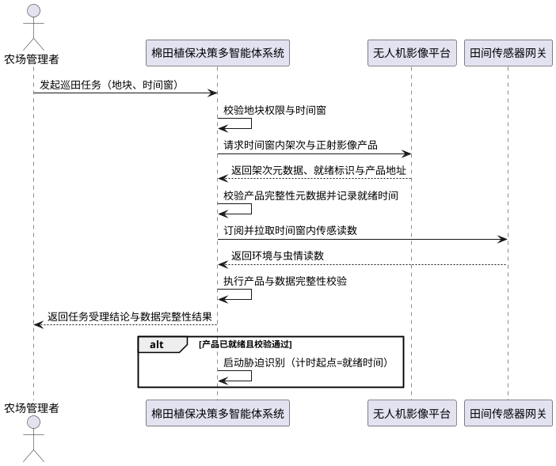

### **5.1.3 异常场景**

1. **正射影像产品未就绪**
   a. 触发条件：架次已采集但拼接、定标或校正尚未完成，就绪标识为假。
   b. 系统行为：任务保持"待接入数据"，不进入识别，不计入识别时效；按配置周期轮询就绪状态。
   c. 用户感知：提示"正射影像产品处理中，就绪后将自动开始识别"。
2. **影像地址失效**
   a. 触发条件：签名地址过期或对象已被清理。
   b. 系统行为：自动向影像平台申请新地址并重试，最多重试 3 次；失败则保留任务并标记数据接入失败。
   c. 用户感知：提示"影像获取失败，请检查架次是否已归档"，并展示失败架次编号。
3. **传感器数据断点**
   a. 触发条件：时间窗内读数覆盖不足 90% 或指标缺失。
   b. 系统行为：继续完成影像识别，并在胁迫结果中标注"环境数据不完整，施药量结论需人工确认"。
   c. 用户感知：任务详情展示数据完整性不足项，处方图标注待确认标识。
4. **地块重复任务**
   a. 触发条件：同一地块存在时间窗重叠且未完成的巡田任务。
   b. 系统行为：拒绝创建新任务，返回已存在任务的编号与状态。
   c. 用户感知：提示"该地块已有进行中的巡田任务"，并提供跳转入口。
5. **架次覆盖不足**
   a. 触发条件：匹配架次的地块覆盖率低于 100%。
   b. 系统行为：记录未覆盖区域，限制识别结果只能覆盖已有影像范围，禁止输出全地块处方。
   c. 用户感知：提示"影像覆盖不足，未覆盖区域不生成处方"。

## **5.2 病虫害胁迫识别**

### **5.2.1 业务规则**

1. **波段要求规则**：参与识别的正射影像产品必须至少包含近红外、红光两个波段，地面分辨率必须不高于 5 厘米。
   a. 验收条件：影像缺少近红外波段 → 系统拒绝识别并提示波段不满足要求。
2. **区域划分规则**：胁迫识别结果必须以管理分区为最小粒度输出，每个分区必须给出唯一胁迫类型与胁迫等级。
   a. 验收条件：识别完成 → 每个管理分区均输出胁迫类型、等级、置信度、可解释原始指标与面积。
3. **等级判定规则**：胁迫等级必须依据农技专家维护的防治阈值判定，等级取值仅允许无、轻度、中度、重度。
   a. 验收条件：分区指标低于轻度阈值 → 该分区胁迫等级判定为无。
4. **可解释指标规则**：每个分区在输出胁迫等级时，必须至少附带一项可解释原始指标，取值为 NDVI 偏离值或虫口密度推算值之一，并必须记录该指标的参考基线、基线版本与计算依据。
   a. 验收条件：虫害类分区 → 输出虫口密度推算值（头/百株）及其推算依据。
   b. 验收条件：病害、缺素或干旱类分区 → 输出 NDVI 偏离值及所比对的同物候期健康参考基线版本。
   c. 验收条件：两项指标均无法计算 → 系统必须将该分区置信度置为低于 0.7 并强制标记待复核。
5. **置信度规则**：置信度低于 0.7 的分区必须标记为"待复核"，不得直接进入处方计算。
   a. 验收条件：分区置信度为 0.62 → 该分区标记待复核并进入人工复核队列。
6. **阻断规则**：同一巡田任务下存在任一分区处于"待复核"状态时，系统必须对该任务的处方生成执行整体阻断，将任务置为"待复核（阻断）"，不得生成部分分区处方，也不得向下游决策环节输出可用识别结果。
   a. 验收条件：某任务 20 个分区中 1 个置信度 0.65 → 全部 20 个分区均不可进入处方计算，处方生成请求被拒绝。
   b. 验收条件：阻断期间发起处方生成 → 系统返回"识别结果待人工复核，处方生成已暂停"。
7. **人工复核规则**：重度胁迫分区与全部待复核分区必须由农技专家复核，复核结论取值仅允许"复核确认""复核改判""无法判定"，复核结论必须可覆盖系统判定并留痕。
   a. 验收条件：农技专家将某分区由中度改为重度 → 系统记录修改前后值、修改人与时间，并按重度参与处方计算。
8. **阻断恢复规则**：当且仅当该任务下全部待复核分区均完成复核，且复核结论均为"复核确认"或"复核改判"时，系统必须自动解除阻断，将任务置为"可决策"，并向发起人与农场管理者推送恢复通知；存在"无法判定"结论时不得解除阻断。
   a. 验收条件：3 个待复核分区中 2 个已确认、1 个未复核 → 阻断保持，处方生成仍被拒绝。
   b. 验收条件：全部分区复核完成且结论为确认或改判 → 系统自动解除阻断，允许以复核后结论重新生成处方。
   c. 验收条件：某分区复核结论为"无法判定" → 阻断保持，任务转专家线下处置，且必须提供终止任务入口。
9. **恢复后计算规则**：阻断解除后重新生成处方时，必须以复核后的识别结果版本为唯一输入，不得复用阻断期间的处方中间结果，且处方依据中必须展示复核记录。
   a. 验收条件：解除阻断后生成处方 → 处方详情展示复核人、复核时间与改判前后值。
10. **结果冻结规则**：胁迫识别结果一旦被处方图引用即必须冻结，同一任务不得生成互相冲突的多份有效胁迫结果。
    a. 验收条件：已引用该结果的处方图处于待审核状态 → 重新识别必须生成新版本结果，原结果保持冻结。
11. **禁止项**：禁止在胁迫类型无法判定时默认按病虫害处理。
    a. 验收条件：分区仅呈现缺素特征且无法区分具体类型 → 系统输出"胁迫类型待定"并进入复核，不得自动生成施药处方。
12. **禁止项**：禁止在缺少可解释原始指标的情况下输出确定的四级胁迫等级。
    a. 验收条件：分区仅有等级结论而无任何原始指标 → 系统拒绝出具结果并要求补充计算。

### **5.2.2 交互流程**

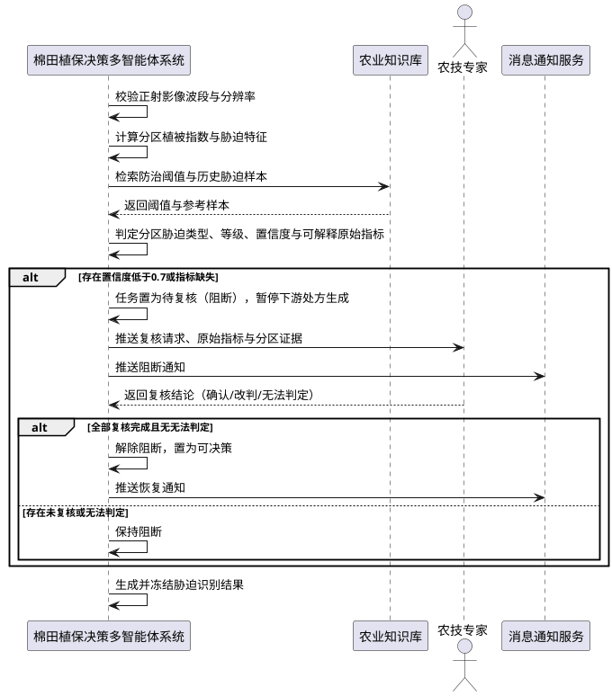

### **5.2.3 异常场景**

1. **影像质量不达标**
   a. 触发条件：云量超过 10%、影像存在大面积缺失或分辨率不满足要求。
   b. 系统行为：终止识别，保留任务并记录质量不合格原因。
   c. 用户感知：提示"影像质量不满足识别要求，请重新安排架次"。
2. **可解释指标缺失**
   a. 触发条件：分区无法计算 NDVI 偏离值且无虫口密度推算依据。
   b. 系统行为：该分区置信度置为低于 0.7，任务进入阻断待复核。
   c. 用户感知：提示"该分区缺少可解释依据，已暂停处方生成并转人工复核"。
3. **复核超时**
   a. 触发条件：阻断状态持续超过 48 小时且仍有分区未复核。
   b. 系统行为：保持阻断，升级提醒至农场管理者，不自动解除、不自动放行。
   c. 用户感知：仪表盘展示"复核超时"标识与待复核分区清单。
4. **识别结果全为无胁迫**
   a. 触发条件：全部管理分区胁迫等级均为无。
   b. 系统行为：正常输出识别结果，流程在处方环节终止，不生成作业单。
   c. 用户感知：展示"本次巡田未发现需防治胁迫"，并提供下次巡田建议时间。
5. **知识库不可用**
   a. 触发条件：防治阈值检索超时或返回空。
   b. 系统行为：使用最近一次生效的阈值快照继续识别，并在结果中标注阈值版本与降级标识。
   c. 用户感知：结果页展示"阈值服务降级，结论需复核"提示。
6. **分区边界异常**
   a. 触发条件：识别出的胁迫区域跨越地块边界或落入非棉田区域。
   b. 系统行为：按地块边界裁剪，裁剪后面积低于最小作业分区面积的分区予以合并，并在结果中记录裁剪量。
   c. 用户感知：展示裁剪说明与最终有效胁迫面积。

## **5.3 变量施药处方图生成**

### **5.3.1 业务规则**

1. **前置条件规则**：处方生成必须以已冻结且不处于阻断状态的胁迫识别结果、地块种植档案（含灌溉方式）、农事日历（含预计采收日期）、72 小时气象预报与可用登记用药目录为输入，任一缺失必须阻止生成。
   a. 验收条件：识别结果处于阻断状态 → 系统不生成处方，提示"识别结果待复核"。
   b. 验收条件：缺少农事日历中预计采收日期 → 系统不生成处方，提示"缺少采收日期，无法完成安全间隔校验"。
   c. 验收条件：登记用药目录不可用且无有效快照 → 系统不生成处方，提示"登记用药目录不可用"。
2. **处方三元组规则**：每个管理分区必须同时输出药剂品类、制剂亩用量（毫升/亩）与喷液量（升/亩）或稀释浓度（倍液）三项内容，三项缺一不可。
   a. 验收条件：某分区仅输出胁迫等级或施药量系数 → 系统判定处方不完整，禁止进入待审核状态。
   b. 验收条件：某分区同时给出喷液量与稀释浓度 → 系统必须校验两者按制剂亩用量换算一致，不一致则拒绝生成并提示配置冲突。
3. **登记用药目录绑定规则**：处方中的药剂品类必须引用新疆现行登记用药目录中登记作物含棉花、防治对象与本分区胁迫类型匹配、处于有效期内且本季使用次数未超限的条目；每个分区最多允许两个复配组分，每个组分均必须为有效目录项。
   a. 验收条件：药剂为目录外品种 → 系统拒绝生成处方并提示"该药剂不在新疆现行棉花登记用药目录内"。
   b. 验收条件：目录项已过期或已停用 → 系统不得引用该条目，并返回可用替代条目清单。
   c. 验收条件：本季该药剂使用次数已达目录项规定的最多使用次数 → 系统拒绝使用该药剂。
4. **制剂亩用量计算规则**：制剂亩用量必须依据胁迫等级、物候期与棉花生长模型计算，且必须落在所引用目录项标注的制剂亩用量区间内，并不得高于该药剂在当期物候期的单次用量上限。
   a. 验收条件：计算结果低于目录项下限 → 系统按下限取值或提示无需施药。
   b. 验收条件：计算结果超过目录项上限 → 系统按上限截断并在处方中标注截断原因。
5. **喷液量与滴灌模式规则**：喷液量取值必须落在目录项推荐区间内，并必须按地块灌溉方式修正：滴灌棉田模式下喷液量不得超过区间中值，非滴灌模式下不得超过区间上限，且均不得超过设备在该地块的最大喷液量。
   a. 验收条件：地块为滴灌棉田模式且处方喷液量高于区间中值 → 系统按中值修正并记录修正说明。
   b. 验收条件：地块灌溉方式缺失 → 系统不生成处方，提示补录灌溉方式。
6. **零施药规则**：胁迫等级为无的分区目标施药量必须为 0，且不得纳入作业面积统计，不得为该分区引用目录项。
   a. 验收条件：某分区胁迫等级为无 → 该分区施药量为 0 并标记"不作业"。
7. **物候期限制规则**：苗期与吐絮期必须使用低风险药剂方案，且花铃期以外的施药必须经农技专家确认。
   a. 验收条件：当前物候期为吐絮期 → 处方必须引用低风险药剂方案并进入专家确认队列。
8. **安全间隔与采收窗口校验规则**：生成处方前，决策环节必须查询该地块历史用药记录、所引用目录项的安全间隔期，并结合农事日历中的预计采收日期计算采收剩余天数，完成安全间隔校验。
   a. 验收条件：采收剩余天数为 10 天、药剂安全间隔期为 7 天 → 校验通过，处方记录"满足"结论。
   b. 验收条件：采收剩余天数为 5 天、药剂安全间隔期为 7 天 → 校验冲突，系统必须执行降级或拒绝判定。
   c. 验收条件：历史用药记录显示同一有效成分在安全间隔期内重复施用 → 系统拒绝使用该有效成分。
9. **降级处方规则**：安全间隔校验虽可通过但缓冲不足（采收剩余天数减安全间隔期小于 3 天），或距上次同有效成分用药间隔不足目录项规定的最小轮换间隔，或当前处于采收前敏感窗口时，系统必须降级为保守处方：改选目录中安全间隔期更短且满足剩余天数的低风险药剂、制剂亩用量取下限、喷液量取下限，并将处方置为"降级待确认"，需农技专家确认后方可提交审核。
   a. 验收条件：采收剩余天数 9 天、原选药剂安全间隔期 7 天 → 触发降级，系统输出替代药剂与降级原因。
   b. 验收条件：降级处方未经农技专家确认 → 系统禁止提交农场管理者审核。
10. **拒绝下发规则**：当采收剩余天数小于所引用药剂安全间隔期，或降低用量后仍无法满足安全间隔，或目录中不存在满足安全间隔的可用药剂时，系统必须拒绝生成可下发处方，仅保留"已拒绝"记录并给出拒绝原因。
    a. 验收条件：采收剩余天数 5 天、目录中最短安全间隔期为 7 天 → 系统拒绝，提示"距采收仅剩 5 天，短于最短安全间隔期 7 天，禁止施药"。
    b. 验收条件：拒绝后重复发起处方生成 → 系统返回同一拒绝结论，不得静默放行。
11. **提示口径规则**：降级与拒绝提示必须同时包含剩余天数、安全间隔期、冲突药剂名称与可选替代方案四项要素。
    a. 验收条件：触发拒绝 → 提示文案包含"距预计采收 {N} 天、安全间隔期 {S} 天、冲突药剂 {药名}、可选替代 {列表}"四项内容。
12. **作业窗口校验规则**：处方生成前必须调用新疆作业窗口约束模块完成校验，校验不通过时不得生成可下发处方，仅可生成"待作业窗口"草稿并输出候选作业窗口。
    a. 验收条件：拟作业日温度红线不满足 → 处方状态为"待作业窗口"，不进入审核队列。
13. **气象窗口规则**：处方建议作业时间窗必须由作业窗口约束模块输出，时间窗内预报风速不得大于 3 级、未来 6 小时降水概率不得大于 30%。
    a. 验收条件：未来 6 小时降水概率为 45% → 系统不得将对应时段作为建议作业时间窗。
14. **审核规则**：处方图生成后必须处于"待审核"状态，未经农场管理者审核通过不得下发作业。
    a. 验收条件：未审核处方被请求下发 → 系统拒绝并提示"处方未审核"。
15. **调整留痕规则**：审核人调整分区制剂亩用量时必须填写调整原因，调整幅度超过 30% 时必须由农技专家二次确认；调整后必须重新执行登记目录与安全间隔校验。
    a. 验收条件：审核人将某分区制剂亩用量上调 40% → 系统要求农技专家确认并重新校验目录区间与安全间隔。
16. **禁止项**：禁止生成超出地块边界、跨越相邻非目标地块的处方分区。
    a. 验收条件：处方分区超出地块边界 → 系统裁剪至地块边界内并记录裁剪说明。
17. **禁止项**：禁止使用登记用药目录外的药剂，禁止以"施药量系数"替代制剂亩用量与喷液量。
    a. 验收条件：提交仅含系数的处方 → 系统拒绝并提示必须给出三元组。

### **5.3.2 交互流程**

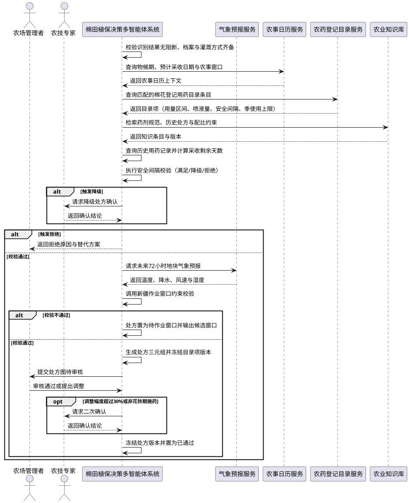

### **5.3.3 异常场景**

1. **农事日历缺失**
   a. 触发条件：农事日历服务不可用、无该地块记录或缺预计采收日期。
   b. 系统行为：阻止处方生成，不使用估算日期替代；保留待办并周期重试。
   c. 用户感知：提示"缺少农事日历或预计采收日期，无法完成安全间隔校验，请补录后重试"。
2. **登记用药目录不可用**
   a. 触发条件：目录服务超时、返回空或仅有已过期条目。
   b. 系统行为：若存在 7 天内有效目录快照则使用快照并标注降级；否则阻止处方生成。
   c. 用户感知：提示"登记用药目录不可用"或"目录已降级，处方需专家确认"。
3. **安全间隔冲突**
   a. 触发条件：采收剩余天数小于所引用药剂安全间隔期，或同有效成分重复施用。
   b. 系统行为：拒绝生成可下发处方，记录冲突药剂、剩余天数与替代方案；不自动改用目录外药剂。
   c. 用户感知：提示"距采收仅剩 N 天，短于安全间隔期 S 天，禁止施药；可选替代：…"。
4. **气象预报不可用**
   a. 触发条件：预报服务超时或返回地块级数据缺失。
   b. 系统行为：作业窗口校验按不通过处理，处方置为"待作业窗口"，禁止下发。
   c. 用户感知：提示"气象数据不可用，暂时无法确定作业窗口"。
5. **作业窗口不满足**
   a. 触发条件：温度、风速或湿度红线中任一项不通过。
   b. 系统行为：处方置为"待作业窗口"，输出不通过项与候选窗口，不进入审核队列。
   c. 用户感知：展示"气温/风速不满足新疆作业窗口要求"与候选作业日期。
6. **药剂冲突**
   a. 触发条件：处方药剂与地块最近 7 天内已施用农药存在成分冲突。
   b. 系统行为：阻止生成处方，返回冲突药剂名称与最近施用日期。
   c. 用户感知：提示"存在药剂冲突，请更换药剂或延后作业"。
7. **分区面积过小**
   a. 触发条件：单个管理分区面积低于设备最小调节面积。
   b. 系统行为：与相邻同等级分区合并，合并后仍过小的分区按相邻分区制剂亩用量取整处理。
   c. 用户感知：处方图展示合并后的分区范围与调整说明。
8. **处方审核驳回**
   a. 触发条件：审核人驳回处方并填写原因。
   b. 系统行为：处方置为"已驳回"，保留版本记录，允许基于原识别结果重新生成新版本。
   c. 用户感知：展示驳回原因与重新生成入口。

## **5.4 作业指令下发与执行跟踪**

### **5.4.1 业务规则**

1. **下发前置规则**：作业下发必须同时满足处方已审核通过、设备在线、作业时间窗在当前时间之后、执行前作业窗口约束校验通过四项条件。
   a. 验收条件：设备离线 → 系统不允许下发并提示"设备不可达"。
   b. 验收条件：执行前校验不通过 → 系统不允许下发并提示校验失败项。
2. **执行前二次校验规则**：每次下发前，执行环节必须以最新气象预报重新执行新疆作业窗口约束校验，校验结论必须绑定本次下发请求；决策阶段与执行阶段结论不一致时以执行阶段为准。
   a. 验收条件：决策时温度满足但下发时预报下调至不满足 → 系统拒绝下发，作业单转"待重新排期"。
   b. 验收条件：校验所需数据不可用 → 按不通过处理，拒绝下发。
3. **二次确认规则**：下发必须由农场管理者在场确认，确认内容必须包含作业地块、处方版本、药剂品类、制剂亩用量、喷液量或稀释浓度、安全间隔期提示与强制提示项。
   a. 验收条件：管理者未确认 → 系统保持作业单"待下发（或待排期）"状态，不向设备发送任何指令。
   b. 验收条件：确认清单缺少喷液量或稀释浓度 → 系统拒绝确认并提示处方三元组不完整。
4. **幂等规则**：同一作业单的重复下发请求必须返回首次受理结果，不得向设备重复发送指令。
   a. 验收条件：同一作业单 10 秒内两次下发 → 第二次返回首次受理编号，设备侧仅收到一条指令。
5. **指令内容规则**：作业指令必须包含作业地块边界、分区制剂亩用量、喷液量或稀释浓度、药液配比、飞行高度、飞行速度、安全间隔提示、作业窗口校验结论编号，缺失项不得下发；存在强制提示项时必须一并下发。
   a. 验收条件：指令缺少分区喷液量且无稀释浓度 → 系统拦截并提示字段缺失。
   b. 验收条件：南疆午后湿度触发防漂移提示但指令未携带 → 系统拦截下发。
6. **状态流转规则**：作业单状态必须按待排期、待下发、已下发、执行中、已完成、已中止依次流转，禁止跳跃或逆向流转；待重新排期仅可由待下发或待排期转入，已中止可重新创建新作业单。
   a. 验收条件：作业单处于执行中时请求置为待下发 → 系统拒绝非法状态流转。
   b. 验收条件：单地块作业未组建批次 → 可跳过待排期直接进入待下发。
7. **进度跟踪规则**：执行中作业单必须按不超过 60 秒的间隔更新作业进度与已作业面积。
   a. 验收条件：设备连续 3 分钟未回传进度 → 系统将作业单标记"回传异常"并告警。
8. **偏差告警规则**：实际流量与处方量偏差超过 20% 的作业区域必须记录为偏差分区并提示复核。
   a. 验收条件：某分区实际流量比处方量低 25% → 系统生成偏差分区记录并通知管理者。
9. **中止规则**：作业中止必须记录中止原因，已作业面积必须纳入评估，未作业面积必须支持生成补充作业单。
   a. 验收条件：因风速超限中止作业 → 系统记录原因、保留已作业面积并允许基于剩余分区新建作业单。
10. **强制提示确认规则**：指令携带强制提示项时，管理者二次确认中必须勾选"已阅知并落实提示要求"，未勾选不得下发。
    a. 验收条件：存在防漂移提示但未勾选知悉 → 系统拒绝下发。
11. **禁止项**：禁止在作业单未关联有效处方版本的情况下下发指令。
    a. 验收条件：作业单处方版本被撤销 → 系统拒绝下发并提示重新审核。
12. **禁止项**：禁止在无有效作业窗口校验结论的情况下下发指令，禁止人工豁免温度与风速红线。
    a. 验收条件：提交人工豁免温湿度红线的请求 → 系统拒绝并记录尝试操作。

### **5.4.2 交互流程**

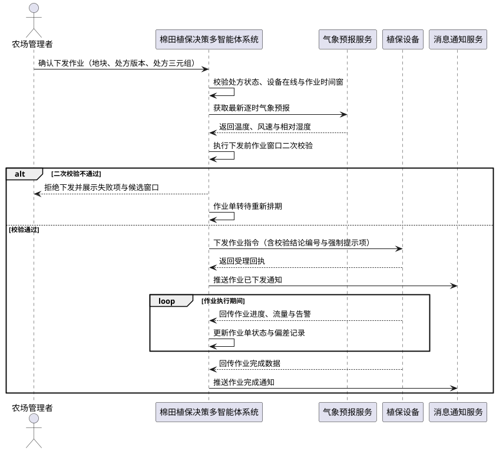

### **5.4.3 异常场景**

1. **设备不可达**
   a. 触发条件：设备接口超时或无响应。
   b. 系统行为：按配置重试 3 次，失败后作业单保持"待下发"或"待排期"并记录失败原因；批量作业中该地块标记失败，不阻塞后续地块。
   c. 用户感知：提示"植保设备暂时不可达，请检查设备状态后重试"。
2. **执行前校验不通过**
   a. 触发条件：下发时刻气象更新导致温度或风速红线不再满足，或校验服务不可用。
   b. 系统行为：拒绝下发，作业单转"待重新排期"，保留处方版本不变，记录校验快照。
   c. 用户感知：提示"当前气象条件不满足新疆作业窗口要求，已转为待重新排期"。
3. **设备拒绝指令**
   a. 触发条件：设备返回药剂类型不支持、药箱容量不足或任务冲突等拒绝原因。
   b. 系统行为：不改变作业单状态，记录设备返回码与原因。
   c. 用户感知：展示设备拒绝原因与处置建议。
4. **作业中断**
   a. 触发条件：设备在作业中上报故障或失联超过 5 分钟。
   b. 系统行为：作业单置为"已中止"，固化已作业面积与偏差分区。
   c. 用户感知：推送中断告警，并提供补充作业单创建入口。
5. **重复下发冲突**
   a. 触发条件：网络重试导致同一作业单指令重复到达设备。
   b. 系统行为：以作业单号作为幂等标识，返回已有受理结果，不重复执行。
   c. 用户感知：界面展示"作业已受理，无需重复提交"。
6. **气象突变**
   a. 触发条件：作业期间实测风速超过 3 级或开始降雨。
   b. 系统行为：立即向用户告警并建议中止作业，记录气象突变时间点用于评估扣减。
   c. 用户感知：弹出"气象条件不满足作业要求"告警与中止建议。
## **5.5 作业效果闭环评估**

### **5.5.1 业务规则**

1. **评估触发规则**：作业单完成后系统必须自动创建待评估记录，并在作业后复查正射影像产品可用时自动执行评估。
   a. 验收条件：作业单置为已完成 → 系统生成待评估记录并请求复查影像。
2. **复查时效规则**：复查影像采集时间必须晚于作业完成时间且不早于安全间隔期结束日期，间隔超过 30 天的复查不得用于效果评估。
   a. 验收条件：复查影像早于安全间隔期结束日 → 系统判定复查无效并提示重新采集。
3. **评估输入规则**：评估必须引用作业前冻结的识别结果版本、作业单绑定的处方三元组与登记用药目录项版本、作业回传数据与复查识别结果；处方三元组缺失或目录项版本不可追溯时不得出具达标结论。
   a. 验收条件：处方记录缺少制剂亩用量 → 报告标注"处方信息不完整"并不得判定达标。
4. **复查阻断规则**：复查识别结果处于阻断状态时，评估不得出具达标结论，仅可输出"效果待复查"。
   a. 验收条件：复查识别存在待复核分区 → 报告结论为"效果待复查"并展示阻断说明。
5. **指标计算规则**：评估必须计算作业前后胁迫指数变化、胁迫缓解率、作业覆盖率与流量偏差四项指标，缺任一项不得出具达标结论。
   a. 验收条件：缺少流量回传数据 → 系统仅输出"部分评估"，不得判定为达标。
6. **达标判定规则**：缓解率不低于 60% 且覆盖率不低于 95% 且无重度偏差分区的作业单必须判定为达标。
   a. 验收条件：缓解率 65%、覆盖率 97%、存在 1 个重度偏差分区 → 判定为不达标并列出偏差分区。
7. **未作业区域规则**：未作业区域必须单独评估，不得计入缓解率分母。
   a. 验收条件：作业单存在 15% 未作业面积 → 评估报告分别展示已作业区域与未作业区域的结论。
8. **建议规则**：评估报告必须给出下一轮巡田建议时间与是否需补充作业的结论，且下一轮建议日期不得早于安全间隔期结束日期。
   a. 验收条件：缓解率低于 60% → 报告必须建议在 7 天内补充作业并重新巡田，且补充作业须重新执行安全间隔校验。
9. **反馈规则**：评估结论必须回写到该地块的历史档案，作为下一轮处方生成与登记用药目录比对的参考依据。
   a. 验收条件：评估完成后再次生成同地块处方 → 处方依据中展示历史评估结论与历史用药效果。
10. **禁止项**：禁止在复查影像缺失时出具"达标"结论。
    a. 验收条件：无复查影像时请求评估 → 系统降级为"作业合规性评估"并明确标注结论范围。

### **5.5.2 交互流程**

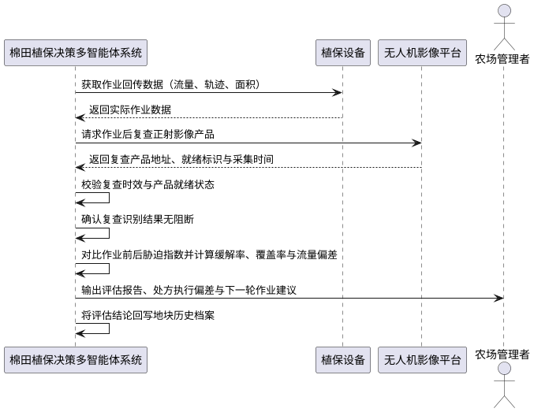

### **5.5.3 异常场景**

1. **缺少复查影像**
   a. 触发条件：作业完成后未安排复查架次或复查影像超期。
   b. 系统行为：仅出具作业合规性评估，不判定防治效果，保留记录待补采。
   c. 用户感知：报告标注"效果待复查"，并提供复查任务发起入口。
2. **复查识别阻断**
   a. 触发条件：复查识别结果存在待复核分区。
   b. 系统行为：按"效果待复查"处理，阻断解除后可重新评估。
   c. 用户感知：报告展示待复核分区清单与复核入口。
3. **回传数据残缺**
   a. 触发条件：设备回传数据缺失分区流量或轨迹中断。
   b. 系统行为：以可用数据完成部分评估，标注缺失项，不判定达标。
   c. 用户感知：报告展示"部分评估"标识与缺失项清单。
4. **评估周期内二次作业**
   a. 触发条件：同一地块在评估完成前发生新的作业单。
   b. 系统行为：以上一次作业完成至本次作业开始为评估观察窗，观察窗不足 7 天的评估标注"受二次作业影响"。
   c. 用户感知：报告展示观察窗说明与结论可信度提示。
5. **胁迫未缓解**
   a. 触发条件：缓解率低于 30% 且复查影像无质量异常。
   b. 系统行为：判定为防治效果不佳，触发农技专家复核流程，并将该药剂效果结论纳入下一轮目录比对参考。
   c. 用户感知：推送"防治效果异常"告警并展示复核建议。

## **5.6 巡田—处方—作业—评估仪表盘**

### **5.6.1 业务规则**

1. **阶段视图规则**：仪表盘必须以巡田、处方、作业、评估四个阶段展示每个地块的当前状态与最近更新时间，并展示阻断、降级、拒绝与待排期四类业务标识。
   a. 验收条件：进入仪表盘 → 每个地块显示四阶段状态、业务标识与最近更新时间。
2. **待办规则**：仪表盘必须展示当前用户的待办事项，包含待复核阻断分区、待确认降级处方、待审核处方、待确认下发、待确认批量批次、待发起复查。
   a. 验收条件：存在 3 个待复核分区 → 农技专家首页待办显示"待复核分区 3"并可跳转。
3. **权限视图规则**：农户只能查看本地块数据，农场管理者可查看本农场全部地块，农技专家可查看授权区域。
   a. 验收条件：农户访问他人工地块详情 → 系统拒绝并提示无权限。
4. **空间展示规则**：处方图与胁迫结果必须支持在地块底图上按分区展示，并可按胁迫等级、制剂亩用量、喷液量与紧迫度切换图例。
   a. 验收条件：切换图例为喷液量 → 底图按分区喷液量着色并展示分区数值。
   b. 验收条件：点击某分区 → 展示该分区处方三元组、绑定的目录项与安全间隔校验结论。
5. **异常高亮规则**：存在数据缺失、识别阻断、安全间隔冲突、作业窗口校验不通过、设备异常、作业中断或评估不达标的地块必须高亮标识。
   a. 验收条件：某地块作业窗口校验不通过 → 仪表盘该地块显示"待作业窗口"标识并展示不通过项。
6. **批次队列规则**：批量作业批次必须展示批次编号、地块清单、紧迫度分值、排序位次、当前执行地块与各作业单状态，并支持按紧迫度与状态筛选。
   a. 验收条件：打开批次视图 → 按排序位次展示地块及其紧迫度构成（等级权重与窗口权重）。
7. **导出规则**：用户必须可导出地块级评估报告与分区处方清单，导出内容必须包含处方三元组与目录项版本。
   a. 验收条件：点击导出评估报告 → 生成包含四项指标、处方三元组与结论的报告文件。
8. **禁止项**：仪表盘禁止展示未经审核的处方作为可执行作业依据。
   a. 验收条件：待审核处方在仪表盘中仅展示为草稿状态 → 不提供下发入口。
9. **禁止项**：仪表盘禁止展示阻断任务的处方入口，禁止展示人工豁免红线的操作入口。
   a. 验收条件：任务处于阻断状态 → 处方页签不可点击并提示"待人工复核"。

### **5.6.2 交互流程**

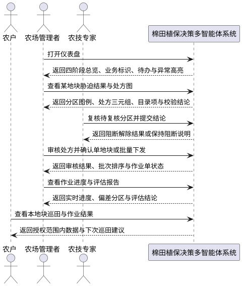

### **5.6.3 异常场景**

1. **数据刷新失败**
   a. 触发条件：状态查询超时或部分数据源不可用。
   b. 系统行为：展示最近一次成功快照并标注数据时间。
   c. 用户感知：页面提示"数据更新于某时某分，部分数据可能延迟"。
2. **无地块数据**
   a. 触发条件：新用户尚未绑定地块或地块无任何任务记录。
   b. 系统行为：展示空状态引导，不展示虚构指标。
   c. 用户感知：提示"暂无巡田记录，可发起首次巡田任务"。
3. **图表渲染失败**
   a. 触发条件：分区数据过大或格式异常导致底图无法渲染。
   b. 系统行为：降级为分区清单表格展示，处方三元组与校验结论不丢失。
   c. 用户感知：提示"地图暂不可用，已切换为列表视图"。
4. **批次视图数据不一致**
   a. 触发条件：批次内某作业单状态变更未及时同步。
   b. 系统行为：以作业单最新状态重新汇总批次状态，并标注同步时间。
   c. 用户感知：批次状态展示"部分数据延迟"提示。

## **5.7 外部数据接入配置**

### **5.7.1 业务规则**

1. **接入项管理规则**：系统管理员必须可维护五类接入配置：无人机影像 OSS、传感器 MQTT、植保设备 REST、农事日历 REST、农药登记目录 REST，每类配置必须包含连接地址、认证凭据引用、超时阈值与启停开关。
   a. 验收条件：新增一个农事日历接入配置并启用 → 系统按配置拉取物候期与采收日期，无需重启业务。
2. **连通性校验规则**：接入配置启用前必须通过连通性校验，校验失败不得启用。
   a. 验收条件：OSS 地址不可达 → 配置保存为草稿并提示校验失败原因。
3. **凭据保护规则**：认证凭据必须加密保存，界面仅展示掩码，禁止回显明文。
   a. 验收条件：查看设备 REST 凭据 → 仅显示掩码与最后修改时间。
4. **多设备并存规则**：系统必须支持同一地块下多个植保设备并存，且每个设备必须能独立启停与独立下发。
   a. 验收条件：地块绑定 2 台设备并禁用其中 1 台 → 仅启用设备可被选择下发。
5. **Topic 规范规则**：传感器 MQTT topic 必须按"农场/地块/设备/指标"层级组织，订阅范围不得跨农场。
   a. 验收条件：配置跨农场订阅 → 系统拒绝并提示订阅范围越界。
6. **变更生效规则**：接入配置变更必须记录变更人与变更时间，变更后必须重新校验连通性。
   a. 验收条件：修改设备接口基地址 → 配置状态回退为待校验，校验通过后恢复启用。
7. **关键依赖可用性规则**：农事日历与农药登记目录接入必须配置降级策略；农事日历不可用时处方生成必须阻断，农药登记目录不可用时可使用有效快照但必须标注降级。
   a. 验收条件：农事日历接入停用且无缓存 → 处方生成请求被拒绝并提示补录采收日期。
8. **禁止项**：禁止在接入配置中存储明文密钥或共享同一凭据给多个农场。
   a. 验收条件：提交含明文密钥的配置 → 系统拒绝保存并提示使用凭据引用方式。

### **5.7.2 交互流程**

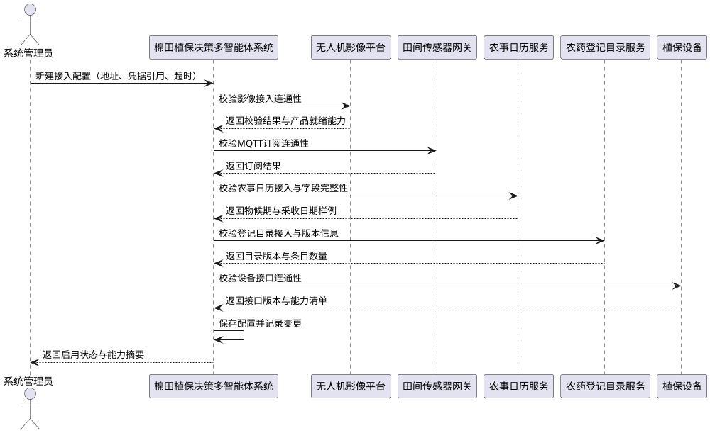

### **5.7.3 异常场景**

1. **凭据失效**
   a. 触发条件：凭据过期或密钥被吊销导致接入失败。
   b. 系统行为：自动停用该接入配置并告警，保留已有业务数据；若为农事日历或登记目录，则处方生成进入阻断或降级。
   c. 用户感知：告警提示"接入凭据失效，相关任务将暂停"，提供更新入口。
2. **设备能力不匹配**
   a. 触发条件：设备接口不支持变量施药或分区控制。
   b. 系统行为：配置标记为"能力受限"，禁止将该设备用于变量施药作业单。
   c. 用户感知：设备详情展示"不支持变量施药"，并在下发时过滤该设备。
3. **订阅重复**
   a. 触发条件：同一 topic 被多个配置订阅导致读数重复。
   b. 系统行为：按设备编号与采集时间去重，保留首次读数。
   c. 用户感知：不产生重复记录，接入监控展示去重计数。
4. **配置误停用**
   a. 触发条件：仍有关联进行中任务时停用接入配置。
   b. 系统行为：阻止停用并列出受影响任务与作业单。
   c. 用户感知：提示"存在进行中任务，无法停用该接入"。
5. **目录接入返回旧版本**
   a. 触发条件：登记目录服务返回的版本早于系统已记录版本。
   b. 系统行为：拒绝覆盖本地版本，保留现有版本并告警，待人工确认后同步。
   c. 用户感知：提示"登记目录版本异常，已暂停同步"。

## **5.8 知识库辅助决策**

### **5.8.1 业务规则**

1. **检索范围规则**：知识库必须覆盖防治阈值、药剂使用规范、历史处方、历史胁迫样本与评估结论五类知识。
   a. 验收条件：生成处方时 → 决策依据中展示所引用的知识条目与版本。
2. **引用可追溯规则**：任何由知识库支撑的判定必须记录引用条目标识与生效版本。
   a. 验收条件：复核某次胁迫判定 → 可查看其引用的阈值条目及版本号。
3. **阈值版本规则**：防治阈值必须支持版本管理，已被引用的阈值版本不得被直接修改，只能新增版本。
   a. 验收条件：农技专家修改阈值 → 生成新版本，历史判定仍引用旧版本。
4. **历史优先规则**：同地块同胁迫类型存在有效历史处方时，处方生成必须参考历史处方效果与历史用药记录，并展示差异说明。
   a. 验收条件：同地块存在达标历史处方 → 新处方展示与历史处方的三元组差异与依据。
5. **登记用药目录同步规则**：登记用药目录必须按目录服务版本整体同步，条目新增、停用、过期与用量区间调整必须记录变更日志；目录项被停用或过期后不得用于新处方，已引用该条目的处方必须标注"目录已变更"。
   a. 验收条件：某目录项被停用 → 引用该条目的待审核处方标注"目录已变更"并禁止下发。
6. **目录条目唯一性规则**：同一有效成分、同一剂型、同一防治对象只允许一条生效条目；出现重复条目时必须保留登记证有效期更晚者并将冲突条目置为待人工确认。
   a. 验收条件：同步到两条相同条目 → 系统标记冲突并暂停使用该组条目。
7. **降级规则**：知识库不可用时必须允许降级使用最近生效快照，并在结论中标注降级。
   a. 验收条件：知识库超时 → 使用快照并标注"知识库降级"。
8. **禁止项**：禁止将未经农技专家审核的外部资料直接作为防治阈值使用。
   a. 验收条件：导入未审核资料作为阈值 → 系统将其置为"待审核"状态，不参与判定。

### **5.8.2 交互流程**

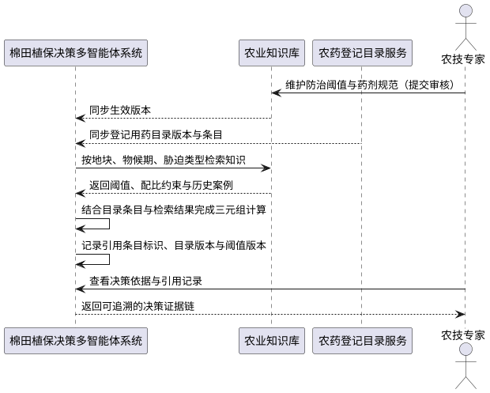

### **5.8.3 异常场景**

1. **检索无结果**
   a. 触发条件：知识库中无匹配的阈值或药剂规范。
   b. 系统行为：终止自动判定，转入农技专家人工处理队列。
   c. 用户感知：提示"缺少可用防治依据，已转人工处理"。
2. **知识冲突**
   a. 触发条件：同一胁迫类型存在多条生效阈值且互相矛盾。
   b. 系统行为：采用物候期更具体、版本更新的条目，并记录冲突说明。
   c. 用户感知：决策依据中展示冲突条目与最终采用理由。
3. **版本回滚**
   a. 触发条件：新版本阈值被发现存在错误需回滚。
   b. 系统行为：将新版本置为失效并恢复上一有效版本，历史判定保持原引用不变。
   c. 用户感知：提示"阈值已回滚至某版本，后续判定按新版本执行"。
4. **目录同步失败**
   a. 触发条件：登记目录服务超时或返回结构异常。
   b. 系统行为：保留现有版本继续使用（7 天内视为有效），超过 7 天则新处方必须阻断并转专家确认。
   c. 用户感知：提示"登记目录同步失败，已使用 X 月 X 日版本"。

## **5.9 新疆作业窗口约束模块**

### **5.9.1 业务规则**

1. **模块定位规则**：本模块必须是独立的校验模块，由决策环节（处方生成前）与执行环节（指令下发前）双重调用，两个环节必须使用同一套红线阈值与同一判定逻辑；阈值必须版本化，处方与作业单必须记录所引用的阈值版本。
   a. 验收条件：决策与执行两次调用 → 校验记录均引用同一阈值版本，且校验编号可互相关联。
2. **温度红线规则**：校验窗口必须覆盖拟作业日前后各 3 天的逐日气象；当拟作业日超出气象服务 72 小时精准预报范围、改用趋势预报时，必须扩展为前后各 5 天。窗口内每日最低气温必须不低于 12.5℃，每日平均气温必须高于 23℃；任一日不满足即判定红线不通过。
   a. 验收条件：拟作业日 T-2 日最低气温为 11.8℃ → 校验不通过，输出该日期、实测预报值与阈值。
   b. 验收条件：窗口内全部日期最低气温≥12.5℃且日均温>23℃ → 温度项通过。
3. **风速红线规则**：作业时间窗内逐时预报风速必须不大于 3 级；任一时段超过 3 级即判定不通过，禁止安排飞行作业。
   a. 验收条件：作业时间窗 10:00—12:00 中 11:00 风速为 4 级 → 校验不通过，输出超限时段。
4. **南疆湿度防漂移规则**：地块地域属性为南疆且作业时间窗落在 14:00—18:00 且该时段预报相对湿度低于 30% 时，模块必须在结论中输出防漂移强制提示，提示内容必须至少包含提高雾滴粒径、降低飞行高度、添加抗漂移助剂、避开高温时段四项措施。
   a. 验收条件：南疆地块 15:00 相对湿度 24% → 结论为"通过（带强制提示）"，提示项必须随处方与作业指令下发。
   b. 验收条件：北疆地块或相对湿度 35% → 不触发防漂移提示。
5. **滴灌模式喷液量规则**：滴灌棉田模式作为地块属性必须参与喷液量计算：滴灌模式下喷液量不得超过目录项推荐区间中值，非滴灌模式下不得超过区间上限，两者均不得超过设备在该地块的最大喷液量；灌溉方式缺失时校验必须判定为不通过。
   a. 验收条件：滴灌地块处方喷液量为区间上限 → 校验不通过，输出修正建议值为区间中值。
   b. 验收条件：地块灌溉方式为空 → 校验不通过并提示补录。
6. **双重校验与优先级规则**：决策环节校验通过后，执行环节必须以最新气象数据重新校验；两次结论不一致时以执行环节为准，处方版本不失效但作业窗口必须重新选择。
   a. 验收条件：决策通过、执行时风速升至 4 级 → 拒绝下发，作业单转"待重新排期"。
7. **失败处置规则**：决策环节不通过时，处方必须置为"待作业窗口"，不得进入审核队列，并必须输出最近 72 小时内满足红线的候选作业窗口；执行环节不通过时，必须拒绝下发并记录失败项；校验所需数据不可用时按不通过处理。
   a. 验收条件：全部候选窗口均不满足 → 输出"未来 72 小时无可用作业窗口"并建议延后巡田或调整药剂。
8. **审计规则**：每次校验必须记录校验编号、调用方、处方或作业单编号、地块编号、拟作业时间窗、气象数据版本与发布时间、红线阈值版本、逐日温度与逐时风速湿度取值、结论、不通过项清单与强制提示项，记录保留不少于 2 年。
   a. 验收条件：回溯某次下发 → 可按校验编号还原当时的全部输入与结论。
9. **阈值变更规则**：红线阈值不得由系统自动调整，变更必须由农技专家提出、农场管理者确认，生成新版本并记录生效时间；已下发的作业单仍按原版本审计，不追溯重判。
   a. 验收条件：提交仅由管理员发起的阈值修改 → 系统拒绝并要求双人确认。
10. **禁止项**：禁止人工豁免温度红线与风速红线，禁止在无有效校验结论时下发指令。
    a. 验收条件：提交豁免申请 → 系统拒绝并记录操作尝试。

### **5.9.2 交互流程**

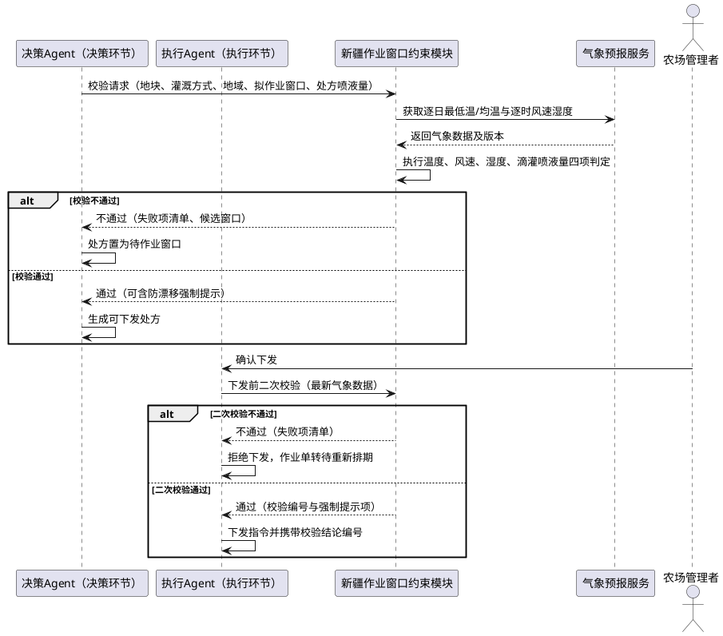

### **5.9.3 异常场景**

1. **气象数据缺失或不完整**
   a. 触发条件：缺少逐日最低气温、日均气温、逐时风速或相对湿度中任一项。
   b. 系统行为：按不通过处理（安全默认），不得以历史均值替代。
   c. 用户感知：提示"气象数据不完整，无法完成作业窗口校验，暂不可下发"。
2. **校验服务不可用**
   a. 触发条件：模块超时或内部异常。
   b. 系统行为：按不通过处理，阻止下发，记录服务异常并告警。
   c. 用户感知：提示"作业窗口校验服务异常，已暂停下发"。
3. **候选窗口全部不满足**
   a. 触发条件：未来 72 小时内所有候选日期均违反温度或风速红线。
   b. 系统行为：处方保持"待作业窗口"，不进入审核；输出延期建议。
   c. 用户感知：提示"未来 72 小时无满足新疆作业窗口的时段，建议延后作业"。
4. **阈值邻近波动**
   a. 触发条件：预报最低气温处于 12.5℃ 临界值附近（±0.5℃）或风速处于 3 级边界。
   b. 系统行为：按更严格侧判定，并在结论中标注"临界波动"提示管理者临近作业前重校。
   c. 用户感知：展示"临界条件，作业前需再次校验"提示。
5. **地块属性缺失**
   a. 触发条件：地块地域分区或灌溉方式为空。
   b. 系统行为：校验不通过，阻止处方生成或下发，要求补录地块属性。
   c. 用户感知：提示"地块缺少地域或灌溉方式属性，无法计算喷液量"。
6. **预报与实际偏差**
   a. 触发条件：作业期间实测温度、风速与预报偏差超出红线。
   b. 系统行为：触发气象突变告警并建议中止，记录偏差用于评估扣减与阈值复核。
   c. 用户感知：弹出"实测气象超出作业窗口"告警与中止建议。

## **5.10 多地块批量作业队列调度**

### **5.10.1 业务规则**

1. **批次组建规则**：同一农场、同一植保设备（或同一设备组）下，多块地处方均已审核通过且作业时间窗重叠或相邻时，系统必须支持组建批量作业批次；单个批次地块数不得超过 20 个。
   a. 验收条件：管理者勾选 8 块地已审核处方并选择同一设备 → 系统生成批次编号并按规则排序。
   b. 验收条件：勾选跨农场地块 → 系统拒绝并提示"不得跨农场组建批次"。
2. **紧迫度计算规则**：每个地块的紧迫度必须等于胁迫等级权重与物候期窗口权重的乘积。胁迫等级权重取值：重度 5、中度 3、轻度 1、无 0；物候期窗口权重按"距关键防治窗口关闭天数 D"取值：D≤3 天为 3.0，4—7 天为 2.0，8—14 天为 1.5，大于 14 天为 1.0，窗口已关闭为 0。
   a. 验收条件：重度胁迫且 D=2 天 → 紧迫度为 5×3.0=15.0。
   b. 验收条件：轻度胁迫且 D=10 天 → 紧迫度为 1×1.5=1.5。
   c. 验收条件：物候期窗口已关闭 → 紧迫度为 0，不得纳入队列。
3. **分区取值规则**：单个地块存在多个不同等级分区时，紧迫度必须按该地块内最高胁迫等级计算；物候期窗口必须取自农事日历中该地块当前物候期对应的关键防治窗口。
   a. 验收条件：地块内含重度与轻度分区 → 按重度 5 计算紧迫度。
4. **排序规则**：队列必须按紧迫度降序排列；紧迫度相同时依次按"采收剩余天数升序、地块面积降序、处方审核通过时间升序、地块编号升序"排序，排序结果必须确定且可复现。
   a. 验收条件：两个地块紧迫度同为 3.0 → 采收剩余天数少者排前；若仍相同则面积大者排前。
5. **零作业排除规则**：全部分区胁迫等级为无或施药量为 0 的地块不得进入队列，且不得计入批次地块数。
   a. 验收条件：勾选的地块中 1 块全为零施药 → 该地块被排除并在结果中说明原因。
6. **指令模板统一规则**：单地块作业与批量作业必须共用同一套作业指令模板与同一套字段校验规则，批量作业不得引入专用字段；批次信息仅以批次编号、排序位次与紧迫度分值附加在统一模板上。
   a. 验收条件：比对单地块与批量下发指令 → 除批次编号与位次外字段集合完全一致。
7. **队列变更规则**：新处方入队必须触发全队列重排；设备离线、处方被驳回或撤销、作业窗口失效、执行前校验不通过的作业单必须移出队列并重排，同时通知管理者。
   a. 验收条件：批次执行中某地块处方被撤销 → 该作业单移出队列，后续地块递补并重排。
8. **不可插队规则**：执行中的作业单不得被新入队的高紧迫度地块中断，只能在当前作业完成后按最新排序取下一个。
   a. 验收条件：执行中地块紧迫度 3.0，新入队地块紧迫度 15.0 → 当前作业继续，下一顺位为新地块。
9. **批量确认规则**：批量下发必须由农场管理者一次确认覆盖批次内全部地块，确认清单必须逐地块展示处方版本、药剂品类、制剂亩用量、喷液量或稀释浓度、地块面积、紧迫度分值与强制提示项；任一项缺失不得确认。
   a. 验收条件：确认清单中 1 个地块缺少喷液量 → 系统拒绝整批确认并定位该地块。
10. **批量下发规则**：同一设备必须按排序位次串行下发，逐地块执行下发前作业窗口二次校验；单地块下发失败不得阻塞后续地块，失败地块标记"待重新排期"并汇总展示。
    a. 验收条件：批次 5 个地块中第 2 个设备拒绝 → 第 3—5 个继续下发，批次状态为"部分完成"。
11. **批次状态规则**：批次状态必须由批次内作业单状态汇总得出，取值仅允许待确认、排队中、执行中、部分完成、已完成、已中止；全部作业单完成方可置为已完成，存在中止且无进行中作业单时置为部分完成或已中止。
    a. 验收条件：3 个完成、1 个中止、1 个排队 → 批次状态为"部分完成"。
12. **禁止项**：禁止将不同农场或不同权属地块合并至同一批次，禁止在批次确认后新增地块而不重新确认。
    a. 验收条件：批次确认后追加地块并直接下发 → 系统拦截并要求重新确认。

### **5.10.2 交互流程**

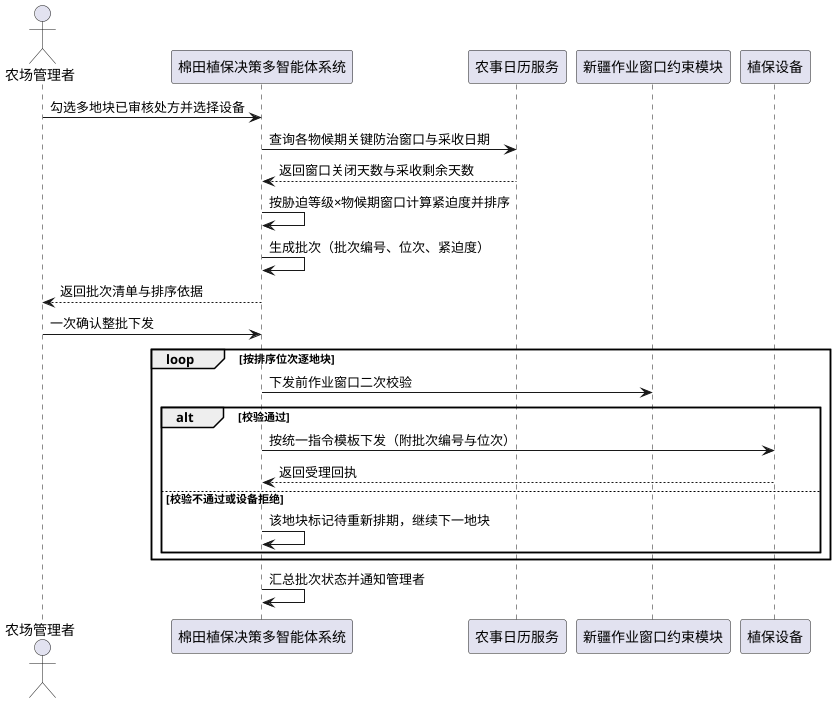

### **5.10.3 异常场景**

1. **队列为空**
   a. 触发条件：所选地块全部为零施药或物候期窗口已关闭。
   b. 系统行为：不生成批次，返回排除原因清单。
   c. 用户感知：提示"所选地块无需作业或已过防治窗口"。
2. **紧迫度数据缺失**
   a. 触发条件：农事日历缺失关键防治窗口或采收日期，导致窗口权重无法计算。
   b. 系统行为：该地块不参与排序并标记数据缺失，其余地块正常组建批次。
   c. 用户感知：提示"某地块缺少农事日历数据，未纳入本批次"。
3. **同分排序争议**
   a. 触发条件：多个地块四级排序键全部相同。
   b. 系统行为：按地块编号升序作最终排序键，保证结果确定。
   c. 用户感知：批次视图展示完整排序依据链。
4. **单地块下发失败**
   a. 触发条件：设备拒绝、二次校验不通过或设备超时。
   b. 系统行为：该地块转"待重新排期"，其余地块继续；批次汇总展示失败清单。
   c. 用户感知：提示"批次中 N 个地块下发失败，已转待重新排期"。
5. **批次执行中处方撤销**
   a. 触发条件：批次排队中或执行中，某地块处方被驳回或撤销。
   b. 系统行为：移出该作业单并重排，已执行部分不受影响；若该地块正在执行则先中止再移出。
   c. 用户感知：通知"某地块处方已撤销，已从批次移除"。
6. **设备切换**
   a. 触发条件：批次绑定的设备不可用且需改用其他设备。
   b. 系统行为：终止当前批次排队，按新设备能力重新校验并重建批次，位次重新计算。
   c. 用户感知：提示"已按新设备重建批次，请重新确认"。
# **6. 数据约束**

## **6.1 巡田任务**

1. **任务编号**：全局唯一，创建后不可变更，作为任务全链路追溯依据。
2. **地块编号**：必填，必须为系统中已登记且处于启用状态的地块。
3. **时间窗开始时间**：必填，不得早于当前时间，且与结束时间的间隔不超过 24 小时。
4. **时间窗结束时间**：必填，不得晚于发起时间 7 天。
5. **发起人**：必填，必须为具备该地块访问权限的用户。
6. **任务状态**：必填，取值仅允许待接入数据、数据接入中、识别中、待复核（阻断）、可决策、待审核、已完成、数据接入失败、识别失败。
7. **数据完整性结论**：必填，取值仅允许完整、部分缺失、不可用，并必须附带缺失项清单。
8. **关联架次编号**：正射影像产品接入成功后必填，且必须唯一对应一个架次。
9. **正射影像就绪时间**：必填，必须取自影像平台的就绪标识时间，作为 10 分钟识别时效的计时起点。
10. **识别开始时间**：必填，不得早于正射影像就绪时间。
11. **阻断状态**：必填，取值仅允许未阻断、阻断待复核、已解除；取值为阻断待复核时任务不得进入处方生成，且必须记录触发阻断的分区清单。
12. **结果版本号**：每次重新识别必须递增，已完成任务的结果版本号不得回退。

## **6.2 正射影像产品**

1. **架次编号**：全局唯一，由影像平台生成，系统内不得重复登记。
2. **产品访问地址**：必填，必须为带有效期的签名地址，有效期不超过 24 小时，且不得在日志中记录完整签名串。
3. **拼接完成标识**：必填，取值仅允许是、否，取值为否时不得用于识别。
4. **辐射定标完成标识**：必填，取值仅允许是、否，取值为否时不得用于识别。
5. **几何校正完成标识**：必填，取值仅允许是、否，取值为否时不得用于识别。
6. **产品就绪时间**：必填，必须为三项完成标识均为是的时刻，且不得晚于系统接收时间。
7. **投影坐标系**：必填，必须为地块空间数据可叠加的坐标系。
8. **拍摄时间**：必填，必须落在所属巡田任务的时间窗内。
9. **覆盖地块编号**：必填，必须与任务地块一致，覆盖比例需单独记录且不得低于 100% 才可用于全地块处方。
10. **波段清单**：必填，至少包含近红外与红光两个波段。
11. **地面分辨率**：必填，不得高于 5 厘米。
12. **云量**：必填，取值范围 0% 至 100%，超过 10% 判定为质量不合格。
13. **影像张数与总容量**：必填，单架次张数不超过 500 张、总容量不超过 2 GB。
14. **校验状态**：必填，取值仅允许待校验、通过、不通过，并必须记录不通过原因。

## **6.3 传感器读数**

1. **设备编号**：必填，必须为已登记且启用状态的田间传感设备。
2. **地块编号**：必填，必须与设备绑定地块一致。
3. **指标类型**：必填，取值仅允许土壤温度、土壤湿度、空气温度、空气湿度、光照强度、风速、风向、降雨量、虫情计数。
4. **采集时间**：必填，不得晚于接收时间，与接收时间偏差超过 10 分钟的读数必须标记为迟到数据。
5. **指标数值**：必填，必须落在该指标业务合理区间内，超出区间必须标记为异常值且不参与计算。
6. **异常标记**：非必填，取值仅允许空、越限、设备故障、人工剔除。
7. **数据来源主题**：必填，必须符合农场/地块/设备/指标的四级命名层级。
8. **时间窗覆盖率**：按任务时间窗统计，必须不低于 90% 才可判定传感器数据完整。

## **6.4 胁迫识别结果**

1. **结果编号**：全局唯一，与任务编号和结果版本号组合唯一。
2. **关联任务编号**：必填，必须指向已完成数据接入的巡田任务。
3. **管理分区编号**：必填，同一结果内唯一，且必须落在地块边界内。
4. **空间范围**：必填，分区面积必须大于 0，跨地块部分必须裁剪后记录。
5. **胁迫类型**：必填，取值允许病虫害、缺素、干旱、渍害、待定；取值为待定时必须进入人工复核。
6. **胁迫等级**：必填，取值仅允许无、轻度、中度、重度。
7. **置信度**：必填，取值范围 0 至 1，低于 0.7 必须标记待复核并触发下游阻断。
8. **可解释原始指标**：必填，至少包含一项，取值仅允许 NDVI 偏离值、虫口密度推算值；必须记录指标数值、单位、所比对的参考基线标识与基线版本，虫口密度推算值必须记录推算依据。
9. **判定依据**：必填，必须记录所引用的阈值条目与版本、植被指数取值与正射影像产品架次编号。
10. **复核状态**：必填，取值仅允许无需复核、待复核、已复核-确认、已复核-改判、已复核-无法判定；已复核必须记录复核人与复核时间，改判必须记录改判前后等级。
11. **阻断状态**：必填，取值仅允许未阻断、阻断待复核、已解除；同一任务下任一分区待复核时，全部记录必须置为阻断待复核。
12. **冻结状态**：必填，被处方图引用后必须置为已冻结，冻结后内容不可修改。

## **6.5 处方图**

1. **处方编号**：全局唯一，同一作业单只能引用一个生效处方版本。
2. **处方版本号**：必填，同一识别结果下每次重新生成必须递增，已下发作业单引用的版本必须冻结。
3. **关联识别结果编号**：必填，必须为已冻结且阻断状态为未阻断或已解除的胁迫识别结果。
4. **管理分区清单**：必填，至少包含 1 个分区，分区编号必须与识别结果一致。
5. **药剂品类**：必填，必须引用登记用药目录项，且该目录项的登记作物必须含棉花、防治对象必须与本分区胁迫类型匹配；V1.0 同一分区仅允许一个药剂品类，检测到多剂复配时必须拦截并转人工专家复核，不得生成复配处方。
6. **登记用药目录项编号与目录版本**：必填，必须为引用时有效的目录项，目录版本必须冻结留痕。
7. **制剂亩用量**：必填，单位为毫升/亩，必须落在所引用目录项的制剂亩用量区间内，且不得超过当期物候期单次用量上限；胁迫等级为无的分区不得填写。
8. **喷液量**：条件必填，单位为升/亩，与稀释浓度至少填写一项；滴灌棉田模式取值不得超过目录项区间中值，非滴灌模式不得超过区间上限，且不得超过设备最大喷液量。
9. **稀释浓度**：条件必填，单位为倍液，与喷液量至少填写一项；两项同时填写时必须按制剂亩用量换算一致。
10. **处方三元组完整性**：必填，药剂品类、制剂亩用量与喷液量或稀释浓度三项必须同时齐备，缺任一项不得置为待审核。
11. **采收剩余天数**：必填，必须由农事日历预计采收日期与拟作业完成日期计算，不得人工直接填写。
12. **安全间隔校验结论**：必填，取值仅允许满足、降级、拒绝；降级必须记录替代药剂与降级原因，拒绝必须记录冲突药剂与拒绝原因。
13. **历史用药查询结论**：必填，必须记录查询时间范围、命中的历史用药记录与同有效成分使用次数。
14. **建议作业时间窗**：必填，必须由新疆作业窗口约束模块输出，且时间窗内预报风速不得大于 3 级、未来 6 小时降水概率不得大于 30%。
15. **作业窗口校验编号**：必填，必须指向一次通过或通过（带强制提示）的校验记录。
16. **安全间隔期**：必填，单位为天，取值必须与所引用目录项一致，范围 1 至 30。
17. **强制提示项**：南疆午后湿度低于 30% 时必填，必须包含防漂移四项措施。
18. **审核状态**：必填，取值仅允许草稿、待作业窗口、降级待确认、待审核、已通过、已驳回、已拒绝；仅已通过状态可下发。
19. **审核与调整记录**：审核通过、驳回或调整制剂亩用量时必须记录操作人、时间、原因与调整前后值；调整后必须重新校验目录区间与安全间隔。

## **6.6 作业单**

1. **作业单号**：全局唯一，贯穿下发、执行、回传与评估全过程。
2. **地块编号**：必填，必须与处方图地块一致。
3. **设备编号**：必填，必须为启用状态且支持变量施药的植保设备。
4. **处方编号与版本号**：必填，必须为已通过审核的处方版本。
5. **计划作业时间窗**：必填，必须落在处方建议作业时间窗内。
6. **作业单状态**：必填，取值仅允许待排期、待下发、已下发、执行中、已完成、已中止、待重新排期；状态流转必须按业务顺序，待重新排期仅可由待下发或待排期转入。
7. **作业窗口校验结论编号**：必填，必须为下发前二次校验的通过记录，且校验时间不得早于下发请求时间 10 分钟。
8. **强制提示确认记录**：处方存在强制提示项时必填，必须记录确认人、确认时间与"已阅知并落实提示要求"的勾选结果。
9. **实际作业面积**：作业开始后必填，不得大于地块面积，且必须与分区清单可加总核对。
10. **覆盖率**：作业完成后必填，取值范围 0% 至 100%，低于 95% 不得判定为达标。
11. **中止原因**：状态为已中止时必填，必须取自设备故障、气象突变、人工中止、药剂不足之一。
12. **偏差分区清单**：存在实际流量与处方量偏差超过 20% 的分区时必填，必须包含分区编号与偏差比例。
13. **批次编号**：批量作业时必填，必须指向一个有效批量作业批次，且同一作业单不得同时属于多个批次。
14. **队列位次**：批量作业时必填，必须为正整数且在同一批次内唯一。
15. **紧迫度分值**：批量作业时必填，必须可由胁迫等级权重与物候期窗口权重复算得到，并记录两项权重取值。

## **6.7 作业回传记录**

1. **回传序号**：同一作业单内单调递增且唯一。
2. **关联作业单号**：必填，必须指向已下发或执行中的作业单。
3. **回传时间**：必填，不得晚于系统接收时间。
4. **分区实际流量**：必填，按管理分区记录，取值范围不得为负。
5. **飞行高度与速度**：必填，必须落在处方安全约束范围内，超出范围必须标记异常。
6. **作业轨迹**：必填，必须覆盖已上报作业面积，轨迹断点超过 5 分钟必须标记为回传异常。
7. **告警码**：非必填，存在设备告警时必须记录告警码与告警描述。
8. **数据完整性**：必填，取值仅允许完整、部分缺失，部分缺失必须列出缺失项。

## **6.8 效果评估报告**

1. **报告编号**：全局唯一，一个作业单可对应多份报告但仅一份为最终结论。
2. **关联作业单号**：必填，必须为已完成或已中止的作业单。
3. **作业前胁迫指数**：必填，必须引用作业前冻结的识别结果与版本。
4. **作业后胁迫指数**：必填，必须引用有效的复查影像识别结果，且该结果不得处于阻断状态。
5. **处方执行依据**：必填，必须包含处方三元组与登记用药目录项版本，缺失时不得判定达标。
6. **胁迫缓解率**：必填，取值范围 -100% 至 100%，按已作业区域计算，未作业区域不得计入分母。
7. **覆盖率与流量偏差**：必填，两项均不得为空，缺失时只能输出部分评估。
8. **达标结论**：必填，取值仅允许达标、不达标、部分评估、效果待复查，缓解率不低于 60% 且覆盖率不低于 95% 且无重度偏差分区时才允许取值为达标。
9. **复查影像采集时间**：必填，必须晚于作业完成时间且不早于安全间隔期结束日期。
10. **下一轮建议**：必填，必须包含建议巡田日期与是否需要补充作业的结论，建议日期不得早于安全间隔期结束日期。
11. **结论可信度标识**：必填，存在二次作业影响、气象突变、识别阻断或数据缺失时必须标注影响范围。

## **6.9 数据接入配置**

1. **配置编号**：全局唯一，按接入类型分别管理。
2. **接入类型**：必填，取值仅允许无人机影像 OSS、传感器 MQTT、植保设备 REST、农事日历 REST、农药登记目录 REST。
3. **连接地址**：必填，必须符合对应协议格式，且同一农场内地址不得重复登记。
4. **认证凭据引用**：必填，必须为加密保存的凭据引用标识，禁止直接填写明文密钥。
5. **超时阈值**：必填，取值范围 1 秒至 60 秒。
6. **重试次数**：必填，取值范围 0 至 3。
7. **订阅范围**：接入类型为传感器 MQTT 时必填，必须限定在单一农场内，不得跨农场。
8. **设备能力标识**：接入类型为植保设备 REST 时必填，必须标明是否支持变量施药与分区控制。
9. **快照有效期**：接入类型为农药登记目录 REST 时必填，取值范围 1 天至 7 天，超过有效期不得用于新处方。
10. **启停状态**：必填，取值仅允许草稿、待校验、启用、停用，启用前必须通过连通性校验。
11. **变更记录**：必填，任何修改必须记录变更人、变更时间与变更前后摘要。

## **6.10 登记用药目录项**

1. **目录项编号**：全局唯一，由目录服务提供，系统内不得重复登记。
2. **目录版本**：必填，必须为同步时的整体目录版本标识，处方引用后必须冻结。
3. **药剂品类**：必填，必须包含有效成分名称与剂型，同名不同剂型必须分条登记。
4. **登记证号**：必填，必须为新疆现行有效的农药登记证号。
5. **登记作物**：必填，必须包含棉花；不包含棉花的条目不得用于本系统处方。
6. **防治对象**：必填，必须与胁迫类型存在可判定的对应关系，且必须为目录原文表述。
7. **制剂亩用量下限**：必填，单位为毫升/亩，必须大于 0。
8. **制剂亩用量上限**：必填，单位为毫升/亩，必须不小于下限。
9. **推荐喷液量区间**：必填，单位为升/亩，下限必须小于上限，且必须标注适用灌溉方式。
10. **推荐稀释浓度区间**：条件必填，单位为倍液，与推荐喷液量至少提供一项。
11. **安全间隔期**：必填，单位为天，取值范围 1 至 30。
12. **每季最多使用次数**：必填，取值范围 1 至 10，必须按生长季累计计数。
13. **毒性级别**：必填，取值仅允许低毒、中等毒、高毒；高毒条目不得用于苗期与吐絮期。
14. **有效起止日期**：必填，必须覆盖拟作业日期，过期条目不得用于新处方。
15. **条目状态**：必填，取值仅允许生效、停用、过期、待人工确认。
16. **变更记录**：必填，任何条目变更必须记录变更来源版本、变更时间与变更前后值。

## **6.11 农事日历记录**

1. **记录编号**：全局唯一，由农事日历服务提供。
2. **地块编号**：必填，必须为已登记且启用状态的地块。
3. **当前物候期**：必填，取值仅允许苗期、蕾期、花铃期、吐絮期。
4. **预计采收日期**：必填，必须晚于当前日期，且变更必须留痕。
5. **关键防治窗口**：必填，必须包含窗口开始日期与关闭日期，关闭日期不得早于开始日期。
6. **农事事件清单**：非必填，包含打顶、灌溉、采收等事件及其计划日期。
7. **数据来源版本**：必填，必须记录同步版本与同步时间。
8. **变更影响标识**：预计采收日期或物候期变更时必填，必须标识受影响且未下发的处方与作业单。

## **6.12 作业窗口校验记录**

1. **校验编号**：全局唯一，决策阶段与执行阶段的校验必须可关联。
2. **调用方**：必填，取值仅允许决策环节、执行环节。
3. **关联处方编号或作业单号**：必填，至少关联其一。
4. **拟作业时间窗**：必填，开始时间必须早于结束时间。
5. **气象数据版本与发布时间**：必填，不得使用超过 6 小时的旧预报，超出必须重新获取。
6. **逐日温度取值**：必填，必须包含校验窗口内每日最低气温与平均气温。
7. **逐时风速与相对湿度取值**：必填，必须覆盖作业时间窗内全部时段。
8. **红线阈值版本**：必填，必须记录温度、风速、湿度与喷液量规则的生效版本。
9. **校验结论**：必填，取值仅允许通过、通过（带强制提示）、不通过。
10. **不通过项清单**：结论为不通过时必填，必须包含规则名称、违反取值、阈值与超限时段。
11. **候选作业窗口建议**：结论为不通过时必填，必须给出 72 小时内满足红线的候选时段，无候选时必须明确说明。
12. **强制提示项**：触发南疆午后湿度规则时必填，必须包含防漂移四项措施。
13. **校验时间**：必填，不得晚于关联下发请求时间。

## **6.13 批量作业批次**

1. **批次编号**：全局唯一，贯穿组建、排队、下发与汇总。
2. **农场编号**：必填，批次内全部地块必须属于同一农场。
3. **设备编号**：必填，必须为启用状态且支持变量施药的单一设备或同一设备组。
4. **地块与作业单清单**：必填，地块数取值范围 1 至 20，每个地块必须关联唯一作业单。
5. **紧迫度分值**：逐地块必填，必须等于胁迫等级权重与物候期窗口权重的乘积，并记录两项权重取值。
6. **排序位次**：逐地块必填，必须为正整数且批次内唯一，必须与排序规则计算结果一致。
7. **批次状态**：必填，取值仅允许待确认、排队中、执行中、部分完成、已完成、已中止，且必须可由批次内作业单状态复算得到。
8. **确认人**：批次下发前必填，必须为具备本农场权限的农场管理者。
9. **确认清单快照**：必填，必须逐地块记录处方版本、药剂品类、制剂亩用量、喷液量或稀释浓度、面积、紧迫度与强制提示项。
10. **排除地块说明**：存在被排除地块时必填，必须记录地块编号与排除原因。
11. **组建与变更记录**：必填，必须记录组建时间、每次重排时间、重排原因与操作人。

## **5.11 仪表盘地块操作交互（Mock 演示补全）**

> 增量说明：本小节为缺陷修复类增量补充，追加于文档末尾，编号 5.11 承接第 5 章连续编号。原有第 1—6 章的全部章节编号、条款内容与验收口径一律保持不变；本小节只补齐 Mock 演示模式下"地块操作入口"区块中"查看处方"与"下发作业"两个动作的最小可演示交互，不新增真实业务后端接口，不改变确定性规则引擎的任何判定口径。

### **5.11.1 业务规则**

1. **增量范围规则**：本小节仅覆盖两个动作——"查看处方"与"下发作业"，且仅在 Mock 演示模式（`CIPM_MOCK=1`）下提供可演示的最小交互闭环；不得以本小节为由扩展巡田、识别、审核、评估等其他环节的行为。
   a. 验收条件：打开仪表盘"地块操作入口（Mock 演示）"区块 → 每个地块按既有可见性规则渲染"查看处方"与"下发作业"入口，新增交互仅在点击后发生。
2. **查看处方可见反馈规则**：点击"查看处方"后必须在当前页面产生可见反馈，展示该地块的处方三元组（药剂品类、制剂亩用量、喷液量或稀释浓度）、登记用药目录项与目录版本、安全间隔期/剩余采收天数/buffer、作业窗口校验结论与处方状态；禁止仅记录日志或点击后无任何界面变化。
   a. 验收条件：点击 PLOT-0912"查看处方" → 页面出现处方编号 RX-20261113-0001、状态"待审核"、分区 Z01 的药剂"啶虫脒·乳油"、制剂亩用量 12.0 毫升/亩、喷液量 1.6 升/亩、目录项 XJ-ACE-0381、目录版本 XJ-REG-2026.11.01、安全间隔期 7 天、采收剩余天数 20 天、buffer 13 天、安全间隔结论"满足"、决策阶段窗口结论"通过"。
3. **取值单一来源规则**：查看处方展示的全部取值必须直接取自 `mock/datasets` 中的 `plots`、`calendar`、`prescriptions`、`registry`、`workOrders` 字段，禁止前端计算推导、禁止用默认值填充、禁止按经验估算；仅"药剂品类"允许按"有效成分·剂型"拼接展示。
   a. 验收条件：某分区的 `doseMlPerMu` 在数据集中缺失 → 页面该字段显示空态文案，不得显示 0 或估算值。
4. **查看处方只读规则**：查看动作不得写入数据集、不得改变处方状态、不得触发任何下发或校验记录落库。
   a. 验收条件：连续点击同一地块"查看处方" 3 次 → 数据集中 `prescriptions[].status`、`dispatchCommands`、`workOrders[].status` 均保持不变。
5. **下发入口可见性规则**："下发作业"按钮仅当该地块处方 `status` 严格等于 `approved` 且地块不具备 `BLOCKED` 业务标识时渲染；其余状态（`draft`、`pending_window`、`degraded_pending_confirm`、`pending_review`、`rejected`、`refused`）只展示状态说明"未通过审核，不可下发"，不得渲染按钮。
   a. 验收条件：以当前 Mock 数据集打开仪表盘 → 全页"下发作业"按钮有且仅有 1 个，且其键为 `dispatch_PLOT-0916`。
   b. 验收条件：PLOT-0915（降级待确认）与 PLOT-0912（待审核）→ 仅展示"未通过审核，不可下发"，无下发按钮。
6. **执行前窗口校验强制规则**：点击"下发作业"必须先执行执行前作业窗口校验，校验输入必须包含地块地域、灌溉方式、拟作业日逐日最低气温与平均气温、作业时间窗逐时风速与相对湿度；任一红线不通过或任一输入不可用即判定"校验不通过"，不得进入下发。
   a. 验收条件：PLOT-0916 点击"下发作业" → 判定不通过，页面提示"作业窗口校验不通过，转待重新排期"。
   b. 验收条件：校验所需数据（逐日温度、逐时风速、地域或灌溉方式）任一缺失 → 判定不通过，不得放行。
7. **零下发副作用规则**：校验不通过时，页面禁止出现"下发成功""已下发""已受理"等成功类状态，禁止写入下发指令记录，禁止将作业单状态改为已下发；既有作业单保持"待重新排期"。
   a. 验收条件：触发 PLOT-0916 校验不通过后 → 页面无成功类文案；数据集 `dispatchCommands` 仍为空数组；`workOrders[0].status` 仍为 `rescheduled`。
8. **阻断零入口规则**：处于阻断状态的地块，"查看处方"入口必须保持禁用，且不得渲染"下发作业"入口，不得提供任何绕过阻断的入口。
   a. 验收条件：PLOT-0913 → "查看处方"按钮 `disabled=true` 且帮助文案包含"待人工复核"；该地块无"下发作业"按钮。
9. **禁止项**：页面任何可见文本禁止出现"豁免""跳过校验""强制下发"字样（含用于说明禁止的否定式表述），禁止提供放宽红线阈值、解除阻断、临时放行的复选框、开关、链接或输入框。
   a. 验收条件：对渲染后的页面全文检索 → 上述三个字样零命中；控件清单中不存在对应操作控件。
10. **演示模式与非演示模式区分规则**：Mock 模式直接读取本地数据集；当运行在非 Mock 模式且尚未接入处方详情与下发接口时，点击"查看处方"必须提示"当前运行模式未接入处方详情接口，仅演示模式可用"，不得以 Mock 数据冒充真实接口结果，不得伪造下发结论。
    a. 验收条件：以 `api_base` 模式点击"查看处方" → 出现未接入提示，页面不展示任何处方字段与下发结论。

### **5.11.2 查看处方字段口径与空态**

**展示字段与取值来源（逐项）**

| 序号 | 展示项 | 取值来源（`mock/datasets` 路径） | 展示规则与缺失空态 |
|---|---|---|---|
| 1 | 地块编号 | `plots[].plotNo` / `dashboard.plots[].plotNo` | 缺失显示"—" |
| 2 | 地块名称 | `plots[].plotName` | 缺失显示"—" |
| 3 | 面积（亩） | `plots[].areaMu` | 缺失显示"—" |
| 4 | 处方编号 | `prescriptions[].prescriptionNo` | 缺失显示"—" |
| 5 | 处方版本 | `prescriptions[].prescriptionVersion` | 缺失显示"—" |
| 6 | 处方状态 | `prescriptions[].status`，按中文标签映射展示（`approved`→已通过、`pending_review`→待审核、`degraded_pending_confirm`→降级待确认、`refused`→已拒绝等） | 未知取值原样展示，不得猜测 |
| 7 | 分区号 | `prescriptions[].zones[].zoneNo` | 无分区显示"该处方无分区数据" |
| 8 | 药剂品类 | `zones[].product.category.aiName` + `zones[].product.category.formulation`，拼接为"有效成分·剂型" | `product` 为空且 `zeroApplication=true` 时不展示药剂 |
| 9 | 制剂亩用量（毫升/亩） | `zones[].doseMlPerMu` | 缺失显示"—"，不得显示 0（零施药分区除外） |
| 10 | 喷液量（升/亩）/ 稀释浓度（倍液） | `zones[].sprayVolumeLPerMu` 与 `zones[].dilutionRatio` | 二选一展示；二者同时有值时并列展示并标注"已按制剂亩用量换算校验"；均为空显示"—" |
| 11 | 零施药标记 | `zones[].zeroApplication` | 为 `true` 时展示"不作业"，不展示药剂与用量 |
| 12 | 喷液量修正说明 | `zones[].volumeCorrection.applied/reason/originalValue/finalValue` | 未修正时不展示；修正原因按中文展示（如滴灌取中值） |
| 13 | 登记用药目录项 | `zones[].product.registryItemNo`，并匹配 `registry[]` 中同 `registryItemNo` 条目，展示 `registrationNo`、`doseRangeMlPerMu`、`sprayVolumeRangeLPerMu`、`seasonUsageLimit`、`valid` | 目录条目缺失显示"登记用药目录项暂无数据，无法展示用量区间与登记证号" |
| 14 | 目录版本与降级标识 | `prescriptions[].registrySnapshot.version`、`zones[].product.registryVersion`、`registrySnapshot.degraded` | 降级为 `true` 时追加展示"目录已降级"；版本缺失显示"—" |
| 15 | 安全间隔期（天） | `zones[].safetyIntervalDays` / `safetyCheck.safetyIntervalDays` | 两处取值必须一致，不一致时展示两值与差异提示；缺失显示"—" |
| 16 | 采收剩余天数 | `safetyCheck.remainingDays`（可与 `calendar[plotNo].remainingDays` 核对） | 与农事日历不一致时追加"日历取值不一致，请复核"；缺失显示"—" |
| 17 | buffer（天） | `safetyCheck.bufferDays` | 缺失显示"—"；不得前端重算 |
| 18 | 安全间隔结论 | `safetyCheck.conclusion`（`satisfied`→满足、`degraded`→降级、`refused`→拒绝） | 缺失显示"安全间隔校验结论暂无数据" |
| 19 | 冲突药剂、降级原因、可选替代 | `safetyCheck.conflictProduct`、`safetyCheck.degradeReasons`、`safetyCheck.alternatives` | 为空时不展示对应小节；降级原因按中文标签展示 |
| 20 | 决策阶段作业窗口结论 | `prescriptions[].windowCheck.conclusion/checkNo/thresholdVersion/mandatoryNotices/candidateWindows` | 按"通过/通过（带强制提示）/不通过"展示；缺失显示"作业窗口校验结论暂无数据，按不通过处理" |
| 21 | 执行阶段作业窗口结论 | `workOrders[].windowCheckRef.verdict/checkNo/parentCheckNo/thresholdVersion`，并附 `workOrders[].reason` | 无作业单记录显示"尚无执行阶段窗口校验记录"；校验编号必须以 `WC-E-` 前缀展示 |
| 22 | 单剂约束结论 | `prescriptions[].compoundGuard.detected/action` | `detected=false` 展示"单剂，无复配"；缺失显示"—" |
| 23 | 决策证据引用（可选折叠） | `prescriptions[].evidenceRefs`（阈值版本、基线版本、知识条目） | 缺失时不展示该折叠区，不编造引用 |

**空态文案（统一口径，不得编造数值）**

1. **无处方记录**：地块不存在处方时展示"该地块暂无处方记录（识别结果待人工复核，处方生成已暂停）"。
2. **单字段缺失**：展示"该字段暂无数据"，并附只读的来源路径说明，便于核对，不得填充默认值。
3. **目录条目缺失**：展示"登记用药目录项暂无数据，无法展示用量区间与登记证号"。
4. **执行阶段校验记录缺失**：展示"尚无执行阶段窗口校验记录"。
5. **候选窗口为空**：展示"未来 72 小时无满足窗口要求的候选时段"，不得给出未经校验的替代日期。

### **5.11.3 下发作业前置条件与执行前窗口校验口径**

**前置条件（全部满足才执行校验，任一不满足即不进入校验、不产生下发动作）**

1. **P1 处方状态**：`prescriptions[].status` 必须严格等于 `approved`；其余状态一律不渲染下发入口。
   a. 验收条件：`degraded_pending_confirm`、`pending_review`、`refused` → 无下发按钮。
2. **P2 阻断状态**：地块业务标识不得包含 `BLOCKED`。
   a. 验收条件：PLOT-0913 → 无下发按钮，且查看处方仍禁用。
3. **P3 地块属性可用**：地块 `region` 与 `irrigation` 必须非空。
   a. 验收条件：任一为空 → 校验判定不通过，提示"地块缺少地域或灌溉方式属性，暂不可下发"。
4. **P4 气象数据可用**：预报必须包含拟作业日前后逐日 `minT`/`avgT`、作业时间窗逐时 `windLevel`/`rhPct`，且 `version` 与 `publishedAt` 非空。
   a. 验收条件：任一项缺失 → 校验判定不通过，提示"气象数据不完整，无法完成作业窗口校验，暂不可下发"。
5. **P5 校验结论可用**：执行前校验必须实际执行并返回结论；校验过程异常按不通过处理。
   a. 验收条件：校验模块抛出异常 → 页面展示不通过结论与"校验服务异常，已暂停下发"，不得静默放行。

**执行前窗口校验口径（与 5.9.1、design 2.1.3.4 完全一致，不新增、不放宽、不收紧）**

1. **T1 温度红线**：校验窗口内每日必须满足 `minT ≥ 12.5℃` 且 `avgT > 23℃`；任一日不满足即温度项不通过，并输出违反日期、实测预报值与阈值。
   a. 验收条件：某日 `minT=11.8℃` → 温度项不通过，输出该日期、11.8℃ 与 12.5℃ 阈值。
   b. 验收条件：某日 `minT=12.6℃` 且 `avgT=23.4℃` → 该日通过，但其余违反日期仍导致整体不通过。
2. **T2 风速红线**：拟作业时间窗内逐时风速必须 `≤ 3 级`；任一时段超限即风速项不通过，并输出超限时段清单。
   a. 验收条件：某时段风速 4 级 → 风速项不通过并展示该时段。
3. **T3 南疆防漂移强制提示**：地块 `region=south` 且作业时间窗落在 14:00—18:00 且该时段 `rhPct < 30` 时，结论为"通过（带强制提示）"，提示项必须包含提高雾滴粒径、降低飞行高度、添加抗漂移助剂、避开高温时段四项措施；`region=north` 或 `rhPct ≥ 30` 时不触发。
   a. 验收条件：南疆地块 15:00 `rhPct=24` → 结论"通过（带强制提示）"且四项措施齐全。
   b. 验收条件：南疆地块 15:00 `rhPct=34` → 不触发提示，结论为"通过"。
4. **T4 数据可用性**：T1—T3 所需输入任一缺失、阈值版本不可读或预报发布时间缺失时，一律判定不通过（安全默认为不通过），不得用历史均值替代、不得跳过该项。
   a. 验收条件：缺少 `rhPct` 且地块为南疆 → 判定不通过并说明缺失项。
5. **结论聚合**：任一红线不通过 → "不通过"；仅 T3 触发 → "通过（带强制提示）"；否则 → "通过"。不通过必须输出不通过项清单，且不得展示任何成功类状态。
   a. 验收条件：T1 与 T2 同时违反 → 结论"不通过"，清单同时包含温度与风速两项。
6. **校验范围声明**：本小节演示校验仅覆盖 T1—T3 与 T4 数据可用性；滴灌喷液量判定仍按 5.9.1-5 由正式的作业窗口约束模块执行，本次 Mock 未提供设备最大喷液量输入，故不纳入演示判定，也不得因该项未执行而放行任何 T1—T4 的不通过结论。

**Mock 演示数据下的期望结果（用于验收比对，不得改动数据集取值）**

| 地块 | 处方状态 | 下发入口 | 执行前校验期望 | 页面必须出现 | 页面禁止出现 |
|---|---|---|---|---|---|
| PLOT-0912 | `pending_review` | 无 | 不执行 | "未通过审核，不可下发" | 任何下发结论 |
| PLOT-0913 | 无处方（阻断） | 无 | 不执行 | "待人工复核"、查看处方禁用 | 处方字段、下发入口 |
| PLOT-0914 | `refused` | 无 | 不执行 | "未通过审核，不可下发" | 任何下发结论 |
| PLOT-0915 | `degraded_pending_confirm` | 无 | 不执行 | "未通过审核，不可下发" | 任何下发结论 |
| PLOT-0916 | `approved` | 有（唯一） | 不通过（T1） | "作业窗口校验不通过，转待重新排期"、2026-11-13 最低气温 11.8℃ 低于 12.5℃、平均气温 22.4℃ 未高于 23℃ | "下发成功""已下发""已受理" |

PLOT-0916 判定过程必须可复现：预报日 2026-11-13 `minT=11.8`、`avgT=22.4` → 违反；2026-11-14 `minT=12.1`、`avgT=22.9` → 违反；2026-11-15 `minT=12.6`、`avgT=23.4` → 通过。任一日违反即整体不通过。

### **5.11.4 阻断与禁止项**

1. **阻断地块入口规则**：PLOT-0913 的"查看处方"按钮必须保持 `disabled=true`，帮助文案必须包含"识别结果待人工复核，处方生成已暂停"，不得因本次增量改造而解除禁用。
   a. 验收条件：PLOT-0913 查看处方按钮 `disabled=true`，帮助文案包含"待人工复核"，且无下发按钮。
2. **禁止项**：页面不得出现"豁免""跳过校验""强制下发"字样，不得出现任何未通过校验仍可下发的替代路径（含隐藏按钮、二次确认后放行、仅提示不阻断）。
   a. 验收条件：全文检索页面渲染文本 → 三个字样零命中。
3. **禁止项**：校验不通过时不得出现"下发成功""已下发""已受理"等成功状态，不得展示绿色的成功提示，不得展示受理回执编号。
   a. 验收条件：PLOT-0916 点击下发 → 无成功类文案与回执编号。
4. **禁止项**：不得修改 `mock/datasets/*.json` 以制造"下发成功"记录，不得在 `dispatchCommands` 中写入伪造指令。
   a. 验收条件：交互前后数据集文件内容一致，`dispatchCommands` 保持为空数组。
5. **禁止项**：不得新增解除阻断、放宽温度/风速阈值、跳过数据可用性检查的操作控件。
   a. 验收条件：控件清单中不存在阈值输入、豁免开关、强制下发按钮。

### **5.11.5 交互流程**

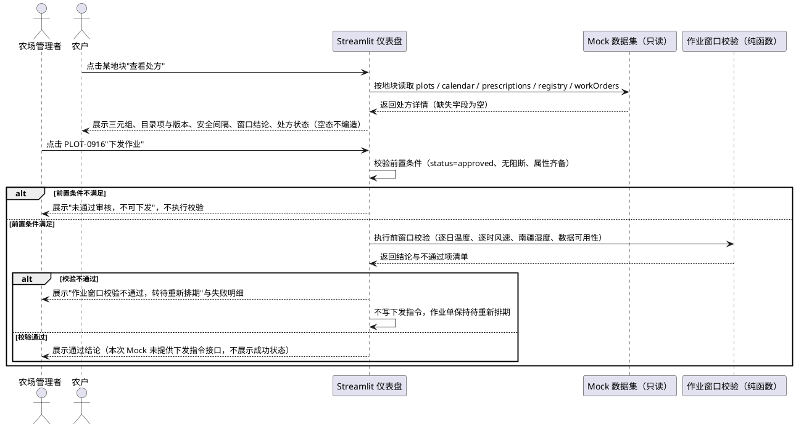

### **5.11.6 异常场景**

1. **数据集文件缺失**
   a. 触发条件：`mock/datasets/*.json` 不存在（未执行 `python -m mock.cli --write`）。
   b. 系统行为：查看处方与下发动作均提示数据不可用，不展示任何处方字段，不进入校验。
   c. 用户感知：提示"演示数据集不存在，请先执行 python -m mock.cli --write"。
2. **地块不存在或未登记**
   a. 触发条件：请求的地块编号不在任一数据集 `plots` 中。
   b. 系统行为：仅读查询返回空，不抛未捕获异常，页面展示空态。
   c. 用户感知：提示"该地块暂无数据"。
3. **处方记录缺失但地块存在**
   a. 触发条件：地块处于阻断状态或已拒绝且数据集未生成处方（如 PLOT-0913）。
   b. 系统行为：不编造处方字段，展示统一空态；查看入口保持禁用。
   c. 用户感知：提示"该地块暂无处方记录（识别结果待人工复核，处方生成已暂停）"。
4. **字段残缺**
   a. 触发条件：处方存在但分区、目录条目或窗口校验字段缺失。
   b. 系统行为：逐字段展示空态，其余字段正常展示；窗口结论缺失按不通过处理。
   c. 用户感知：缺失字段显示"该字段暂无数据"，不出现 0 或估算值。
5. **非演示模式未接入接口**
   a. 触发条件：运行在 `api_base` 模式且后端未提供处方详情或下发接口。
   b. 系统行为：提示能力未接入，不请求不存在的接口，不回退到 Mock 数据。
   c. 用户感知：提示"当前运行模式未接入处方详情接口，仅演示模式可用"。
6. **校验执行异常**
   a. 触发条件：校验函数抛异常或输入结构不符合预期。
   b. 系统行为：按不通过处理，阻止下发，记录异常类型，不展示成功状态。
   c. 用户感知：提示"作业窗口校验不通过，转待重新排期"，并附"校验服务异常，已暂停下发"。
7. **重复点击**
   a. 触发条件：同一地块短时间内多次点击"下发作业"。
   b. 系统行为：重复执行同一校验并覆盖同一结果面板，不产生多条下发记录，不展示重复成功状态。
   c. 用户感知：结果面板内容保持唯一且一致。
8. **刷新数据后结果残留**
   a. 触发条件：点击"刷新数据"后数据集快照变化。
   b. 系统行为：清除上一轮详情与校验结果状态，按最新快照重新渲染入口可见性。
   c. 用户感知：页面展示最新快照时间，不残留上一轮下发结论。

### **5.11.7 数据与接口约束**

1. **数据来源约束**：本小节的全部展示数据优先复用 `mock/datasets` 中已有的 `plots`、`calendar`、`prescriptions`、`registry`、`workOrders` 与 `mock/services/weather_stub.py` 提供的固定预报回放，不新增数据集文件、不改写既有数据集取值。
   a. 验收条件：三个数据集文件内容与修复前一致，仅通过只读方式消费。
2. **只读查询约束**：允许在 `mock/loader.py` 中新增只读的地块处方详情查询能力（按地块编号聚合 `plots`、`calendar`、`prescriptions`、`registry` 匹配条目与 `workOrders`），不得改变 `load_all`、`plot_index`、`dashboard_projection` 的现有返回结构与语义。
   a. 验收条件：现有仪表盘投影用例（地块数 5、快照时间非空）仍通过。
3. **接口约束（本次）**：本次不新增任何后端接口，`apps/platform_api` 维持现有 `GET /dashboard`、`POST /agents/decision/invoke`、`GET /health` 三类路由，不新增处方详情与下发路由。
   a. 验收条件：路由清单与修复前一致。
4. **后续接口契约草案（本次不实现，仅供评审确认影响范围）**：
   - `GET /api/v1/plots/{plotNo}/prescription`：响应 `data{plotNo, prescription{prescriptionNo,prescriptionVersion,status,registrySnapshot,safetyCheck,windowCheck,zones[],compoundGuard,evidenceRefs}, registryItems[], calendar{}, workOrder?}`；异常复用 `CIPM-DATA-7001`（数据不可用）与 `CIPM-CONTRACT-*`（校验失败）。
   - `POST /work-checks`（复用 IF-06）：请求 `{caller:"execution", plotNo, region, irrigationType, plannedWindow, prescriptionRef, sprayVolumeLPerMu, deviceMaxSprayVolumeLPerMu, idempotencyKey}`；响应 `{checkNo, verdict, thresholdVersion, weatherVersion, weatherPublishedAt, failedItems[], candidateWindows[], mandatoryNotices[], noCandidateReason?}`，其中执行阶段 `checkNo` 必须以 `WC-E-` 前缀并携带 `parentCheckNo`。
   - 影响范围：需扩展 IF-14 仪表盘查询或新增 IF-18/IF-19；需新增契约测试、审计记录（≥2 年）、执行阶段校验快照并与决策阶段快照并存；需满足 5.9.1-1/6/8 与 4.1-4（≤2 秒）、4.2-7/8、4.3-8 的既有红线。上述接口本次一律不实现。
5. **依赖约束**：不得引入新的重型依赖；前端反馈使用现有 Streamlit 能力（`session_state` 与内置提示组件）实现。
   a. 验收条件：依赖清单无新增重型包。

### **5.11.8 影响文件与验收用例**

**预计影响文件**

| 文件 | 变更类型 | 变更说明 |
|---|---|---|
| `apps/console/components/plot_table.py` | 修改 | 为"查看处方""下发作业"两个按钮补充点击处理（`on_click` 或 `if button:` 分支）、交互状态键与结果面板渲染；保持 PLOT-0913 禁用逻辑与"仅 `approved` 展示下发按钮"逻辑不变 |
| `apps/console/app.py` | 修改 | 为操作区块注入处方详情只读查询依赖（Mock 模式注入，非 Mock 模式注入 `None` 并提示未接入）；保持既有渲染顺序、待办、批次队列、异常提示与页尾说明不变 |
| `mock/loader.py` | 修改 | 新增按地块聚合的处方详情只读查询函数（返回 `plot`、`calendar`、`prescription`、`registryItems`、`workOrder`、`scenarioId`）；不改动既有函数签名与返回结构 |
| `domain/rules/work_window.py` | 新增 | 新增纯函数作业窗口校验模块（温度、风速、南疆湿度提示、数据可用性、结论聚合），mock 与界面共用；**不修改** `safety_interval.py`、`single_agent.py`、`types.py` 及 `domain/rules/__init__.py` 现有导出语义 |
| `tests/unit/rules/test_work_window.py` | 新增 | 覆盖 WW-01 至 WW-07 |
| `tests/unit/console/test_plot_actions.py` | 新增 | 覆盖 UI-14 至 UI-20 |
| `tests/unit/mock/test_plot_detail.py` | 新增 | 覆盖 LD-01 至 LD-03 |

**明确不改动**：`mock/datasets/*.json`（只读）、`apps/platform_api/**`（不新增路由）、`domain/rules/safety_interval.py`、`domain/rules/single_agent.py`、`domain/rules/types.py`、`domain/models/enums.py`、`domain/state_machines/**`、`apps/console/theme.py` 中既有文案常量（`BLOCKED_BUTTON_HELP`、`NOT_APPROVED_HINT`）。

**可执行验收用例**

| 用例编号 | 类型 | 验收点 | 预期 |
|---|---|---|---|
| WW-01 | 单元 | 逐日 `minT ≥ 12.5` 且 `avgT > 23` | 结论"通过" |
| WW-02 | 单元 | 2026-11-13 `minT=11.8`、`avgT=22.4` | 结论"不通过"，失败项含日期、11.8、12.5、22.4、23 |
| WW-03 | 单元 | 逐时风速 4 级 | 结论"不通过"，失败项含超限时段 |
| WW-04 | 单元 | 南疆 15:00 `rhPct=24` | 结论"通过（带强制提示）"，四项措施齐全 |
| WW-05 | 单元 | 北疆或 `rhPct=34` | 不触发提示，结论"通过" |
| WW-06 | 单元 | 温度/风速/湿度/地域/灌溉任一项缺失 | 结论"不通过"（安全默认） |
| WW-07 | 单元 | 多项同时违反 | 结论"不通过"，失败项清单完整，结论带阈值版本 |
| UI-14 | 界面 | 点击 PLOT-0912"查看处方" | 可见 RX-20261113-0001、12.0/1.6、XJ-ACE-0381、XJ-REG-2026.11.01、7/20/13、"满足"、"通过"、"待审核" |
| UI-15 | 界面 | 点击 PLOT-0915"查看处方" | 展示"降级待确认"、buffer 2、降级原因"缓冲不足3天" |
| UI-16 | 界面 | 点击 PLOT-0916"下发作业" | 出现"作业窗口校验不通过，转待重新排期"与 11.8℃/12.5℃ 明细，无成功类文案 |
| UI-17 | 界面 | PLOT-0913 | 查看处方 `disabled=true` 且帮助含"待人工复核"，无下发按钮 |
| UI-18 | 界面 | 全页文本检索 | "豁免""跳过校验""强制下发"零命中 |
| UI-19 | 界面 | 全页按钮统计 | "下发作业"按钮数量为 1，键为 `dispatch_PLOT-0916` |
| UI-20 | 界面 | 注入无 `approved` 处方的数据 | 页面不渲染任何"下发作业"按钮 |
| LD-01 | 单元 | `PLOT-0916` 详情查询 | 返回处方 `approved` 与 `workOrders[].windowCheckRef.verdict=fail` |
| LD-02 | 单元 | `PLOT-0913` 详情查询 | 处方为空、不抛异常、不编造字段 |
| LD-03 | 单元 | 未知地块编号 | 返回空结果并给出可读提示 |

**回归与测试数量口径**

1. 既有 339 项测试必须全部通过（以 `venv/Scripts/python.exe -m pytest -q` 实测为准），本小节不得使任何既有用例失败或跳过范围扩大。
   a. 验收条件：执行全量测试 → 失败项为 0。
2. 当前真实测试采集数为 376 项（339 原有 + 19 项仪表盘交互 + 18 项三个 Agent 与四阶段编排）；最终数量以实际采集结果为准，如与预期不一致必须在交付说明中写明差异原因。
   a. 验收条件：`pytest --collect-only -q` 采集数与新增用例数一致。

### **5.11.9 条款不变声明**

1. **安全间隔口径不变**：`domain/rules/safety_interval.py` 的满足/降级/拒绝判定、`R`/`S`/buffer 计算口径与提示四要素文案（5.3.1-8—11、design 2.1.3.4）一律不变。
2. **单剂复配口径不变**：`domain/rules/single_agent.py` 的 V1.0 单剂约束与复配硬拦截（5.3.1-3、5.3.1-17、design 2.1.3.4）一律不变。
3. **处方与识别契约不变**：识别结果阻断与恢复、处方三元组完整性、目录绑定与版本冻结、审核与调整留痕（5.2、5.3、6.4、6.5）一律不变。
4. **作业单状态机不变**：待排期、待下发、已下发、执行中、已完成、已中止的流转与"待重新排期"的转入条件（5.4.1-6）一律不变；本次交互仅在页面上展示既有状态，不新增状态取值。
5. **作业窗口口径不变**：5.9.1 的温度、风速、南疆湿度、滴灌喷液量四项判定与双重校验优先级、阈值版本双人确认、不可人工豁免红线条款一律不变；新增的 `work_window.py` 只作为同一判定逻辑在演示链路上的纯函数实现，不得产生第二套阈值口径。
6. **DFX 红线不变**：4.1 性能（校验 ≤2 秒、首屏 ≤3 秒）、4.2 可靠性（安全默认为不通过、双阶段快照并存）、4.3 安全性（二次确认与审计）、4.4 可维护性（校验快照可回放）、4.5 兼容性（版本冻结）条款一律不变。
7. **数据约束不变**：6.5 处方图、6.6 作业单、6.12 作业窗口校验记录的全部字段约束一律不变；本小节新增的只是展示层聚合视图，不新增领域对象。
8. **后端接口不变**：本次不新增、不修改任何后端接口；本小节中"下发作业"只做校验与结果展示，不产生真实下发动作。