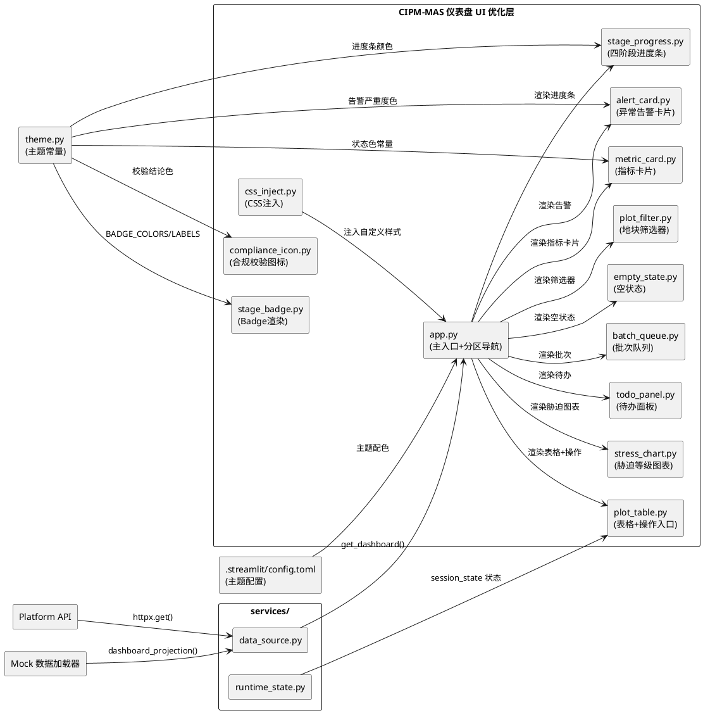
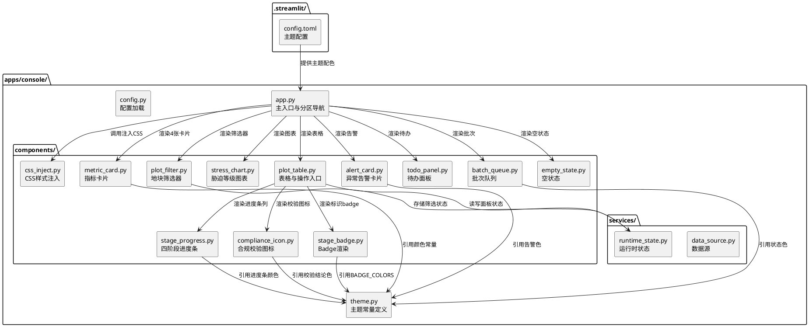
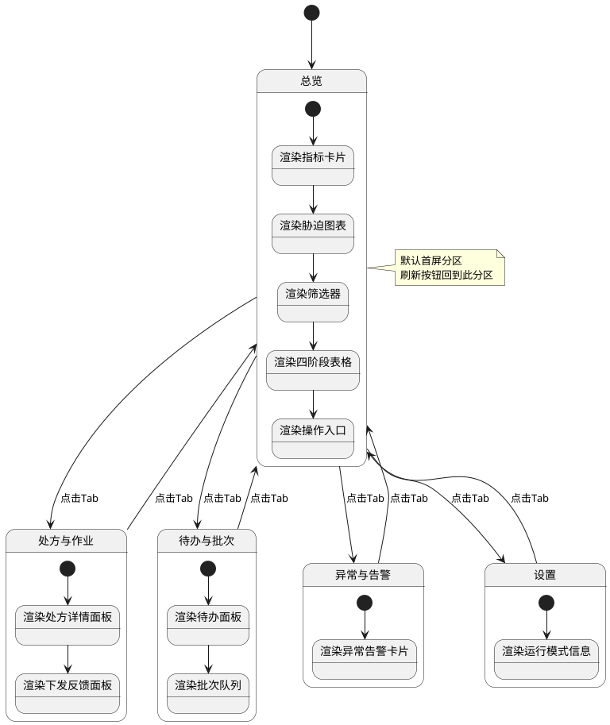
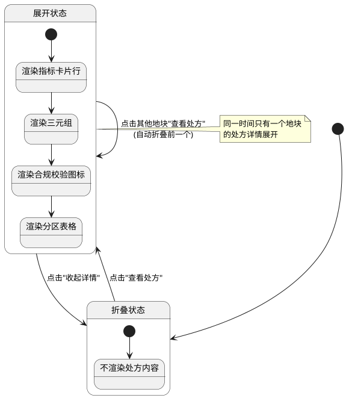
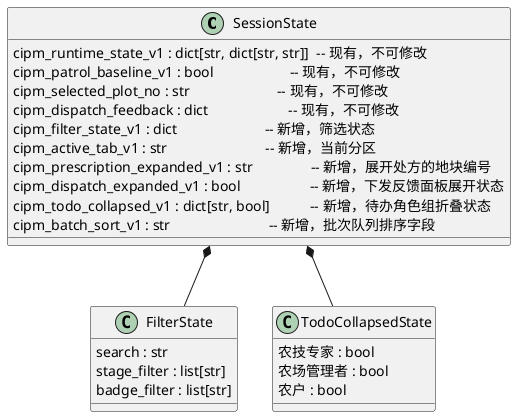
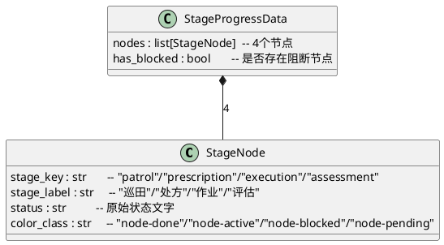
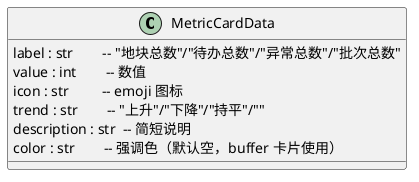
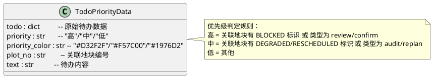

# 棉田植保决策多智能体系统 仪表盘 UI 优化实现方案

# 一、需求与存量功能关系分析

## 1.1 需求功能与存量功能对比

### 1.1.1 已实现功能

| 需求功能 | 存量功能 | 代码位置 | 匹配度 |
|---------|---------|---------|--------|
| 页面标题与模式说明 | `st.title` + `st.caption` 渲染标题与模式说明 | `app.py:37-41` | 100% |
| 快照时间展示 | `st.caption` 渲染快照时间 | `app.py:43-44` | 100% |
| 刷新按钮 | `st.button("刷新数据")` + `get_dashboard.clear()` + `clear_runtime_state()` + `st.rerun()` | `app.py:46-49` | 75% |
| 地块总数 metric | `metric_column.metric("地块总数", len(plots))` | `app.py:62` | 50% |
| 四阶段总览表格 | `render_plot_table(plots)` 使用 `st.dataframe` 展示9列文字表格 | `plot_table.py:53-59` | 50% |
| 业务标识 badge | `render_badges()` 使用 `st.markdown` 渲染胶囊标签 | `stage_badge.py:16-23` | 75% |
| Badge 颜色映射 | `BADGE_COLORS` 定义4种状态色 | `theme.py:9-14` | 100% |
| Badge 标签映射 | `BADGE_LABELS` 定义4种中文标签 | `theme.py:16-21` | 100% |
| 处方详情渲染 | `render_prescription_detail()` 渲染处方状态、三元组、合规校验、分区表格 | `plot_table.py:142-249` | 50% |
| 下发反馈渲染 | `render_dispatch_feedback()` 渲染下发校验结论 | `plot_table.py:259-279` | 50% |
| 查看处方按钮 | `columns[1].button("查看处方")` + disabled 控制 | `plot_table.py:72-80` | 75% |
| 下发作业按钮 | `columns[2].button("下发作业")` + approved 条件控制 | `plot_table.py:82-115` | 75% |
| 待办事项分组 | `group_todos()` 按 ROLE_ORDER 分3组 | `todo_panel.py:15-20` | 75% |
| 待办事项渲染 | `render_todos()` 逐条 markdown 列表 | `todo_panel.py:27-36` | 25% |
| 批次队列渲染 | `render_batch_queue()` 使用 `st.dataframe` 展示5列 | `batch_queue.py:21-31` | 50% |
| 批次队列空状态 | `st.info("暂无批次")` | `batch_queue.py:23-24` | 100% |
| 异常提示渲染 | `st.error()` 逐条渲染告警 | `app.py:83-86` | 25% |
| 空状态提示 | `render_empty_state()` 使用 `st.info` | `empty_state.py:8-9` | 100% |
| 数据源缓存 | `@st.cache_data(ttl=CACHE_TTL_SECONDS)` | `data_source.py:10-11` | 100% |
| 运行时状态管理 | `set_stage()` / `merge_stages()` / `clear_runtime_state()` | `runtime_state.py:17-58` | 100% |
| 阻断按钮禁用 | `disabled=blocked` + `help=BLOCKED_BUTTON_HELP` | `plot_table.py:72-76` | 100% |
| 未审核不可下发 | `NOT_APPROVED_HINT` caption 提示 | `plot_table.py:114-115` | 75% |

### 1.1.2 需要扩展的功能

| 需求功能 | 存量功能 | 差异说明 | 扩展方向 |
|---------|---------|---------|---------|
| 刷新按钮清除筛选 | `clear_runtime_state()` 仅清除 stage 状态 | 需额外清除筛选条件与折叠状态 session_state 键 | 在 `clear_runtime_state()` 中增加清除筛选/折叠键，或新增 `clear_ui_state()` 函数 |
| 指标卡片展示 | `st.metric("地块总数", len(plots))` 仅1个指标 | 需4张卡片（地块/待办/异常/批次），含图标、趋势、说明文字 | 新增 `metric_card.py` 组件，使用 `st.container(border=True)` + 自定义 CSS |
| 四阶段进度条 | 表格4列文字展示阶段状态 | 需合并为1列水平进度条，节点颜色区分4种状态 | 新增 `stage_progress.py` 组件，使用 HTML/CSS 渲染进度条 |
| Badge 样式优化 | `render_badge()` 已有胶囊样式 | 需增加内边距、调整字号、添加阴影 | 修改 `stage_badge.py` 中 CSS 样式字符串 |
| 处方详情卡片化 | `st.container(border=True)` 已有边框容器 | 需圆角、阴影、内边距等更精致卡片样式 | 通过 CSS 注入增强 `st.container(border=True)` 样式 |
| 处方指标卡片化 | `st.metric` 4列展示处方指标 | buffer 需根据值变色（<0红/0-3橙/≥3绿） | 新增 `metric_card.py` 中条件变色逻辑 |
| 合规校验图标化 | 文字展示 "满足"/"降级"/"拒绝" | 需图标+文字（勾号/感叹号/叉号） | 新增 `compliance_icon.py` 组件 |
| 待办优先级标签 | 无优先级判定 | 需按地块标识+类型自动判定高/中/低 | 新增 `todo_priority()` 函数在 `todo_panel.py` |
| 待办卡片化 | markdown 列表 `- plotNo: text` | 需每条待办为独立卡片含标签+地块+内容 | 修改 `render_todos()` 使用 `st.container(border=True)` |
| 批次队列状态 badge | 纯文字状态列 | 需 badge 标签形式，6种状态色 | 新增批次状态色映射，修改 `batch_queue.py` |
| 异常提示卡片化 | `st.error()` 逐条渲染 | 需卡片形式含图标+地块+文字+背景色 | 新增 `alert_card.py` 组件 |
| 地块操作入口紧凑化 | 逐地块三列布局（名称\|查看处方\|下发作业） | 需改为表格内嵌按钮或紧凑列表 | 重构 `render_action_entries()` 为表格内嵌形式 |

### 1.1.3 需要新增的功能或接口

**布局与导航模块**
- 分区导航（5个Tab：总览/处方与作业/待办与批次/异常与告警/设置） — `app.py` 重构
- 顶部固定区域（标题/模式/快照时间/刷新按钮） — `app.py` 重构
- 地块筛选器（搜索框+阶段筛选+标识筛选） — 新增 `plot_filter.py` 组件
- 筛选状态保持（session_state 存储） — 新增筛选状态键
- 胁迫等级分布图表 — 新增 `stress_chart.py` 组件

**可视化模块**
- 指标卡片组件 — 新增 `metric_card.py`
- 四阶段进度条组件 — 新增 `stage_progress.py`
- 紧迫度热力标识 — 修改 `batch_queue.py` 增加 CSS 渐变背景
- 安全间隔 buffer 可视化 — 修改 `plot_table.py` 处方详情区域
- 合规校验图标组件 — 新增 `compliance_icon.py`

**交互模块**
- 处方详情折叠面板 — 修改 `plot_table.py` 使用 `st.expander`
- 下发反馈折叠面板 — 修改 `plot_table.py` 使用 `st.expander`
- 待办角色组折叠 — 修改 `todo_panel.py` 使用 `st.expander`
- 批次队列排序 — 修改 `batch_queue.py` 增加排序控件
- 表格行高亮（阻断浅红/降级浅橙） — 新增 CSS 行样式注入

**主题模块**
- `.streamlit/config.toml` — 新建文件
- 自定义 CSS 注入 — 新增 `css_inject.py` 组件
- theme.py 扩展常量 — 修改 `theme.py`

**测试模块**
- `test_metric_card.py` — 新增
- `test_stage_progress.py` — 新增
- `test_plot_filter.py` — 新增
- `test_stress_chart.py` — 新增
- `test_compliance_icon.py` — 新增
- `test_alert_card.py` — 新增
- `test_batch_queue.py` — 新增
- `test_todo_priority.py` — 新增
- `test_css_inject.py` — 新增
- 现有测试文件更新 — 适配新布局

## 1.2 存量功能详细分析

### 1.2.1 app.py 主入口

**接口契约**：
- 入参：无（从 `get_dashboard()` 获取数据）
- 出参：无（直接渲染 Streamlit 页面）
- 异常：`get_dashboard()` 失败时返回 `degraded=True` 的降级数据
- 副作用：设置 `session_state` 中的运行时状态键

**业务规则**：
- Mock 模式优先：`settings is None` 时自动切换 mock 模式
- 巡田基线应用：`apply_patrol_baseline(plots)` 在首次加载时执行，后续通过 `BASELINE_KEY` 跳过
- 阶段合并：`merge_stages(plots)` 将运行时状态覆盖到原始数据

**扩展点**：
- `st.set_page_config(page_title=PAGE_TITLE, layout="wide")` — 页面配置入口
- 数据加载与渲染之间无中间层，需在此处插入分区导航逻辑

**约束**：
- `st.set_page_config` 必须是第一个 Streamlit 调用
- `apply_patrol_baseline` 只执行一次（受 `BASELINE_KEY` 控制）
- `st.rerun()` 会重置所有非 session_state 状态

### 1.2.2 plot_table.py 地块表格与操作入口

**接口契约**：
- `render_plot_table(plots)` → None：渲染9列 dataframe
- `render_action_entries(plots)` → None：逐地块渲染操作按钮
- `render_action_feedback()` → None：渲染处方详情与下发反馈
- `build_rows(plots)` → list[dict]：构建表格行数据
- `evaluate_dispatch_window(bundle)` → WorkWindowResult：评估作业窗口

**业务规则**：
- 阻断地块（`BLOCKED` in badges）的查看处方按钮 disabled
- 仅 `prescription == "已通过"` 的地块显示下发作业按钮
- 下发后根据 `outcome.status` 更新 execution 和 assessment 阶段
- 处方详情通过 `STATE_SELECTED_PLOT` session_state 键控制显示/隐藏

**扩展点**：
- `COLUMNS` 常量控制表格列顺序 — 可修改列定义
- `build_rows()` 函数控制行数据结构 — 可重构为进度条数据
- `STATE_SELECTED_PLOT` / `STATE_DISPATCH` 控制面板状态 — 可扩展为折叠面板

**约束**：
- `st.rerun()` 在按钮点击后触发，导致页面整体刷新
- `plot_bundle(plot_no)` 依赖 mock 数据加载器，不可修改其返回结构
- `ExecutionAgent().dispatch()` 调用链不可修改

### 1.2.3 stage_badge.py Badge 渲染

**接口契约**：
- `badge_label(code)` → str：返回中文标签
- `badge_color(code)` → str：返回 hex 颜色值
- `render_badge(code)` → None：渲染单个 badge
- `render_badges(codes)` → None：渲染多个 badge

**业务规则**：
- 颜色映射引用 `BADGE_COLORS` 常量，未知 code 回退到 `#757575`
- 标签映射引用 `BADGE_LABELS` 常量，未知 code 回退到 "未知标识"

**扩展点**：
- CSS 样式字符串可修改（当前 `padding:2px 10px;border-radius:12px;font-size:12px`）
- 可增加阴影、调整字号

**约束**：
- `unsafe_allow_html=True` 必须保留
- 颜色值必须引用 `theme.py` 常量，不可硬编码

### 1.2.4 batch_queue.py 批次队列

**接口契约**：
- `build_batch_rows(batches)` → list[dict]：构建5列行数据
- `render_batch_queue(batches)` → None：渲染队列

**业务规则**：
- 空批次显示 `st.info("暂无批次")`
- 列顺序固定：批次号/地块/位次/紧迫度/状态

**扩展点**：
- `BATCH_COLUMNS` 常量可修改列定义
- 紧迫度列可增加 CSS 渐变背景
- 状态列可改为 badge 标签

**约束**：
- `st.dataframe` 不支持单元格级别样式，紧迫度热力标识需通过自定义 HTML 表格实现

### 1.2.5 todo_panel.py 待办面板

**接口契约**：
- `group_todos(todos)` → dict[str, list[dict]]：按角色分组
- `todo_count(todos)` → int：返回待办总数
- `render_todos(todos)` → None：渲染待办列表

**业务规则**：
- 3个角色组：农技专家/农场管理者/农户
- 类型映射：review/confirm→农技专家，audit/replan/reschedule→农场管理者
- 空组显示 "暂无待办"

**扩展点**：
- `ROLE_ORDER` 可调整角色顺序
- `ROLE_BY_TYPE` 可扩展类型映射
- 渲染逻辑可改为卡片化+优先级标签+折叠

**约束**：
- 优先级判定需访问地块 badges 数据，当前 `render_todos` 只接收 todos 列表，需扩展入参

### 1.2.6 runtime_state.py 运行时状态

**接口契约**：
- `set_stage(plot_no, stage, value)` → None：设置阶段状态
- `stage_of(plot_no, stage)` → str | None：查询阶段状态
- `merge_stages(plots)` → list[dict]：合并运行时状态到 plots
- `apply_patrol_baseline(plots)` → None：应用巡田基线
- `clear_runtime_state()` → None：清除运行时状态

**业务规则**：
- `STATE_KEY = "cipm_runtime_state_v1"` 存储 plot_no → {stage: value} 映射
- `BASELINE_KEY = "cipm_patrol_baseline_v1"` 标记基线是否已应用
- `STAGES = ("patrol", "prescription", "execution", "assessment")` 合法阶段枚举

**扩展点**：
- 可新增筛选状态键（如 `cipm_filter_state_v1`）
- 可新增折叠状态键（如 `cipm_expand_state_v1`）

**约束**：
- 不可修改现有键名 `cipm_runtime_state_v1`、`cipm_patrol_baseline_v1`
- 不可修改 `STAGES` 定义
- `apply_patrol_baseline` 中 `PatrolAgent().inspect()` 调用不可修改

### 1.2.7 data_source.py 数据源

**接口契约**：
- `get_dashboard(mock, api_base)` → dict：获取仪表盘数据
- `@st.cache_data(ttl=CACHE_TTL_SECONDS)` 缓存装饰

**业务规则**：
- Mock 模式调用 `dashboard_projection()`
- 运行模式调用 `httpx.get(f"{api_base}/api/v1/dashboard")`
- 失败时返回降级数据（`degraded=True`）

**约束**：
- 不可修改 API 调用方式与返回处理
- `CACHE_TTL_SECONDS = 30` 不可修改
# 二、增量设计方案

## 2.1 实现模型

### 2.1.1 上下文视图



### 2.1.2 服务/组件总体架构



### 2.1.3 实现设计文档

#### 分区导航状态流转



#### 处方详情折叠面板状态流转



## 2.2 接口设计

### 2.2.1 总体设计

接口按功能模块分为4类：

| 接口分类 | 组件文件 | 稳定性 | 说明 |
|---------|---------|--------|------|
| 布局导航 | `app.py` | 稳定 | 分区导航、顶部固定区域 |
| 数据可视化 | `metric_card.py`, `stage_progress.py`, `stress_chart.py`, `compliance_icon.py` | 稳定 | 指标卡片、进度条、图表、图标 |
| 交互控件 | `plot_filter.py`, `plot_table.py`, `todo_panel.py`, `batch_queue.py` | 稳定 | 筛选器、表格、待办、批次 |
| 主题样式 | `css_inject.py`, `theme.py`, `.streamlit/config.toml` | 稳定 | CSS注入、常量定义、主题配置 |
| 异常展示 | `alert_card.py`, `empty_state.py` | 稳定 | 告警卡片、空状态 |

### 2.2.2 接口清单

#### css_inject.py — CSS 样式注入

```python
def inject_custom_css() -> None:
    """注入自定义 CSS 样式到 Streamlit 页面。

    包含卡片样式、间距规范、进度条样式、热力标识样式、badge 胶囊样式增强。

    前置条件：必须在 st.set_page_config 之后调用。
    后置条件：页面 DOM 中注入 <style> 标签。
    异常映射：无（纯字符串注入，不产生业务异常）。
    """
```

#### metric_card.py — 指标卡片

```python
def render_metric_card(
    label: str,
    value: int | str,
    icon: str,
    trend: str = "",
    description: str = "",
    color_override: str = "",
) -> None:
    """渲染单张指标卡片。

    Args:
        label: 指标名称（如"地块总数"）
        value: 指标数值
        icon: emoji 图标（如 "🌾"）
        trend: 趋势指示（"上升"/"下降"/"持平"/""）
        description: 简短说明文字
        color_override: 自定义卡片强调色（如 buffer 变色），空字符串表示使用默认色

    前置条件：inject_custom_css() 已调用。
    后置条件：页面渲染一张卡片容器。
    """

def render_metric_cards_row(
    plots_count: int,
    todos_count: int,
    alerts_count: int,
    batches_count: int,
) -> None:
    """渲染4张指标卡片横向排列。

    前置条件：dashboard 数据已加载。
    后置条件：页面渲染4张卡片（地块总数/待办总数/异常总数/批次总数）。
    """
```

#### stage_progress.py — 四阶段进度条

```python
STAGE_ORDER: tuple[str, ...] = ("patrol", "prescription", "execution", "assessment")
STAGE_LABELS: dict[str, str] = {
    "patrol": "巡田",
    "prescription": "处方",
    "execution": "作业",
    "assessment": "评估",
}

# 节点颜色映射：状态 → CSS颜色类
NODE_COLOR_MAP: dict[str, str] = {
    # 绿色（已完成）
    "已完成": "node-done",
    "已通过": "node-done",
    "已下发": "node-done",
    "达标": "node-done",
    # 蓝色（进行中/待处理）
    "识别中": "node-active",
    "待审核": "node-active",
    "待作业窗口": "node-active",
    "待下发": "node-active",
    "待评估": "node-active",
    "草稿": "node-active",
    "待接入数据": "node-active",
    # 红色（阻断/拒绝/不可下发）
    "阻断待复核": "node-blocked",
    "已阻断": "node-blocked",
    "已驳回": "node-blocked",
    "已拒绝": "node-blocked",
    "不可下发": "node-blocked",
    "数据接入失败": "node-blocked",
    # 灰色（未开始）
    "未开始": "node-pending",
}

def render_stage_progress(stages: dict[str, str]) -> str:
    """渲染四阶段水平进度条，返回 HTML 字符串。

    Args:
        stages: {"patrol": "已完成", "prescription": "已阻断", ...}

    Returns:
        HTML 字符串，包含4个节点和连接线。

    前置条件：stages 包含4个阶段键。
    后置条件：无（纯字符串生成）。
    """

def classify_stage_status(status: str) -> str:
    """将阶段状态值分类为颜色类别。

    Args:
        status: 阶段状态文字（如"已完成""已阻断"）

    Returns:
        颜色类别（"node-done"/"node-active"/"node-blocked"/"node-pending"）
    """
```

#### plot_filter.py — 地块筛选器

```python
FILTER_STATE_KEY = "cipm_filter_state_v1"

def get_filter_state() -> dict:
    """从 session_state 获取筛选状态。

    Returns:
        {"search": str, "stage_filter": list[str], "badge_filter": list[str]}
    """

def set_filter_state(search: str, stage_filter: list[str], badge_filter: list[str]) -> None:
    """将筛选状态写入 session_state。"""

def clear_filter_state() -> None:
    """清除筛选状态。"""

def filter_plots(plots: list[dict], search: str, stage_filter: list[str], badge_filter: list[str]) -> list[dict]:
    """根据筛选条件过滤地块列表。

    Args:
        plots: 地块列表
        search: 搜索关键词（匹配 plotNo 或 plotName）
        stage_filter: 阶段状态筛选值集合
        badge_filter: 业务标识筛选值集合

    Returns:
        过滤后的地块列表

    前置条件：plots 已经过 merge_stages 处理。
    """

def render_plot_filter(plots: list[dict]) -> list[dict]:
    """渲染筛选器控件并返回过滤后的地块列表。

    Args:
        plots: 原始地块列表

    Returns:
        过滤后的地块列表

    前置条件：plots 已加载。
    后置条件：筛选条件写入 session_state[FILTER_STATE_KEY]。
    """
```

#### stress_chart.py — 胁迫等级分布图表

```python
STRESS_LEVELS: tuple[str, ...] = ("无", "轻度", "中度", "重度")
STRESS_COLORS: dict[str, str] = {
    "无": "#4CAF50",
    "轻度": "#FFEB3B",
    "中度": "#FF9800",
    "重度": "#D32F2F",
}

def build_stress_data(plots: list[dict]) -> dict[str, int]:
    """统计各胁迫等级的地块数量。

    Args:
        plots: 地块列表

    Returns:
        {"无": 3, "轻度": 1, "中度": 1, "重度": 0}
    """

def render_stress_chart(plots: list[dict]) -> None:
    """渲染胁迫等级分布柱状图。

    使用 st.plotly_chart 渲染 plotly Figure。

    前置条件：plots 已加载。
    后置条件：页面渲染一张柱状图。
    异常映射：所有地块胁迫等级为"无"时展示单色柱+标注文字。
    """
```

#### compliance_icon.py — 合规校验图标

```python
SAFETY_ICON_MAP: dict[str, tuple[str, str]] = {
    "satisfied": ("✅", "#4CAF50"),
    "degraded": ("⚠️", "#F57C00"),
    "refused": ("❌", "#D32F2F"),
}
WINDOW_ICON_MAP: dict[str, tuple[str, str]] = {
    "pass": ("✅", "#4CAF50"),
    "pass_with_mandatory_notice": ("⚠️", "#F57C00"),
    "fail": ("❌", "#D32F2F"),
}

def render_safety_icon(conclusion: str) -> None:
    """渲染安全间隔校验结论图标+文字。

    Args:
        conclusion: "satisfied"/"degraded"/"refused"
    """

def render_window_icon(conclusion: str) -> None:
    """渲染作业窗口校验结论图标+文字。

    Args:
        conclusion: "pass"/"pass_with_mandatory_notice"/"fail"
    """
```

#### alert_card.py — 异常告警卡片

```python
ALERT_SEVERITY_COLORS: dict[str, str] = {
    "high": "#D32F2F",
    "medium": "#F57C00",
    "low": "#1976D2",
}

def classify_alert_severity(alert: dict, plots: list[dict]) -> str:
    """判定告警严重程度。

    Args:
        alert: {"plotNo": str, "text": str}
        plots: 地块列表（用于查询关联地块的 badges）

    Returns:
        "high"/"medium"/"low"
    """

def render_alert_card(alert: dict, plots: list[dict]) -> None:
    """渲染单条异常告警卡片。

    前置条件：alert 包含 plotNo 和 text 字段。
    后置条件：页面渲染一张告警卡片。
    """

def render_alert_cards(alerts: list[dict], plots: list[dict]) -> None:
    """渲染全部异常告警卡片列表。"""
```

#### theme.py 扩展常量

```python
# 新增常量定义

# 进度条节点颜色
NODE_DONE_COLOR = "#4CAF50"       # 已完成 - 绿色
NODE_ACTIVE_COLOR = "#1976D2"     # 进行中 - 蓝色
NODE_BLOCKED_COLOR = "#D32F2F"    # 阻断 - 红色
NODE_PENDING_COLOR = "#9E9E9E"    # 未开始 - 灰色

# 行高亮颜色
ROW_BLOCKED_BG = "#FFEBEE"        # 阻断行浅红背景
ROW_DEGRADED_BG = "#FFF3E0"       # 降级行浅橙背景

# 卡片样式
CARD_BORDER_RADIUS = "8px"
CARD_PADDING = "16px"
CARD_BOX_SHADOW = "0 2px 4px rgba(0,0,0,0.1)"
CARD_MARGIN_BOTTOM = "16px"

# 间距规范
SECTION_GAP = "24px"
CARD_GAP = "16px"

# 状态色（与 BADGE_COLORS 一致，独立命名用于不同上下文）
STATUS_BLOCKED = "#D32F2F"
STATUS_DEGRADED = "#F57C00"
STATUS_REFUSED = "#B71C1C"
STATUS_RESCHEDULED = "#1976D2"

# 批次队列状态色
BATCH_STATE_COLORS: dict[str, str] = {
    "draft": "#9E9E9E",           # 草稿 - 灰色
    "pending_confirm": "#1976D2",  # 待确认 - 蓝色
    "queued": "#4CAF50",           # 已入队 - 绿色
    "executing": "#F57C00",        # 执行中 - 橙色
    "completed": "#2E7D32",        # 已完成 - 深绿色
    "cancelled": "#D32F2F",        # 已取消 - 红色
}

BATCH_STATE_LABELS: dict[str, str] = {
    "draft": "草稿",
    "pending_confirm": "待确认",
    "queued": "已入队",
    "executing": "执行中",
    "completed": "已完成",
    "cancelled": "已取消",
}

# 紧迫度热力色阶
URGENCY_HEAT_LOW = "#FFF9C4"      # 浅黄
URGENCY_HEAT_HIGH = "#D32F2F"     # 深红

# 待办优先级色
PRIORITY_HIGH_COLOR = "#D32F2F"   # 高 - 红色
PRIORITY_MEDIUM_COLOR = "#F57C00" # 中 - 橙色
PRIORITY_LOW_COLOR = "#1976D2"    # 低 - 蓝色

# 安全间隔 buffer 色
BUFFER_DANGER_COLOR = "#D32F2F"   # <0 红色
BUFFER_WARNING_COLOR = "#F57C00"  # 0-3 橙色
BUFFER_SAFE_COLOR = "#4CAF50"     # ≥3 绿色

# 分区名称
TAB_OVERVIEW = "总览"
TAB_PRESCRIPTION = "处方与作业"
TAB_TODO_BATCH = "待办与批次"
TAB_ALERT = "异常与告警"
TAB_SETTINGS = "设置"
```

#### .streamlit/config.toml

```toml
[theme]
primaryColor = "#2E7D32"
backgroundColor = "#FAFAFA"
secondaryBackgroundColor = "#E8F5E9"
textColor = "#212121"
font = "sans serif"

[server]
maxUploadSize = 10
```

说明：
- `primaryColor` 采用绿色系 `#2E7D32`（Material Green 800），契合棉田植保业务场景
- `backgroundColor` 采用浅灰 `#FAFAFA`，保证与主色对比度 ≥ 4.5:1
- `secondaryBackgroundColor` 采用浅绿 `#E8F5E9`，与主色协调
- `textColor` 采用深灰 `#212121`，保证文字可读性
- `font` 使用 `sans serif`（Streamlit 内置字体族），兼容中文字体

## 2.3 数据模型

### 2.3.1 设计目标

1. **支持的业务场景**：分区导航、指标卡片展示、四阶段进度可视化、筛选交互、胁迫等级图表、合规校验图标化、待办优先级标签、批次队列热力标识、异常告警卡片化、折叠面板交互
2. **性能目标**：首屏加载 ≤3秒、筛选响应 ≤500ms、Tab切换 ≤800ms、折叠动画 ≤300ms
3. **兼容策略**：复用现有 session_state 键名体系，新增键名以 `cipm_` 前缀保持一致性

### 2.3.2 模型实现

#### session_state 键名体系



#### 进度条数据模型



#### 指标卡片数据模型



#### 待办优先级数据模型



## 2.4 各组件修改/新增详细方案

### 2.4.1 新增 `.streamlit/config.toml`

**文件路径**：`.streamlit/config.toml`

**内容**：如 2.2.2 节中定义的主题配置

**影响范围**：全局 Streamlit 主题，所有组件渲染时自动应用

**兼容性**：向后兼容，config.toml 不存在时 Streamlit 使用默认主题

### 2.4.2 修改 `apps/console/theme.py`

**修改方式**：在现有常量之后追加新增常量定义

**新增内容**：
- 进度条节点颜色常量（`NODE_DONE_COLOR` 等4个）
- 行高亮颜色常量（`ROW_BLOCKED_BG`、`ROW_DEGRADED_BG`）
- 卡片样式常量（`CARD_BORDER_RADIUS` 等4个）
- 间距规范常量（`SECTION_GAP`、`CARD_GAP`）
- 状态色独立命名常量（`STATUS_BLOCKED` 等4个）
- 批次队列状态色映射（`BATCH_STATE_COLORS`、`BATCH_STATE_LABELS`）
- 紧迫度热力色阶常量（`URGENCY_HEAT_LOW`、`URGENCY_HEAT_HIGH`）
- 待办优先级色常量（`PRIORITY_HIGH_COLOR` 等3个）
- 安全间隔 buffer 色常量（`BUFFER_DANGER_COLOR` 等3个）
- 分区名称常量（`TAB_OVERVIEW` 等5个）

**约束**：不修改现有 `BADGE_COLORS`、`BADGE_LABELS`、`COLUMNS`、`PAGE_TITLE` 等常量

### 2.4.3 新增 `apps/console/components/css_inject.py`

**文件路径**：`apps/console/components/css_inject.py`

**核心函数**：`inject_custom_css() -> None`

**CSS 内容包含**：

1. **卡片样式**：
   - `.stContainer[data-testid="stVerticalBlockBorderWrapper"]` 增加圆角 `border-radius: 8px`、阴影 `box-shadow: 0 2px 4px rgba(0,0,0,0.1)`、内边距 `padding: 16px`

2. **间距规范**：
   - 分区间距：通过 `st.markdown` 插入 `<div style="margin-bottom: 24px">` 分隔
   - 卡片间距：通过 flexbox gap 或 margin-bottom 实现

3. **进度条样式**：
   - `.stage-progress-container`：flex 水平布局
   - `.stage-node`：圆形节点，40px 直径
   - `.stage-node.node-done`：绿色背景 `#4CAF50`
   - `.stage-node.node-active`：蓝色背景 `#1976D2`
   - `.stage-node.node-blocked`：红色背景 `#D32F2F`
   - `.stage-node.node-pending`：灰色背景 `#9E9E9E`
   - `.stage-connector`：节点间连接线，高度 4px
   - `.stage-label`：节点下方文字标签

4. **紧迫度热力标识样式**：
   - `.urgency-cell`：表格单元格背景色渐变
   - 通过 inline style 动态设置 `background-color`

5. **Badge 胶囊样式增强**：
   - `.badge-pill`：`padding: 4px 12px; border-radius: 16px; font-size: 11px; box-shadow: 0 1px 2px rgba(0,0,0,0.08); font-weight: 500`

6. **表格行高亮样式**：
   - `.row-blocked`：`background-color: #FFEBEE`
   - `.row-degraded`：`background-color: #FFF3E0`

7. **折叠面板样式**：
   - Streamlit `st.expander` 默认样式增强：圆角、阴影

**调用时机**：在 `app.py` 中 `st.set_page_config` 之后、任何内容渲染之前调用

### 2.4.4 新增 `apps/console/components/metric_card.py`

**文件路径**：`apps/console/components/metric_card.py`

**核心函数**：
- `render_metric_card(label, value, icon, trend, description, color_override) -> None`
- `render_metric_cards_row(plots_count, todos_count, alerts_count, batches_count) -> None`

**实现方式**：
- 每张卡片使用 `st.container(border=True)` 包裹
- 卡片内部使用 `st.columns([1, 3])` 分为图标列和内容列
- 图标列渲染 emoji 图标（`🌾` 地块、`📋` 待办、`⚠️` 异常、`📦` 批次）
- 内容列渲染指标名称（caption 样式）、数值（大字号 markdown）、说明文字
- buffer 卡片通过 `color_override` 参数传入 `BUFFER_DANGER_COLOR`/`BUFFER_WARNING_COLOR`/`BUFFER_SAFE_COLOR`

**数据流**：
- `render_metric_cards_row` 从 `dashboard` 数据中提取4个计数值
- 4张卡片使用 `st.columns(4)` 横向排列

### 2.4.5 新增 `apps/console/components/stage_progress.py`

**文件路径**：`apps/console/components/stage_progress.py`

**核心函数**：
- `classify_stage_status(status: str) -> str`
- `render_stage_progress(stages: dict[str, str]) -> str`

**实现方式**：
- 使用纯 HTML/CSS 渲染水平进度条
- 4个圆形节点 + 3条连接线
- 节点颜色通过 CSS class 控制（`node-done`/`node-active`/`node-blocked`/`node-pending`）
- 节点下方显示阶段名称标签
- 通过 `st.markdown(html, unsafe_allow_html=True)` 注入

**数据流**：
- 输入 `stages` 字典：`{"patrol": "已完成", "prescription": "已阻断", "execution": "未开始", "assessment": "未开始"}`
- `classify_stage_status` 将每个状态值映射到颜色类别
- 输出 HTML 字符串

### 2.4.6 新增 `apps/console/components/plot_filter.py`

**文件路径**：`apps/console/components/plot_filter.py`

**核心函数**：
- `get_filter_state() -> dict`
- `set_filter_state(search, stage_filter, badge_filter) -> None`
- `clear_filter_state() -> None`
- `filter_plots(plots, search, stage_filter, badge_filter) -> list[dict]`
- `render_plot_filter(plots) -> list[dict]`

**实现方式**：
- 使用 `st.columns([2, 1, 1])` 布局3个控件
- 搜索框：`st.text_input("搜索地块", key="cipm_filter_search", value=get_filter_state()["search"])`
- 阶段筛选：`st.multiselect("阶段筛选", options=ALL_STAGE_STATUSES, key="cipm_filter_stage")`
- 标识筛选：`st.multiselect("标识筛选", options=["BLOCKED", "DEGRADED", "REFUSED", "RESCHEDULED"], key="cipm_filter_badge")`
- 筛选状态存储在 `session_state["cipm_filter_state_v1"]`
- `filter_plots` 逻辑：搜索匹配 plotNo/plotName 模糊匹配；阶段筛选检查 stages 值是否在筛选集合中；标识筛选检查 badges 是否包含筛选值

**筛选状态保持**：
- 所有控件使用 `key` 参数绑定 session_state，Streamlit 自动保持状态
- 刷新按钮点击时调用 `clear_filter_state()` 清除

### 2.4.7 新增 `apps/console/components/stress_chart.py`

**文件路径**：`apps/console/components/stress_chart.py`

**核心函数**：
- `build_stress_data(plots) -> dict[str, int]`
- `render_stress_chart(plots) -> None`

**实现方式**：
- 使用 `plotly.graph_objects.Bar` 创建柱状图
- X 轴：胁迫等级（无/轻度/中度/重度）
- Y 轴：地块数量
- 每个柱子颜色对应 `STRESS_COLORS`
- 通过 `st.plotly_chart(fig, use_container_width=True)` 渲染
- 所有地块胁迫等级为"无"时，图表正常渲染单色柱，添加注释文字"全部地块无胁迫"

**数据来源**：
- 从 `plot_bundle(plot_no)["stressResult"]["stressLevel"]` 获取胁迫等级
- 或从 `dashboard` 数据中的 `stages` 字段推断（需确认数据结构）

### 2.4.8 新增 `apps/console/components/compliance_icon.py`

**文件路径**：`apps/console/components/compliance_icon.py`

**核心函数**：
- `render_safety_icon(conclusion: str) -> None`
- `render_window_icon(conclusion: str) -> None`

**实现方式**：
- 使用 `st.markdown` 渲染 emoji 图标 + 文字
- 安全间隔结论映射：`satisfied` → ✅ 满足（绿色）、`degraded` → ⚠️ 降级（橙色）、`refused` → ❌ 拒绝（红色）
- 作业窗口结论映射：`pass` → ✅ 通过（绿色）、`pass_with_mandatory_notice` → ⚠️ 通过（带强制提示）（橙色）、`fail` → ❌ 不通过（红色）
- 图标和文字使用 `<span>` 标签包裹，颜色通过 inline style 设置

### 2.4.9 新增 `apps/console/components/alert_card.py`

**文件路径**：`apps/console/components/alert_card.py`

**核心函数**：
- `classify_alert_severity(alert, plots) -> str`
- `render_alert_card(alert, plots) -> None`
- `render_alert_cards(alerts, plots) -> None`

**实现方式**：
- 每条告警使用 `st.container(border=True)` 包裹
- 卡片内部：左侧图标列 + 右侧内容列
- 图标根据严重程度：high → ❌、medium → ⚠️、low → ℹ️
- 背景色根据严重程度：high → 浅红、medium → 浅橙、low → 浅蓝
- 严重程度判定：关联地块有 BLOCKED 标识 → high；关联地块有 DEGRADED/RESCHEDULED 标识 → medium；其他 → low

### 2.4.10 修改 `apps/console/components/plot_table.py`

**修改范围**：

1. **`build_rows()` 重构**：
   - 将"巡田""处方""作业""评估"4列合并为"四阶段进度"1列
   - "四阶段进度"列值为 `render_stage_progress(stages)` 返回的 HTML 字符串
   - "业务标识"列改为 badge 标签 HTML（使用 `render_badge` 的 HTML 输出）
   - 列数从9列减少为6列：地块/农场/面积(亩)/四阶段进度/业务标识/更新时间
   - `COLUMNS` 常量同步更新

2. **`render_plot_table()` 重构**：
   - 由于 `st.dataframe` 不支持单元格内嵌 HTML，改为使用自定义 HTML 表格渲染
   - 使用 `st.markdown(html_table, unsafe_allow_html=True)` 渲染
   - 表格行根据 badges 添加高亮 CSS class（`row-blocked`/`row-degraded`）
   - 支持排序：通过列头按钮触发排序，排序状态存储在 session_state

3. **`render_action_entries()` 重构**：
   - 从逐地块三列布局改为表格内嵌按钮形式
   - 在四阶段总览表格中增加"操作"列，内嵌"查看处方"和"下发作业"按钮
   - 按钮状态：阻断地块的"查看处方"按钮灰色禁用 + tooltip；未审核地块的"下发作业"按钮灰色禁用

4. **`render_prescription_detail()` 重构**：
   - 使用 `st.expander("处方详情 · {plotNo}", expanded=True)` 包裹
   - 4张指标卡片使用 `render_metric_card()` 渲染，buffer 卡片根据值变色
   - 合规校验结论使用 `render_safety_icon()` 和 `render_window_icon()` 渲染
   - 拒绝/降级提示使用 `st.error`/`st.warning` 卡片突出展示
   - 分区表格中零施药行文字灰色标识

5. **`render_dispatch_feedback()` 重构**：
   - 使用 `st.expander("下发前作业窗口校验 · {plot_no}", expanded=True)` 包裹
   - 与处方详情面板独立

6. **`_close_button()` 调整**：
   - 折叠面板的关闭通过 `st.expander` 的内置折叠机制实现
   - 不再需要单独的"收起详情"按钮

**保留不变**：
- `evaluate_dispatch_window()` 函数签名与逻辑
- `STATE_SELECTED_PLOT`、`STATE_DISPATCH` session_state 键名
- `ExecutionAgent().dispatch()` 调用链
- `AssessmentAgent().assess()` 调用链
- `build_demo_feedback()` 调用

### 2.4.11 修改 `apps/console/components/stage_badge.py`

**修改范围**：
- `render_badge()` 中 CSS 样式字符串优化：增加 `padding: 4px 12px`、`font-weight: 500`、`box-shadow: 0 1px 2px rgba(0,0,0,0.08)`
- 新增 `render_badge_html(code: str) -> str` 函数：返回 badge HTML 字符串（不直接渲染），用于表格内嵌
- 颜色值改为引用 `theme.py` 常量（`BADGE_COLORS` 已在 theme.py 中定义，当前已引用）

### 2.4.12 修改 `apps/console/components/todo_panel.py`

**修改范围**：

1. **新增优先级判定**：
   - `classify_todo_priority(todo: dict, plots: list[dict]) -> str`：返回"高"/"中"/"低"
   - 判定规则：关联地块有 BLOCKED 标识或类型为 review/confirm → 高；关联地块有 DEGRADED/RESCHEDULED 标识或类型为 audit/replan → 中；其他 → 低
   - 需要扩展 `render_todos()` 入参，增加 `plots` 参数以查询关联地块 badges

2. **待办卡片化**：
   - 每条待办使用 `st.container(border=True)` 包裹
   - 卡片内：优先级标签（badge 样式）+ 地块编号 + 待办内容
   - 卡片之间通过 `st.markdown("<div style='margin-bottom: 8px'></div>", unsafe_allow_html=True)` 间隔

3. **角色组折叠**：
   - 每个角色组使用 `st.expander(f"{role}（{count}）", expanded=has_items)` 包裹
   - 有待办的组默认展开，无待办的组默认折叠

4. **待办计数**：
   - 角色组标题旁显示数量：`st.expander(f"农技专家（3）")`

### 2.4.13 修改 `apps/console/components/batch_queue.py`

**修改范围**：

1. **紧迫度热力标识**：
   - 由于 `st.dataframe` 不支持单元格样式，改为自定义 HTML 表格渲染
   - 紧迫度单元格背景色按数值线性渐变：`background-color: linear-gradient(...)` 或直接计算中间色
   - 渐变算法：`urgency_normalized = (urgency - min_urgency) / (max_urgency - min_urgency)`，颜色从 `URGENCY_HEAT_LOW` 到 `URGENCY_HEAT_HIGH` 插值
   - 数值文字同时显示

2. **状态 badge**：
   - 状态列改为 badge 标签形式
   - 使用 `BATCH_STATE_COLORS` 和 `BATCH_STATE_LABELS` 映射

3. **批次队列标题**：
   - 标题改为 `st.subheader(f"批次队列（{len(batches)}）")`

4. **排序控件**：
   - 新增排序下拉框 `st.selectbox("排序", ["位次", "紧迫度", "状态"])`
   - 排序状态存储在 `session_state["cipm_batch_sort_v1"]`

### 2.4.14 修改 `apps/console/app.py`

**修改范围**：整体重构为分区导航布局

**新结构**：

```python
st.set_page_config(page_title=PAGE_TITLE, layout="wide")
inject_custom_css()

# 顶部固定区域
st.title("新疆棉田植保决策多智能体系统")
# 模式说明 + 快照时间 + 刷新按钮（使用 columns 布局在一行内）

# 分区导航
tabs = st.tabs([TAB_OVERVIEW, TAB_PRESCRIPTION, TAB_TODO_BATCH, TAB_ALERT, TAB_SETTINGS])

# 总览分区
with tabs[0]:
    render_metric_cards_row(...)
    render_stress_chart(plots)
    filtered_plots = render_plot_filter(plots)
    render_plot_table(filtered_plots)  # 含进度条列和操作按钮

# 处方与作业分区
with tabs[1]:
    render_prescription_panel(plots)  # 处方详情折叠面板
    render_dispatch_panel()           # 下发反馈折叠面板

# 待办与批次分区
with tabs[2]:
    render_todos(todos, plots)
    render_batch_queue(batches)

# 异常与告警分区
with tabs[3]:
    render_alert_cards(alerts, plots)

# 设置分区
with tabs[4]:
    render_settings(mock_mode, settings)
```

**保留不变**：
- `st.set_page_config(page_title=PAGE_TITLE, layout="wide")`
- 数据加载逻辑：`get_dashboard(mock=mock_mode, api_base=api_base)`
- `apply_patrol_baseline(plots)` + `merge_stages(plots)` 调用
- 刷新按钮逻辑：`get_dashboard.clear()` + `clear_runtime_state()` + `clear_filter_state()` + `st.rerun()`
- 降级提示：`st.warning("数据更新失败，已切换为最近快照")`
- 空状态处理：`render_empty_state()`
- 底部声明：`st.caption("演示数据为模拟数据，不代表真实农艺建议。")`

**新增逻辑**：
- `inject_custom_css()` 调用
- 分区 Tab 导航
- 筛选器状态保持与清除
- 各分区内容按"核心指标→详细数据→操作入口"层次排列

### 2.4.15 修改 `apps/console/services/runtime_state.py`

**修改范围**：
- 新增 `clear_filter_state()` 函数：清除 `cipm_filter_state_v1` 键
- 新增 `clear_ui_state()` 函数：清除所有 UI 相关状态键（筛选、折叠、Tab），保留运行时状态和基线状态
- `clear_runtime_state()` 保持不变

## 2.5 测试方案

### 2.5.1 新增测试文件

| 测试文件 | 测试目标 | 测试用例数 |
|---------|---------|-----------|
| `tests/unit/console/test_css_inject.py` | CSS 注入函数 | 2 |
| `tests/unit/console/test_metric_card.py` | 指标卡片渲染 | 3 |
| `tests/unit/console/test_stage_progress.py` | 四阶段进度条 | 4 |
| `tests/unit/console/test_plot_filter.py` | 地块筛选器 | 5 |
| `tests/unit/console/test_stress_chart.py` | 胁迫等级图表 | 3 |
| `tests/unit/console/test_compliance_icon.py` | 合规校验图标 | 3 |
| `tests/unit/console/test_alert_card.py` | 异常告警卡片 | 3 |
| `tests/unit/console/test_batch_queue.py` | 批次队列（含热力标识） | 4 |
| `tests/unit/console/test_todo_priority.py` | 待办优先级判定 | 4 |

### 2.5.2 测试用例详细设计

#### test_css_inject.py

```python
def test_inject_custom_css_no_exception():
    """inject_custom_css() 不抛异常。"""

def test_inject_custom_css_contains_key_styles():
    """注入的 CSS 包含卡片、进度条、badge 等关键样式类。"""
```

#### test_metric_card.py

```python
def test_metric_card_renders_value():
    """指标卡片正确渲染数值。"""

def test_metric_cards_row_shows_four_cards():
    """4张指标卡片横向排列，数值正确。"""

def test_metric_card_buffer_color_override():
    """buffer 卡片根据值变色（<0红/0-3橙/≥3绿）。"""
```

#### test_stage_progress.py

```python
def test_classify_stage_status_done():
    """已完成类状态映射为 node-done。"""

def test_classify_stage_status_blocked():
    """阻断类状态映射为 node-blocked。"""

def test_render_stage_progress_returns_html():
    """render_stage_progress 返回包含4个节点的 HTML 字符串。"""

def test_render_stage_progress_unknown_status():
    """未知状态值映射为 node-pending。"""
```

#### test_plot_filter.py

```python
def test_filter_by_search_plotNo():
    """搜索框按地块编号模糊匹配。"""

def test_filter_by_search_plotName():
    """搜索框按地块名称模糊匹配。"""

def test_filter_by_stage():
    """阶段筛选下拉框过滤匹配地块。"""

def test_filter_by_badge():
    """标识筛选下拉框过滤匹配地块。"""

def test_filter_state_persistence():
    """筛选状态在 session_state 中保持。"""
```

#### test_stress_chart.py

```python
def test_build_stress_data_counts():
    """胁迫等级统计正确。"""

def test_render_stress_chart_no_exception():
    """渲染图表不抛异常。"""

def test_render_stress_chart_all_zero_stress():
    """全部地块无胁迫时图表正常渲染。"""
```

#### test_compliance_icon.py

```python
def test_safety_icon_satisfied():
    """satisfied 结论渲染绿色勾号。"""

def test_safety_icon_degraded():
    """degraded 结论渲染橙色感叹号。"""

def test_window_icon_pass_with_notice():
    """pass_with_mandatory_notice 渲染橙色感叹号。"""
```

#### test_alert_card.py

```python
def test_classify_alert_severity_high():
    """关联地块有 BLOCKED 标识的告警判定为 high。"""

def test_classify_alert_severity_medium():
    """关联地块有 DEGRADED 标识的告警判定为 medium。"""

def test_render_alert_cards_no_exception():
    """渲染告警卡片列表不抛异常。"""
```

#### test_batch_queue.py

```python
def test_batch_state_badge_colors():
    """批次状态 badge 颜色映射正确。"""

def test_urgency_heat_gradient():
    """紧迫度热力标识颜色渐变正确。"""

def test_batch_queue_title_with_count():
    """批次队列标题包含数量。"""

def test_batch_queue_empty_state():
    """无批次时展示空状态提示。"""
```

#### test_todo_priority.py

```python
def test_priority_high_for_blocked_plot():
    """关联地块有 BLOCKED 标识的待办判定为高优先级。"""

def test_priority_high_for_review_type():
    """类型为 review 的待办判定为高优先级。"""

def test_priority_medium_for_degraded_plot():
    """关联地块有 DEGRADED 标识的待办判定为中优先级。"""

def test_priority_low_default():
    """其他待办判定为低优先级。"""
```

### 2.5.3 现有测试更新

| 测试文件 | 更新内容 |
|---------|---------|
| `test_dashboard_smoke.py` | 适配新表格列定义（6列而非9列）、适配分区 Tab 导航、适配指标卡片（4张而非1张） |
| `test_plot_actions.py` | 适配折叠面板交互（expander 而非按钮 rerun）、适配处方详情卡片化 |
| `test_runtime_state.py` | 新增 `clear_filter_state()` 和 `clear_ui_state()` 测试 |

### 2.5.4 测试约束

1. 所有测试使用 `AppTest` 框架（Streamlit Testing v1）
2. 涉及本地套接字的测试用例使用 `pytest.skip` 优雅跳过
3. 纯函数测试（如 `classify_stage_status`、`filter_plots`、`classify_todo_priority`）不依赖 AppTest，直接调用函数
4. Mock 数据通过 `from mock.cli import write_all` 准备
5. 测试不得修改业务逻辑、不得跳过校验、不得伪造成功结果

## 2.6 实施顺序与依赖关系

```plantuml
@startuml
top to bottom direction

rectangle "Phase 1: 主题基础设施" {
  rectangle "新建 .streamlit/config.toml" as P1A
  rectangle "扩展 theme.py 常量" as P1B
  rectangle "新建 css_inject.py" as P1C
}

rectangle "Phase 2: 可视化组件" {
  rectangle "新建 metric_card.py" as P2A
  rectangle "新建 stage_progress.py" as P2B
  rectangle "新建 stress_chart.py" as P2C
  rectangle "新建 compliance_icon.py" as P2D
}

rectangle "Phase 3: 交互组件" {
  rectangle "新建 plot_filter.py" as P3A
  rectangle "新建 alert_card.py" as P3B
}

rectangle "Phase 4: 现有组件改造" {
  rectangle "改造 stage_badge.py" as P4A
  rectangle "改造 plot_table.py" as P4C
  rectangle "改造 todo_panel.py" as P4D
  rectangle "改造 batch_queue.py" as P4E
  rectangle "改造 runtime_state.py" as P4F
}

rectangle "Phase 5: 主入口重构" {
  rectangle "重构 app.py" as P5A
}

rectangle "Phase 6: 测试" {
  rectangle "新增测试文件" as P6A
  rectangle "更新现有测试" as P6B
}

P1A --> P1B --> P1C
P1C --> P2A
P1B --> P2B
P1B --> P2C
P1B --> P2D
P1B --> P3A
P1B --> P3B
P2B --> P4C
P2D --> P4C
P3A --> P4C
P4A --> P4C
P1B --> P4D
P1B --> P4E
P4F --> P5A
P4C --> P5A
P4D --> P5A
P4E --> P5A
P3B --> P5A
P2A --> P5A
P2C --> P5A
P1C --> P5A
P5A --> P6A
P5A --> P6B
@enduml
```

**实施顺序说明**：
1. **Phase 1**（主题基础设施）：先建立主题配置和 CSS 注入基础，后续组件依赖这些常量和样式
2. **Phase 2**（可视化组件）：新建独立可视化组件，不依赖现有组件改造
3. **Phase 3**（交互组件）：新建筛选器和告警卡片，依赖 theme.py 常量
4. **Phase 4**（现有组件改造）：改造现有组件以集成新可视化组件和新交互方式
5. **Phase 5**（主入口重构）：将所有组件组装到分区导航布局中
6. **Phase 6**（测试）：新增测试文件并更新现有测试适配新结构