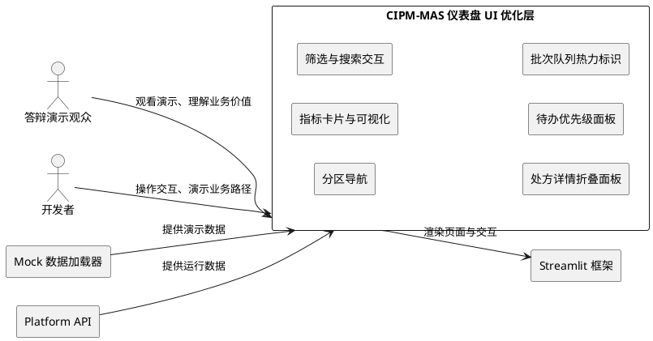
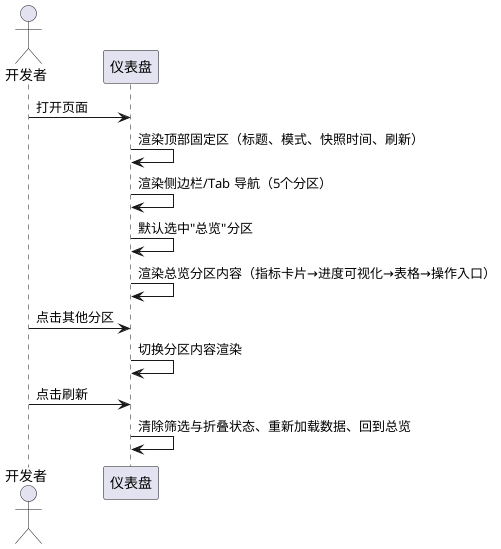
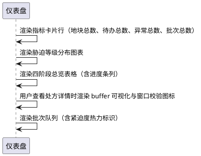
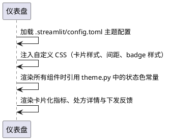
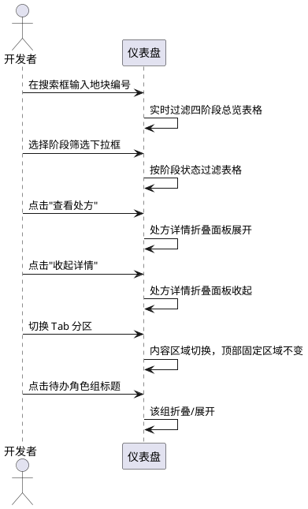

# 棉田植保决策多智能体系统 仪表盘 UI 优化需求规格说明书

# **1. 组件定位**

## **1.1 核心职责**

本组件负责优化 CIPM-MAS Streamlit 仪表盘的页面布局、数据可视化、视觉风格与交互体验，实现信息层次清晰、关键数据直观可视、操作路径简明的演示级界面效果。

## **1.2 核心输入**

1. **现有仪表盘数据模型**：来源于 `dashboard_projection()` 与 `plot_bundle()`，包含地块列表（plotNo、plotName、farmName、areaMu、stages、badges、updatedAt）、待办事项列表（type、plotNo、text）、批次队列列表（batchNo、plotNo、queueRank、urgency、state）、异常告警列表（plotNo、text）、快照时间（snapshotAt）。
2. **处方详情数据**：来源于 `plot_bundle()`，包含处方状态、安全间隔校验结论（safetyCheck）、作业窗口校验结论（windowCheck）、登记用药目录快照（registrySnapshot）、分区处方清单（zones，含 product、doseMlPerMu、sprayVolumeLPerMu、dilutionRatio、safetyIntervalDays、zeroApplication）。
3. **下发反馈数据**：来源于 `ExecutionAgent().dispatch()` 返回的 outcome，包含 status（dispatched/rescheduled/不可下发）、message、violations、notices、work_order_no。
4. **用户操作指令**：来源于答辩演示观众与开发者，包含刷新数据、查看处方、下发作业、筛选地块、搜索地块、切换 Tab 视图、折叠/展开面板。
5. **运行模式标识**：来源于 `CipmSettings.from_env()`，包含 mock 模式标识与运行模式名称。

## **1.3 核心输出**

1. **优化后的仪表盘视图**：输出至浏览器前端，包含分区导航布局、卡片化指标展示、可视化四阶段进度、筛选交互控件、Tab 分区内容、折叠面板、主题化视觉风格。
2. **交互反馈**：输出至浏览器前端，包含筛选结果实时更新、Tab 切换内容渲染、折叠/展开状态保持、搜索匹配高亮。
3. **演示效果提升**：输出至答辩演示场景，包含首屏视觉冲击力、数据故事叙述性、关键业务路径可追踪性。

## **1.4 职责边界**

1. 本组件不负责修改四阶段业务编排逻辑（巡田→处方→作业→评估的 Agent 调用链保持不变）。
2. 本组件不负责修改阻断/窗口失败/降级/拒绝等业务判定规则。
3. 本组件不负责修改 Mock 演示模式的数据生成逻辑与场景配置。
4. 本组件不负责新增后端 API 接口或修改现有 API 返回结构。
5. 本组件不负责引入需要本地回环套接字的组件（如 Streamlit AgGrid 等需额外端口的组件）。
6. 本组件不负责替换 Streamlit 框架为其他前端框架。
7. 本组件不负责修改 `runtime_state.py` 中的 session_state 键名与状态流转逻辑。
8. 本组件不负责实现假成功交互——所有交互必须产生真实业务反馈。

# **2. 领域术语**

**仪表盘分区**
: 仪表盘分区是页面布局中按业务功能划分的独立内容区域，每个分区对应一个核心业务模块（如四阶段总览、处方详情、待办事项等），通过 Tab 或侧边栏导航切换。

**指标卡片**
: 指标卡片是以卡片形式展示单个关键指标的数据可视化组件，包含指标名称、指标数值、趋势指示与图标，替代原有的纯文字 metric 展示。

**四阶段进度条**
: 四阶段进度条是以水平进度条形式展示单个地块在巡田→处方→作业→评估四阶段中当前所处阶段与完成状态的可视化组件。

**地块筛选器**
: 地块筛选器是位于四阶段总览表格上方的交互控件集合，包含搜索框、阶段筛选下拉框、业务标识筛选下拉框，用于实时过滤表格显示的地块范围。

**紧迫度热力标识**
: 紧迫度热力标识是批次队列中根据紧迫度数值高低以颜色渐变方式直观标识优先级的视觉元素，紧迫度越高颜色越深。

**待办优先级标签**
: 待办优先级标签是根据待办类型与关联地块胁迫等级自动判定的优先级标识，取值为高/中/低三级，以颜色标签形式展示在待办事项列表中。

**处方详情折叠面板**
: 处方详情折叠面板是以可折叠容器形式展示处方三元组、合规校验结论与分区清单的交互组件，默认折叠、点击展开，避免占用过多页面纵向空间。

**主题配色方案**
: 主题配色方案是统一定义仪表盘主色、辅助色、背景色、字体色、状态色（阻断/降级/拒绝/待排期）的配色体系，通过 `.streamlit/config.toml` 与自定义 CSS 注入实现。

# **3. 角色与边界**

## **3.1 核心角色**

- **答辩演示观众**：通过仪表盘快速理解系统业务价值与四阶段闭环逻辑，关注视觉冲击力与数据故事性。
- **开发者（演示操作者）**：在答辩现场操作仪表盘，执行刷新、查看处方、下发作业等交互，需要操作路径简明、反馈即时。
- **农户**：查看本地块处方图与评估报告（角色视角不变，仅 UI 展示优化）。
- **农场管理者**：审核处方图、批准作业下发、查看全场四阶段总览与批次队列（角色视角不变，仅 UI 展示优化）。
- **农技专家**：复核阻断分区、确认降级处方（角色视角不变，仅 UI 展示优化）。

## **3.2 外部系统**

- **Mock 数据加载器**：提供演示模式下的全部仪表盘数据，UI 优化不得修改其数据结构。
- **Platform API**：提供运行模式下的仪表盘数据，UI 优化不得修改其调用方式与返回处理。
- **Streamlit 框架**：提供页面渲染与交互能力，UI 优化必须在其能力范围内实现。

## **3.3 交互上下文**

# **4. DFX约束**

## **4.1 性能**

1. 仪表盘首屏加载必须在 3 秒内完成（与现有约束一致），优化后的可视化组件不得增加首屏渲染时间超过 1 秒。
2. 筛选器输入后表格过滤结果必须在 500 毫秒内更新。
3. Tab 切换后内容渲染必须在 800 毫秒内完成。
4. 折叠面板展开/折叠动画必须在 300 毫秒内完成。
5. 自定义 CSS 注入不得阻塞 Streamlit 主线程渲染，必须通过 `st.markdown(unsafe_allow_html=True)` 方式注入。

## **4.2 可靠性**

1. UI 优化不得引入新的 session_state 键名冲突，必须复用现有 `cipm_runtime_state_v1`、`cipm_patrol_baseline_v1`、`cipm_selected_plot_no`、`cipm_dispatch_feedback` 键名体系。
2. 筛选器状态在页面刷新后必须保持，不得因 `st.rerun()` 丢失筛选条件。
3. Tab 切换不得导致已展开的处方详情面板状态丢失。
4. Mock 模式与运行模式的切换不得因 UI 优化而产生异常。

## **4.3 安全性**

1. 自定义 CSS 注入不得引入 XSS 风险，所有动态内容必须经过 Streamlit 的 `unsafe_allow_html` 安全过滤。
2. 不得在 UI 层暴露内部 API 地址、数据源凭据等敏感信息。

## **4.4 可维护性**

1. UI 组件必须按现有 `apps/console/components/` 目录结构组织，新增组件文件命名必须与现有命名风格一致（snake_case）。
2. 主题配色方案必须集中定义在 `apps/console/theme.py` 或 `.streamlit/config.toml` 中，不得在组件文件中散落硬编码颜色值。
3. 新增 UI 组件必须有对应的单元测试，测试文件位于 `tests/unit/console/` 目录下。

## **4.5 兼容性**

1. UI 优化必须兼容 Streamlit 1.28+ 版本（当前项目使用的版本范围）。
2. UI 优化必须兼容 Python 3.12+ 运行环境。
3. UI 优化不得依赖需要额外安装的第三方前端库（如 plotly、altair 之外的库）；如需引入图表库，必须使用 Streamlit 内置支持的 `st.bar_chart`、`st.plotly_chart`（plotly 已在依赖中）或纯 CSS/HTML 实现。
4. `.streamlit/config.toml` 主题配置必须向后兼容，不得影响现有组件渲染。

# **5. 核心能力**

## **5.1 页面整体布局优化**

### **5.1.1 业务规则**

1. **分区导航规则**：仪表盘必须采用侧边栏导航或顶部 Tab 导航将现有 11 个内容区块重组为不超过 5 个一级分区，分区名称必须使用业务语言。
   a. 验收条件：页面加载 → 侧边栏或顶部 Tab 显示"总览""处方与作业""待办与批次""异常与告警""设置"5 个分区入口。
2. **信息层次规则**：每个分区内的内容必须按"核心指标→详细数据→操作入口"三层从上到下排列，不得将操作入口置于核心指标之前。
   a. 验收条件：进入"总览"分区 → 首先看到指标卡片行，其次看到四阶段总览表格，最后看到地块操作入口。
3. **首屏聚焦规则**：默认首屏必须展示"总览"分区内容，包含地块总数指标卡片、四阶段进度可视化与四阶段总览表格。
   a. 验收条件：页面首次加载 → 用户无需任何操作即可看到总览分区的全部核心内容。
4. **标题与模式说明规则**：页面标题、模式说明与快照时间必须保留在页面顶部固定区域，不得因分区导航而隐藏。
   a. 验收条件：切换任意分区 → 页面顶部标题、模式说明与快照时间始终可见。
5. **刷新按钮规则**：刷新按钮必须保留在页面顶部固定区域，点击后必须清除筛选条件与折叠状态并重新加载数据。
   a. 验收条件：设置了筛选条件后点击刷新 → 筛选条件清空、数据重新加载、页面回到总览分区默认状态。
6. **禁止项**：禁止将业务标识与异常区块从总览分区中移除，必须保持其在总览分区中作为辅助信息展示。
   a. 验收条件：进入总览分区 → 业务标识信息以紧凑形式（如表格内嵌 badge 列）展示，不再逐地块平铺。

### **5.1.2 交互流程**

### **5.1.3 异常场景**

1. **分区数据为空**
   a. 触发条件：某分区无数据（如无待办事项、无批次队列、无异常告警）。
   b. 系统行为：在该分区内展示空状态提示，不得显示空白页面。
   c. 用户感知：看到"暂无待办事项""暂无批次""暂无异常"等明确提示。

## **5.2 数据可视化增强**

### **5.2.1 业务规则**

1. **指标卡片规则**：地块总数、待办总数、异常总数、批次总数必须以指标卡片形式展示，每张卡片包含指标名称、数值、趋势指示与图标。
   a. 验收条件：进入总览分区 → 看到 4 张指标卡片横向排列，每张卡片有图标、数值与简短说明。
2. **四阶段进度条规则**：四阶段总览表格中每个地块的巡田→处方→作业→评估四阶段必须以水平进度条形式展示当前阶段与完成状态，进度条节点颜色必须区分"已完成"（绿色）、"进行中"（蓝色）、"已阻断"（红色）、"未开始"（灰色）。
   a. 验收条件：某地块巡田已完成、处方已阻断 → 进度条巡田节点为绿色、处方节点为红色、作业与评估节点为灰色。
3. **胁迫等级分布图表规则**：总览分区必须包含一张胁迫等级分布图表，以柱状图或饼图形式展示当前所有地块的胁迫等级分布（无/轻度/中度/重度）。
   a. 验收条件：总览分区渲染 → 图表展示各胁迫等级的地块数量，颜色区分等级。
4. **安全间隔 buffer 可视化规则**：处方详情中 buffer（R−S）值必须以可视化方式展示，当 buffer < 3 天时必须以红色标识警示，buffer ≥ 3 天时以绿色标识安全。
   a. 验收条件：处方详情中 buffer 为 2 → 该指标以红色卡片或红色进度条展示；buffer 为 5 → 以绿色展示。
5. **紧迫度热力标识规则**：批次队列中紧迫度数值必须以颜色渐变方式标识，紧迫度越高颜色越深（从浅黄到深红），数值必须同时以文字展示。
   a. 验收条件：批次队列渲染 → 紧迫度列每个单元格背景色按数值渐变，同时显示数值文字。
6. **作业窗口校验结论可视化规则**：处方详情中作业窗口校验结论必须以图标+文字形式展示，"通过"为绿色勾号、"通过（带强制提示）"为黄色感叹号、"不通过"为红色叉号。
   a. 验收条件：处方详情中作业窗口校验为"通过（带强制提示）" → 展示黄色感叹号图标与文字说明。
7. **禁止项**：禁止使用需要额外端口或本地回环套接字的图表组件（如 Streamlit AgGrid）。
   a. 验收条件：引入的图表组件仅使用 `st.bar_chart`、`st.plotly_chart`（plotly 已在依赖中）或纯 HTML/CSS 实现。

### **5.2.2 交互流程**

### **5.2.3 异常场景**

1. **图表数据不足**
   a. 触发条件：所有地块胁迫等级均为"无"，图表无分布数据。
   b. 系统行为：图表展示单色柱/饼，标注"全部地块无胁迫"。
   c. 用户感知：看到图表正常渲染，标注说明文字。

## **5.3 主题与视觉风格优化**

### **5.3.1 业务规则**

1. **主题配色方案规则**：必须通过 `.streamlit/config.toml` 定义统一主题配色方案，包含 primaryColor、backgroundColor、secondaryBackgroundColor、textColor、font，配色方案必须与棉田植保业务场景契合（主色采用绿色系，辅助色采用土黄色系）。
   a. 验收条件：创建 `.streamlit/config.toml` → 页面加载后整体配色统一，主色为绿色系，不再使用 Streamlit 默认粉色主题。
2. **状态色体系规则**：必须定义阻断（红色 #D32F2F）、降级（橙色 #F57C00）、拒绝（深红 #B71C1C）、待排期（蓝色 #1976D2）四种状态色，并在所有展示这些状态的组件中统一使用。
   a. 验收条件：四阶段总览表格、业务标识 badge、处方详情面板、批次队列中同一状态的颜色完全一致。
3. **卡片化展示规则**：指标卡片、处方详情、下发反馈必须使用 `st.container(border=True)` 或自定义 CSS 卡片样式实现卡片化展示，卡片必须有圆角边框、内边距与轻微阴影。
   a. 验收条件：指标卡片与处方详情面板渲染 → 内容被圆角边框卡片包裹，有内边距与阴影效果。
4. **字体规范规则**：必须通过主题配置指定统一字体族，中文内容使用系统默认中文字体，数字与英文使用等宽或半等宽字体以增强数据可读性。
   a. 验收条件：页面渲染 → 所有中文文字字体一致，数字列对齐整齐。
5. **间距规范规则**：分区之间必须有明确的视觉间距（不少于 24px），卡片之间间距不少于 16px，卡片内边距不少于 16px。
   a. 验收条件：页面渲染 → 分区之间有明显空白分隔，卡片之间不紧贴，卡片内容不贴边。
6. **Badge 样式优化规则**：现有 badge 标签样式必须优化为更精致的胶囊样式，增加内边距、调整字号、添加轻微阴影，保持现有颜色映射不变。
   a. 验收条件：badge 渲染 → 标签为胶囊形状（圆角矩形），有适当内边距，字号与周围文字协调。
7. **禁止项**：禁止在组件文件中硬编码颜色值，所有颜色必须引用 `theme.py` 中定义的常量或 `config.toml` 中的主题配置。
   a. 验收条件：检查组件代码 → 无硬编码 hex 颜色值（badge 颜色除外，已定义在 theme.py 中）。

### **5.3.2 交互流程**

### **5.3.3 异常场景**

1. **config.toml 配置错误**
   a. 触发条件：`.streamlit/config.toml` 格式错误或字段名不合法。
   b. 系统行为：Streamlit 自动回退到默认主题，自定义 CSS 仍正常注入。
   c. 用户感知：页面使用默认配色但布局与卡片样式仍生效。

## **5.4 交互体验优化**

### **5.4.1 业务规则**

1. **地块筛选器规则**：四阶段总览表格上方必须提供搜索框与筛选下拉框，搜索框支持按地块编号或名称模糊匹配，筛选下拉框支持按阶段状态与业务标识筛选。
   a. 验收条件：在搜索框输入地块编号片段 → 表格实时过滤显示匹配地块；选择"阻断待复核"筛选 → 表格仅显示有该标识的地块。
2. **筛选状态保持规则**：筛选条件必须存储在 session_state 中，页面刷新或分区切换后筛选条件必须保持。
   a. 验收条件：设置筛选条件后切换到其他分区再切回 → 筛选条件仍保持，表格仍为过滤后状态。
3. **处方详情折叠面板规则**：处方详情必须以折叠面板形式展示，默认折叠状态，点击"查看处方"按钮后展开，点击"收起详情"按钮后折叠。
   a. 验收条件：点击"查看处方" → 处方详情面板展开显示全部内容；点击"收起详情" → 面板折叠隐藏。
4. **下发反馈折叠面板规则**：下发反馈必须以折叠面板形式展示，与处方详情面板独立，默认折叠状态，下发操作后自动展开。
   a. 验收条件：点击"下发作业" → 下发反馈面板自动展开显示校验结论；手动折叠后不影响处方详情面板状态。
5. **Tab 分区切换规则**：分区导航必须使用 `st.tabs` 或侧边栏 `st.sidebar` 实现，切换 Tab 时不得触发 `st.rerun()` 导致页面整体刷新，仅切换内容区域。
   a. 验收条件：从"总览"切换到"待办与批次" → 页面顶部固定区域不闪烁，仅内容区域变化。
6. **待办事项分组折叠规则**：待办事项按角色分组后，每个角色组必须支持折叠/展开，默认展开有待办的组、折叠无待办的组。
   a. 验收条件：农技专家组有 3 条待办、农户组无待办 → �技专家组默认展开、农户组默认折叠。
7. **批次队列排序规则**：批次队列必须支持按紧迫度、位次、状态排序，默认按位次升序排列。
   a. 验收条件：点击紧迫度列头 → 队列按紧迫度降序排列；再次点击 → 升序排列。
8. **禁止项**：禁止使用需要 JavaScript 交互的复杂前端组件（如自定义 React 组件），所有交互必须通过 Streamlit 原生组件实现。
   a. 验收条件：所有交互控件均为 `st.button`、`st.selectbox`、`st.text_input`、`st.tabs`、`st.expander` 等原生组件。

### **5.4.2 交互流程**

### **5.4.3 异常场景**

1. **筛选无匹配结果**
   a. 触发条件：搜索词或筛选条件导致无地块匹配。
   b. 系统行为：表格区域显示"无匹配地块"提示，保留筛选条件。
   c. 用户感知：看到明确的无结果提示与筛选条件，可调整筛选条件重新搜索。
2. **折叠面板状态冲突**
   a. 触发条件：处方详情面板已展开，用户点击另一个地块的"查看处方"。
   b. 系统行为：自动折叠前一个地块的处方详情，展开新地块的处方详情。
   c. 用户感知：同一时间只有一个地块的处方详情展开。

## **5.5 关键区域专项优化**

### **5.5.1 四阶段总览表格优化**

1. **表格列优化规则**：四阶段总览表格必须将"巡田""处方""作业""评估"四列合并为单个"四阶段进度"列，以水平进度条形式展示；"业务标识"列必须以 badge 标签形式内嵌展示；保留"地块""农场""面积(亩)""更新时间"列。
   a. 验收条件：表格渲染 → 列数为 6（地块、农场、面积、四阶段进度、业务标识、更新时间），四阶段进度列为可视化进度条。
2. **表格行高亮规则**：存在阻断标识的地块行必须以浅红色背景高亮，存在降级标识的行必须以浅橙色背景高亮，无异常标识的行保持默认背景。
   a. 验收条件：某地块有 BLOCKED 标识 → 该行背景为浅红色；某地块有 DEGRADED 标识 → 该行背景为浅橙色。
3. **表格排序规则**：表格必须支持按地块编号、面积、更新时间排序，默认按更新时间降序排列。
   a. 验收条件：点击"面积(亩)"列头 → 表格按面积降序排列。
4. **禁止项**：禁止移除表格中的任何现有列数据，仅允许改变展示形式（如四列合并为进度条列）。
   a. 验收条件：进度条列必须能还原出原有四列的全部状态信息。

### **5.5.2 处方详情面板优化**

1. **指标卡片化规则**：处方详情中的处方状态、剩余采收天数 R、安全间隔期 S、buffer（R−S）四项指标必须以 4 张指标卡片形式展示，buffer 卡片必须根据值正负与大小变色（< 0 红色、0-3 橙色、≥ 3 绿色）。
   a. 验收条件：处方详情展开 → 4 张指标卡片横向排列，buffer 卡片颜色随值变化。
2. **处方三元组突出展示规则**：药剂品类、制剂亩用量、喷液量/稀释浓度必须以 3 列突出展示，每列有标题与数值，数值字号大于标题字号。
   a. 验收条件：处方详情渲染 → 三元组 3 列清晰展示，数值醒目。
3. **合规校验结论图标化规则**：安全间隔结论与作业窗口校验结论必须以图标+文字形式展示，满足为绿色勾号、降级为橙色感叹号、拒绝为红色叉号、不通过为红色叉号。
   a. 验收条件：安全间隔结论为"降级" → 展示橙色感叹号图标与"降级"文字。
4. **分区表格紧凑化规则**：分区清单表格必须紧凑展示，列宽合理分配，零施药分区行以灰色文字标识，非零施药分区行正常展示。
   a. 验收条件：分区表格渲染 → 零施药行文字为灰色，非零施药行正常黑色，表格整体紧凑不浪费纵向空间。
5. **拒绝/降级提示突出规则**：安全间隔校验拒绝时必须以红色卡片突出展示拒绝原因与替代方案；降级时必须以橙色卡片展示降级原因与确认提示。
   a. 验收条件：安全间隔结论为"拒绝" → 红色卡片展示剩余天数、安全间隔期、冲突药剂与替代方案；结论为"降级" → 橙色卡片展示降级原因。

### **5.5.3 待办事项面板优化**

1. **优先级标签规则**：每条待办事项必须自动判定优先级并展示优先级标签，判定规则为：关联地块有 BLOCKED 标识或类型为 review/confirm → 高优先级（红色标签）；关联地块有 DEGRADED/RESCHEDULED 标识或类型为 audit/replan → 中优先级（橙色标签）；其他 → 低优先级（蓝色标签）。
   a. 验收条件：某待办关联地块有 BLOCKED 标识 → 该待办展示红色"高"标签；某待办类型为 audit → 展示橙色"中"标签。
2. **待办计数规则**：每个角色组标题旁必须显示该组的待办数量，如"农技专家（3）"。
   a. 验收条件：农技专家组有 3 条待办 → 标题显示"农技专家（3）"。
3. **待办卡片化规则**：每条待办事项必须以卡片形式展示，卡片内包含优先级标签、地块编号、待办内容文字，卡片之间有间距。
   a. 验收条件：待办列表渲染 → 每条待办为独立卡片，卡片内有标签与文字，卡片之间不紧贴。
4. **禁止项**：禁止将待办事项改为纯表格展示，必须保持卡片化的视觉层次。
   a. 验收条件：待办面板渲染 → 每条待办为卡片而非表格行。

### **5.5.4 批次队列优化**

1. **紧迫度热力标识规则**：批次队列表格的紧迫度列必须以颜色渐变背景标识紧迫度高低，渐变范围为浅黄（低紧迫度）到深红（紧迫度最高），数值文字必须同时显示。
   a. 验收条件：紧迫度为最高值 → 该单元格背景为深红色；紧迫度为最低值 → 背景为浅黄色；中间值 → 渐变过渡色。
2. **状态 badge 规则**：批次队列的状态列必须以 badge 标签形式展示，草稿为灰色、待确认为蓝色、已入队为绿色、执行中为橙色、已完成为深绿色、已取消为红色。
   a. 验收条件：某批次状态为"执行中" → 状态列展示橙色 badge 标签。
3. **批次队列标题规则**：批次队列必须有独立标题"批次队列"，标题旁显示批次总数，如"批次队列（5）"。
   a. 验收条件：批次队列渲染 → 标题为"批次队列（N）"，N 为当前批次数量。
4. **空状态规则**：无批次时必须展示明确的空状态提示，不得显示空白。
   a. 验收条件：无批次数据 → 展示"暂无批次"提示信息。

### **5.5.5 异常提示优化**

1. **异常告警卡片化规则**：异常提示必须以卡片形式展示，每条告警为一张卡片，卡片内包含地块编号、告警文字与告警图标，卡片背景色按告警严重程度区分。
   a. 验收条件：异常提示渲染 → 每条告警为独立卡片，有图标与文字，背景色区分严重程度。
2. **异常计数规则**：异常提示分区标题旁必须显示异常总数，如"异常与告警（3）"。
   a. 验收条件：有 3 条异常 → 标题显示"异常与告警（3）"。

### **5.5.6 地块操作入口优化**

1. **操作入口紧凑化规则**：地块操作入口必须从逐地块三列布局（名称|查看处方|下发作业）改为表格内嵌按钮或紧凑列表形式，减少纵向占用。
   a. 验收条件：操作入口渲染 → 不再逐地块占一行三列，改为表格内嵌按钮或紧凑卡片列表。
2. **按钮状态可视化规则**：查看处方按钮在阻断状态下必须以灰色禁用样式展示并附带 tooltip 说明；下发作业按钮在未审核状态下必须以灰色禁用样式展示。
   a. 验收条件：某地块处于阻断状态 → 查看处方按钮灰色禁用，hover 显示"识别结果待人工复核，处方生成已暂停"。

# **6. 数据约束**

## **6.1 仪表盘视图数据**

1. **地块总数**：非负整数，等于当前 `dashboard.plots` 列表长度。
2. **待办总数**：非负整数，等于当前 `dashboard.todos` 列表长度。
3. **异常总数**：非负整数，等于当前 `dashboard.alerts` 列表长度。
4. **批次总数**：非负整数，等于当前 `dashboard.batches` 列表长度。
5. **筛选条件**：搜索词为字符串（可为空），阶段筛选为枚举值集合（可为空集），标识筛选为枚举值集合（可为空集）。
6. **当前分区**：枚举值，取值范围为"总览""处方与作业""待办与批次""异常与告警""设置"。

## **6.2 四阶段进度条数据**

1. **巡田阶段状态**：枚举值，取值范围为"已完成""阻断待复核""识别中""待接入数据""数据接入失败"。
2. **处方阶段状态**：枚举值，取值范围为"已通过""待审核""已阻断""待作业窗口""降级待确认""已驳回""已拒绝""草稿""未开始"。
3. **作业阶段状态**：枚举值，取值范围为"已下发""执行中""已完成""待下发""待排期""待重新排期""已中止""不可下发""未开始"。
4. **评估阶段状态**：枚举值，取值范围为"达标""未达标""待评估""未开始"。
5. **进度条节点颜色映射**：已完成→绿色、进行中/待处理→蓝色、已阻断/拒绝/不可下发→红色、未开始→灰色。

## **6.3 指标卡片数据**

1. **卡片标识**：枚举值，取值范围为"地块总数""待办总数""异常总数""批次总数"。
2. **卡片数值**：非负整数。
3. **卡片趋势**：可选字段，取值为"上升""下降""持平"或空。
4. **卡片图标**：字符串，引用 Streamlit 内置 emoji 或 Material Icon 名称。

## **6.4 筛选器数据**

1. **搜索关键词**：字符串，长度不超过 50 字符，可为空。
2. **阶段筛选值**：枚举值集合，取值范围为四阶段所有可能状态值的子集。
3. **标识筛选值**：枚举值集合，取值范围为 BLOCKED、DEGRADED、REFUSED、RESCHEDULED 的子集。

## **6.5 主题配色数据**

1. **primaryColor**：hex 颜色值字符串，格式为 `#RRGGBB`，主色必须为绿色系。
2. **backgroundColor**：hex 颜色值字符串，背景色必须为浅色系。
3. **secondaryBackgroundColor**：hex 颜色值字符串，辅助背景色必须与主背景色协调。
4. **textColor**：hex 颜色值字符串，文字色必须与背景色有足够对比度（对比度比 ≥ 4.5:1）。
5. **font**：字符串，取值为 Streamlit 支持的字体族名称。
6. **状态色常量**：阻断=#D32F2F、降级=#F57C00、拒绝=#B71C1C、待排期=#1976D2，必须与现有 `BADGE_COLORS` 定义一致。

## **6.6 待办优先级数据**

1. **优先级取值**：枚举值，取值范围为"高""中""低"。
2. **优先级颜色映射**：高→红色(#D32F2F)、中→橙色(#F57C00)、低→蓝色(#1976D2)。
3. **优先级判定规则**：关联地块有 BLOCKED 标识或类型为 review/confirm → 高；关联地块有 DEGRADED/RESCHEDULED 标识或类型为 audit/replan → 中；其他 → 低。